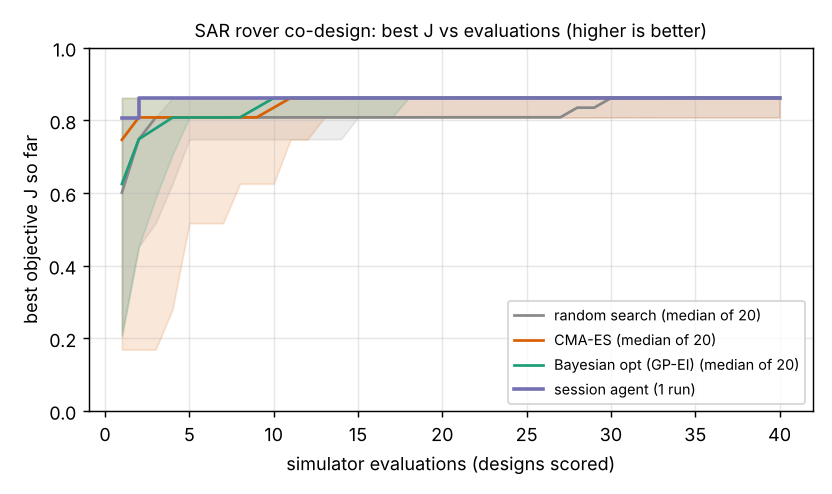

# Which cheap wheel-legged rover design covers the most stylised rubble under a 120 USD parts cap, and does a session agent beat CMA-ES and Bayesian optimisation at 40 evaluations?

Third milestone of the agentic co-design track (`research/PROJECTS.md`, track 14, `codesign`; search-and-rescue domain). A rover with four printed wheels, optional front flippers, two drive motors and a battery carries a 0.6 kg sensor or radio-relay payload over 20 m of random rubble (steps, drops, gaps, patchy friction). Each design gets its own trained speed-and-flipper policy. Produced with AI assistance (Claude).

**Live page:** https://marisstella.app/research/codesign-sar/



> **Corrected 2026-11-18.** The first version's policy search (6 iterations of evolution strategies) returned its starting policy (0.6, 0.4, 0.4) in 2,246 of 2,417 feasible evaluations, so its 0.783 "ceiling", its "almost one-dimensional" design space and its "policy noise" explanation described one fixed default policy. The quality census found it ([`portfolio/quality/audits/2026-11-17-codesign-sar.json`](../../portfolio/quality/audits/2026-11-17-codesign-sar.json)); `train_policy` is now a grid plus coordinate search on training-terrain J, a test fails if training stops beating the default, and every number below is from the rerun. The audit's independent grid search gave J 0.862 for [90, 320, 0, 0.6, 5]; the fixed code gives 0.862 (pinned in `tests/test_sar.py`).

**Headline (simulated, stylised, one agent run, 20 seeds per baseline; all numbers from `experiments/results.txt`, rerun 2026-11-18).**
- **Training the policy is worth 0.08 in J.** The best design, [90, 120, 150, 0.5, 5] at 69 USD, scores 0.783 (16.0 m of 20 m) under the old default policy and 0.863 (17.4 m) under its trained one: approaching obstacles at 1.5 m/s carries it over steps of up to about 34 mm that its 0.5 N m motors cannot climb from rest.
- **Three things matter, not one.** Every design at J of at least 0.86 has wheel radius of 87 mm or more and drive torque of at least 0.5 N m, and it also needs a body long enough not to pitch forward off a 40 mm drop at full approach speed: wheelbase plus deployed flipper of about 195 mm or more (from the tip-forward rule in `run`). A 120 mm body without a flipper must slow to 0.93 m/s and scores 0.792; the same body with an 80 or 150 mm flipper scores 0.863. Battery size matters only at the torque limit: at 0.5 N m, 3 Wh more battery (20 g) fails two 40 mm steps on the test terrains (seeds 1001 and 1010), which is why [90, 180, 0, 0.5, 8] scores 0.700 and [90, 180, 0, 0.5, 5] 0.794. That, not policy noise, is the gap the first version blamed on the search.
- **The speed cap binds.** 93% of feasible designs (2,249 of 2,426) train to the 1.5 m/s approach-speed upper bound: in this model momentum has no cost except tip-forward on drops, so the policy class's bound, not the design, sets the best J. A model where speed also costs grip or risks damage would move this.
- **Everyone still gets there.** Median best J at 40 evaluations: Bayesian optimisation 0.862, CMA-ES 0.862, random search 0.862, session agent 0.863. The agent's 0.001 lead is the energy term of a slightly cheaper design, not a different strategy, and no baseline seed matched it exactly.
- **Evaluations to J of at least 0.86:** session agent 2, Bayesian optimisation 9.5 (median, 20 of 20 seeds reach it), CMA-ES 10 (19 of 20), random search 20.5 (14 of 20).
- **Not a result about language models.** The agent is the Claude session that wrote this project. Before writing round 1 it had run several hundred random evaluations to calibrate the terrain and had seen that wheel radius dominates, so its head start in evaluations is a prior it could not unsee. Its proposals were written against the old, untrained scores and were not rewritten for the rerun. Treat the agent row as one worked example, and the answer to "does it beat the baselines" as: not distinguishable here.
- **Falls now happen, on held-out terrain.** With trained policies, 64 of 2,440 evaluations logged falls (up to 0.33 per run) and 5 logged recoveries: policies tuned to the tip-forward edge on 6 training terrains meet a deeper drop on the 12 test terrains. Tip-back still cannot fire for any design in the box (it needs a step over about 85 mm; the tallest is 40 mm).

## What "agent" means here
The run environment has no model API key. The proposer is the **session agent itself**: 4 rounds of 10 designs, committed as `proposals/round1.json` to `round4.json`, each round written after reading the previous round's diagnostics (distance, falls, share of runs ended on a step, energy per metre) and each file carrying its notes. 40 proposals in all. The baselines got no hand-written prior and 20 seeds each; the agent has one run, so its spread is unknown.

## Method
- **Design** (`src/codesign_sar/sar.py`): wheel radius `R` 25 to 90 mm, wheelbase `L` 120 to 320 mm, flipper length `F` 0 to 150 mm, drive torque `T` 0.2 to 2 N m per axle (one motor per axle; the traction rule sets `T/R` against the axle load), battery `B` 5 to 40 Wh. Mass, printed plastic and parts cost follow from these. Designs over 120 USD score J = -1 and still use an evaluation.
- **Terrain** (`make_terrain`): 40 segments of 0.5 m: 50% flat, 25% step up (10 to 40 mm), 15% step down, 10% gap (30 to 80 mm). Friction per segment is Gamma-distributed (mean 0.9, CV 0.5, floor 0.45), the patchy friction law of `terrain-twin`. Twelve held-out terrains score each design; six training terrains train its policy.
- **Step-up physics, stated plainly:** edge-contact statics. A wheel of radius `R` at a step of height `h` has contact angle `acos((R-h)/R)`; it climbs when thrust from the other axle times cot(angle) plus tractive force over sin(angle) carries the axle load, with traction capped by motor torque over `R` and by friction. A kinetic-energy rule (30% of kinetic energy usable) lets high approach speed cross small steps, only while the step is below the axle (`h < R`; before 2026-11-18 a 25 mm wheel could cross a 30 mm step at speed). Tip-back, tip-forward on drops, gap bridging by a flipper and self-righting (flipper at least half the wheelbase) are simple closed-form rules in `run`.
- **Policy, not PPO:** three numbers per design (cruise speed 0.1 to 1.5 m/s, approach speed 0.05 to 1.5 m/s, flipper deploy threshold as a fraction of `R`) chosen to maximise J on 6 training terrains: a grid of 3 x 15 x 5 (deploy only when the design has a flipper), then 4 rounds of coordinate search with halving steps. Deterministic, about 250 policy evaluations per design. **This is not deep RL**; it is exhaustive search over a three-number policy class. A PPO policy in a physics engine is the part of the milestone this does not do.
- **Objective** `J = mean distance / 20 m - 0.05 falls - 0.02 recoveries - 0.002 x energy per metre`.
- **Baselines** (`optimisers.py`, no language model): random search; CMA-ES (`cma`, population 6); Gaussian-process Bayesian optimisation (Matern 5/2, 8 Sobol points, then expected improvement). 40 evaluations, 20 seeds.
- **Cost:** one evaluation is about 10 to 30 ms of pure Python (terrains are cached); the whole comparison runs in about 15 s on 4 cores (measured 2026-11-18).

## Reproduce
```bash
cd research/codesign-sar
PY=$(python3 ../../platform/ci/pyenv.py pytest numpy scipy cma matplotlib)
PYTHONPATH=src "$PY" -m unittest discover -s tests      # 13 tests
"$PY" experiments/run.py                                  # ~15 s -> results.txt, results.json
"$PY" experiments/figure.py                               # -> curves.png
```

## Bill of materials (assumed, unsourced)
The cost model in `cost_usd` is a placeholder written for this study: motors 4 + 14 x torque (N m) USD each, filament 0.025 USD per gram, battery 0.35 USD per Wh, 25 USD fixed for controller and radio. None of these prices comes from a supplier quote or a dated source. The 120 USD cap is therefore a modelling choice, not a priced build. Pricing real parts is an owner step.

## Limitations
- Stylised quasi-static statics, no dynamics engine, no contact solver, no slopes, soft ground or stairs; this is a screening model, not a safety case. **Simulation is not a safety case**; any field use by responders is an owner step.
- The "terrain from `terrain-twin`" is its friction model only, not its stopping-distance result, and the terrain is generated, not measured.
- The 20 m run ends at the first impassable obstacle, so J mostly measures how far a design gets before a low-friction step, which is why wheel radius dominates.
- Falls are rare (64 of 2,440 evaluations, all tip-forward on drops) and tip-back is unreachable in the design box, so the diagnostic ("how did it fail") channel mostly carries one signal, stuck on a step. This weakens the milestone's question of whether richer feedback helps; `codesign-diagnose` addresses that separately.
- One agent run, an agent with a calibration-time prior, proposals written against the pre-fix scores, and a score tied at the top.
- The approach-speed bound (1.5 m/s) binds for 93% of designs, so the best J is partly a property of the policy class.

## Lab tags
Builds loosely on ARPG's field-robot work (<https://arpg.colorado.edu/>) in motivation only: no paper of theirs is reproduced and nothing here is affiliated with or endorsed by them. Prior work: Ha (2019) and Zhao et al. (2020) on RoboGrammar; Lehman et al. (2022) on evolution through large models; Wong (2008), *Theory of Ground Vehicles*, for the climbing statics lineage (not a derivation reproduced here).

## Next steps
Make the terrain hard enough that tip-over and recovery matter (taller drops, slopes, rubble piles), give speed a cost beyond tip-forward so the policy bound stops binding, swap the three-number policy for PPO in MuJoCo, then `codesign-agri` and `codesign-transfer`.

## Owner steps
Price a real bill of materials with dated sources, print the top design, and measure real step-climbing against the simulated limit.

## Outside dependencies (vitamins)
Open-source Python packages (numpy, scipy, cma, matplotlib). No model API is called. Real motors, battery, controller and radio would be bought.

MIT.

## Known gaps (quality census 2026-11-17)

From the first audit, [`portfolio/quality/audits/2026-11-17-codesign-sar.json`](../../portfolio/quality/audits/2026-11-17-codesign-sar.json) (correctness 1, verification 1, claims 1). Fixed 2026-11-18: the inert policy search, the "policy noise" and "one-dimensional" claims, the kinetic-energy rule above the axle, `T` described per wheel, and tests that pin J, a trained policy, and that training beats its start (13 tests; seeded mutants of the policy return, the `h < R` guard and the tip-forward rule each fail a test). Still open:

- Tip-back needs a step over about 85 mm and the terrain's tallest is 40 mm, so it never fires; the drop rule's `exp(-4h)` factor also barely responds to taller drops. A harder terrain needs new physics, not only new parameters.
- Momentum is free in this model, so the policy's approach-speed bound sets the best J.
