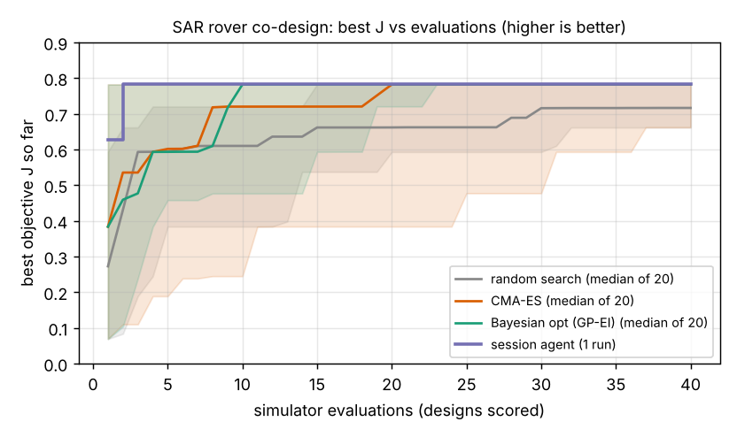

# Which cheap wheel-legged rover design covers the most stylised rubble under a 120 USD parts cap, and does a session agent beat CMA-ES and Bayesian optimisation at 40 evaluations?

Third milestone of the agentic co-design track (`research/PROJECTS.md`, track 14, `codesign`; search-and-rescue domain). A rover with four printed wheels, optional front flippers, two drive motors and a battery carries a 0.6 kg sensor or radio-relay payload over 20 m of random rubble (steps, drops, gaps, patchy friction). Each design gets its own trained speed-and-flipper policy. Produced with AI assistance (Claude).

**Live page:** https://duncan-haywood.github.io/oss-monorepo/research/codesign-sar/



**Headline (simulated, stylised, one agent run, 20 seeds per baseline; all numbers from `experiments/results.txt`).**
- **The problem is almost one-dimensional.** Wheel radius at its 90 mm upper bound plus drive torque of about 0.5 N m or more reaches the ceiling, J = 0.783 (16.0 m of 20 m on average), at 69 USD. Wheelbase, flipper length and battery size did not change J in any design that reached the ceiling.
- **Everyone nearly gets there.** Median best J at 40 evaluations: Bayesian optimisation 0.782, CMA-ES 0.782, session agent 0.783, random search 0.716. No baseline seed beat the agent's 0.783, but the 0.001 gap is inside the noise of the per-design policy search (below).
- **Evaluations to J of at least 0.78:** Bayesian optimisation 10 (median, 20 of 20 seeds reach it), CMA-ES 18 (18 of 20), random search 30 (3 of 20), session agent 2.
- **Not a result about language models.** The agent is the Claude session that wrote this project. Before writing round 1 it had run several hundred random evaluations to calibrate the terrain and had seen that wheel radius dominates, so its head start in evaluations is a prior it could not unsee. Treat the agent row as one worked example, and the answer to "does it beat the baselines" as: not distinguishable here.
- **The flipper and the tip-over and recovery path never fired.** Falls were 0.0 in every evaluation logged, so the "falls" and "recovery" terms of the brief are untested by this terrain. A harder terrain (taller drops, slopes) is the next step.

## What "agent" means here
The run environment has no model API key. The proposer is the **session agent itself**: 4 rounds of 10 designs, committed as `proposals/round1.json` to `round4.json`, each round written after reading the previous round's diagnostics (distance, falls, share of runs ended on a step, energy per metre) and each file carrying its notes. 40 proposals in all. The baselines got no hand-written prior and 20 seeds each; the agent has one run, so its spread is unknown.

## Method
- **Design** (`src/codesign_sar/sar.py`): wheel radius `R` 25 to 90 mm, wheelbase `L` 120 to 320 mm, flipper length `F` 0 to 150 mm, drive torque per wheel `T` 0.2 to 2 N m, battery `B` 5 to 40 Wh. Mass, printed plastic and parts cost follow from these. Designs over 120 USD score J = -1 and still use an evaluation.
- **Terrain** (`make_terrain`): 40 segments of 0.5 m: 50% flat, 25% step up (10 to 40 mm), 15% step down, 10% gap (30 to 80 mm). Friction per segment is Gamma-distributed (mean 0.9, CV 0.5, floor 0.45), the patchy friction law of `terrain-twin`. Twelve held-out terrains score each design; six training terrains train its policy.
- **Step-up physics, stated plainly:** edge-contact statics. A wheel of radius `R` at a step of height `h` has contact angle `acos((R-h)/R)`; it climbs when thrust from the other axle times cot(angle) plus tractive force over sin(angle) carries the axle load, with traction capped by motor torque over `R` and by friction. A kinetic-energy rule (30% of kinetic energy usable) lets high approach speed cross small steps. Tip-back, tip-forward on drops, gap bridging by a flipper and self-righting (flipper at least half the wheelbase) are simple closed-form rules in `run`.
- **Policy, not PPO:** three numbers per design (cruise speed, approach speed, flipper deploy threshold) found by a small evolution-strategies search, 6 iterations of 8 candidates, each scored on 6 training terrains. **This is not deep RL**, and the search noise is real: identical-physics designs can differ by up to 0.09 in J through the policy found (for example `[90,180,0,0.5,8]` scored 0.689, `[90,120,0,0.5,5]` 0.783). A PPO policy in a physics engine is the part of the milestone this does not do.
- **Objective** `J = mean distance / 20 m - 0.05 falls - 0.02 recoveries - 0.002 x energy per metre`.
- **Baselines** (`optimisers.py`, no language model): random search; CMA-ES (`cma`, population 6); Gaussian-process Bayesian optimisation (Matern 5/2, 8 Sobol points, then expected improvement). 40 evaluations, 20 seeds.
- **Cost:** one evaluation is about 10 ms of pure Python; the whole comparison runs in about 12 s.

## Reproduce
```bash
cd research/codesign-sar
PY=$(python3 ../../platform/ci/pyenv.py pytest numpy scipy cma matplotlib)
PYTHONPATH=src "$PY" -m unittest discover -s tests      # 8 tests
"$PY" experiments/run.py                                  # ~12 s -> results.txt, results.json
"$PY" experiments/figure.py                               # -> curves.png
```

## Bill of materials (assumed, unsourced)
The cost model in `cost_usd` is a placeholder written for this study: motors 4 + 14 x torque (N m) USD each, filament 0.025 USD per gram, battery 0.35 USD per Wh, 25 USD fixed for controller and radio. None of these prices comes from a supplier quote or a dated source. The 120 USD cap is therefore a modelling choice, not a priced build. Pricing real parts is an owner step.

## Limitations
- Stylised quasi-static statics, no dynamics engine, no contact solver, no slopes, soft ground or stairs; this is a screening model, not a safety case. **Simulation is not a safety case**; any field use by responders is an owner step.
- The "terrain from `terrain-twin`" is its friction model only, not its stopping-distance result, and the terrain is generated, not measured.
- The 20 m run ends at the first impassable obstacle, so J mostly measures how far a design gets before a low-friction step, which is why wheel radius dominates.
- Falls and recoveries were zero throughout, so the diagnostic ("how did it fail") channel carries one signal, stuck on a step. This weakens the milestone's question of whether richer feedback helps; `codesign-diagnose` addresses that separately.
- One agent run, an agent with a calibration-time prior, and a score tied at the ceiling.

## Lab tags
Builds loosely on ARPG's field-robot work (<https://arpg.colorado.edu/>) in motivation only: no paper of theirs is reproduced and nothing here is affiliated with or endorsed by them. Prior work: Ha (2019) and Zhao et al. (2020) on RoboGrammar; Lehman et al. (2022) on evolution through large models; Wong (2008), *Theory of Ground Vehicles*, for the climbing statics lineage (not a derivation reproduced here).

## Next steps
Make the terrain hard enough that tip-over and recovery matter (taller drops, slopes, rubble piles), swap the evolution-strategies policy for PPO in MuJoCo once the design space is no longer one-dimensional, then `codesign-agri` and `codesign-transfer`.

## Owner steps
Price a real bill of materials with dated sources, print the top design, and measure real step-climbing against the simulated limit.

## Outside dependencies (vitamins)
Open-source Python packages (numpy, scipy, cma, matplotlib). No model API is called. Real motors, battery, controller and radio would be bought.

MIT.
