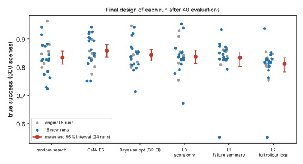

# codesign-seeds: do 24 runs per method rank gripper co-design methods that 8 runs could not?

Track 14 (agentic robot co-design, `codesign`). `../codesign-power` found that with 8 runs per method the interval on a method mean is about ±0.03 whatever the scene count, and asked for 30+ runs. This adds 16 new runs per method (seeds 8-23, protocol unchanged from `../codesign-headroom`: 40 designs, same task, simulator, readers and baselines), giving 24 per method, and scores each run's final design on the same 600 scenes `codesign-power` used. Produced with AI assistance (Claude). No CU Boulder group's work is built on; no connection is claimed.

**Live page:** https://duncan-haywood.github.io/oss-monorepo/research/codesign-seeds/



## Headline
With 24 runs per method, **no method is separable from random search at the 5% level, but the picture shifted**: mean true success after 40 designs is 0.858 for CMA-ES, 0.842 Bayesian opt, 0.837 score-only reader, 0.833 random search, 0.832 failure-summary reader and 0.811 rollout-log reader. CMA-ES is +0.025 above random search (95% interval −0.007 to +0.056, permutation p = 0.15); the rollout-log reader is −0.022 (−0.058 to +0.011, p = 0.24). Richer feedback still does not help: failure summary vs score only −0.005, rollout logs vs score only −0.026 (p = 0.16). Run-to-run SD of the final design is about 0.06, so detecting a true 0.02 gap needs about 140 runs per method, a 0.03 gap about 64.

## Results (`experiments/results.txt`; true success on 600 scenes, mean [95% bootstrap interval over runs])
| method | all 24 runs | original 8 | new 16 | diff to random search (24 runs) |
|---|---|---|---|---|
| random search | 0.833 [0.810, 0.857] | 0.846 | 0.827 | n/a |
| CMA-ES | 0.858 [0.835, 0.880] | 0.846 | 0.864 | +0.025 [−0.007, +0.056] |
| Bayesian opt (GP-EI) | 0.842 [0.822, 0.863] | 0.845 | 0.841 | +0.009 [−0.022, +0.040] |
| L0 score only | 0.837 [0.813, 0.860] | 0.845 | 0.833 | +0.004 [−0.029, +0.036] |
| L1 failure summary | 0.832 [0.802, 0.854] | 0.836 | 0.830 | −0.001 [−0.038, +0.032] |
| L2 full rollout logs | 0.811 [0.782, 0.833] | 0.817 | 0.808 | −0.022 [−0.058, +0.011] |

- **The first 8 runs were a lucky or unlucky draw for some methods.** On the original seeds CMA-ES tied random search (+0.001); on the 16 new seeds it leads by +0.037 (0.864 vs 0.827). Random search fell from 0.846 to 0.827 on the new seeds. This is the sort of drift 8 runs allow (the interval half-width was about 0.03), and is why a first-look ranking should not be trusted.
- **The rollout-log reader is consistently last** (0.817 original, 0.808 new), matching the three earlier projects; its rules overshoot. Still not significant against random search or the other readers.
- **Nothing here supports "feedback earns its tokens"** for these author-written readers: the two feedback readers are at or below the score-only reader.
- Several comparisons were made (5 against random search, 3 between readers) and none is corrected for multiplicity; with none reaching p < 0.05 this does not change a conclusion.

## Method
- Runs: the 8 stored runs of `../codesign-headroom` plus 16 new ones from `experiments/search.py`, which calls that project's own method table with seeds 8-23 (about 40 minutes on 4 cores). Each run's final design is its best feasible design by 40-scene test success after 40 designs, with the grasp force trained for it.
- Scoring: 600 scenes from `scenarios(600, 4004)`; the 144 designs of the original runs were reused from `../codesign-power` rather than re-simulated, the 96 new ones simulated in `experiments/score.py`.
- Statistics: percentile bootstrap (10,000 resamples) over runs, resampled independently per method; two-sided permutation test on run means (20,000 shuffles); power calculation with the normal approximation `n = 2(z_a + z_b)² sd² / delta²`.

## Reproduce
```bash
pip install numpy scipy cma mujoco matplotlib pytest
cd research/codesign-seeds
python -m pytest -q tests          # 5 tests, about 1 s
python experiments/search.py       # about 40 minutes on 4 cores; writes experiments/search.json
python experiments/score.py        # about 4 minutes; reads ../codesign-headroom and ../codesign-power results
python experiments/figure.py
```

## Limitations
Still stylised: author-written readers with untuned constants, not an LLM; assumed costs and strengths; rigid fingers; three object shapes; nothing printed. Designs are selected on 40 test scenes inside each run, so the result says what that selection finds, not what selecting on more scenes would. The 600 scoring scenes are shared by all designs, so scene noise (about 0.015 per design) is common to the comparison. 24 runs resolve a gap of about 0.04 to 0.05 with 80% power, not the 0.02 to 0.025 that separates CMA-ES from random search here.

## Next steps
Either accept the null (no method here beats blind search by a margin that matters for a printed gripper) and spend effort on a harder task where methods can differ, or run about 150 runs per method (roughly 4 hours on 4 cores per 100 runs per method here). An LLM proposer, once a key is available, needs the same run counts.

## Owner steps
None for the simulation.

## Outside dependencies (vitamins)
numpy, scipy, cma, mujoco, matplotlib. No model API is called. A real gripper would need a servo gripper base, a printer, PLA and TPU filament.

MIT.
