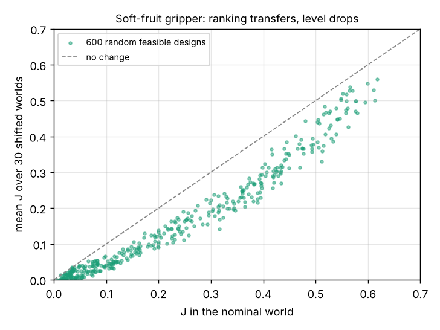

# Does the ranking of printable soft-fruit gripper designs survive a shift in friction, fruit, placement error and print tolerance, and what does a robust design cost?

Seventh milestone of the agentic co-design track (`research/PROJECTS.md`, track 14, `codesign`; `codesign-transfer`). It takes the contact model of `codesign-agri` unchanged and widens what that project holds fixed: per world, fruit size, camera placement error, wet-fruit share, bruise threshold and stem pull are drawn, and the *printed* gripper differs from the design (pad modulus, grip force and pad width tolerances). Sim-to-sim only. Produced with AI assistance (Claude). **Every range is an assumed round number in `src/codesign_transfer/transfer.py`, not a measurement; no gripper was printed and no fruit tested.**

**Live page:** https://duncan-haywood.github.io/monorepo-projects/research/codesign-transfer/



**Headline (simulated, stylised; all numbers from `experiments/results.txt`).**
- **The ranking of designs transfers; the level does not.** 600 random feasible designs: Spearman correlation 0.993 between J in the nominal world and mean J over 30 held-out shifted worlds (per world, median 0.967, minimum 0.924). Of the nominal top 10%, a median 85% (minimum 65%) are still in a shifted world's top 10%. So in this model a design that wins in the narrow world is a good candidate in the wide ones, which is the reassuring reading of the track's question.
- **But everything gets worse, and the winner loses the most.** 20% of designs lose more than 0.10 of J from nominal to the shifted mean. The nominal-world CMA-ES optimum falls from 0.653 to 0.567 (-13%). The best random design falls from 0.618 to 0.560.
- **Widening the spread lowers the level smoothly and the ranking barely.** Spearman against nominal stays at 0.998, 0.998, 0.997, 0.996, 0.993 for spread widths 0, 0.25, 0.5, 0.75, 1.0, while the nominal-best design's mean J falls 0.654, 0.646, 0.634, 0.620, 0.598.
- **A robust objective is cheap here, and small.** Optimising the mean J over 10 training worlds with CMA-ES gives pads 25 x 30 mm, 0.151 MPa, 7.98 N, three fingers. Scored on 30 *held-out* worlds: mean J 0.582 (nominal optimum 0.567), 5th percentile 0.502 (0.465), worst world 0.459 (0.425), at the price of 0.623 in the nominal world (0.653). That is 0.015 more on average and 0.034 more in the worst world, from one CMA-ES seed per objective, so read it as suggestive, not established.
- **The designs that win sit at the bounds**: grip force at its 8 N bound and pad width near its bound.

## What is and is not a transfer test
This is **sim-to-sim**: the same equations score the nominal and shifted worlds, with their inputs perturbed. It tests whether a design is *fragile to the parameters the model exposes*. It cannot test a mechanism the model lacks (stem twist, fruit deformation, pad creep, camera failure), and the shifts are drawn from ranges the author chose, so a high rank correlation here is partly the model's structure: bruise, slip and capture each depend monotonically on force, width and opening. Real bruise and friction data could break it.

## Method
- **Model**: `research/codesign-agri/src/codesign_agri/agri.py`, imported, with its `evaluate(x, pop)` taking a new fruit population. No edits to it.
- **World** (`draw_world`): fruit diameter mean 24 to 32 mm (nominal 28), placement error SD 3 to 8 mm (4), wet share 0.1 to 0.6 (0.3), bruise threshold scale 0.7 to 1.2, stem pull scale 0.8 to 1.4, and print tolerance: pad modulus log-normal SD 0.3, force SD 15%, pad width SD 0.4 mm. A `width` argument interpolates between the nominal world (0) and the full spread (1).
- **Printed copy** (`build`): each design is scored as 3 independently perturbed copies per world, averaged. The 60 USD cap is judged on the design; a copy that lands a few cents over is still scored by its outcomes (`_j`). An earlier version scored such copies -1 and made the bound-sitting optima look catastrophic; that was a bug in this project, fixed before any number above was written.
- **Designs**: 600 feasible points from a Sobol sequence over the codesign-agri design space; the CMA-ES nominal optimum (240 evaluations); the CMA-ES robust optimum (160 evaluations of the mean over 10 training worlds, disjoint from the 30 test worlds).
- **Cost:** about 50 s for the whole experiment on a CPU.

## Reproduce
```bash
cd research/codesign-transfer
PY=$(python3 ../../platform/ci/pyenv.py pytest numpy scipy cma matplotlib)
PYTHONPATH=src "$PY" -m unittest discover -s tests      # 6 tests
"$PY" experiments/run.py                                  # ~50 s -> results.txt, results.json
"$PY" experiments/figure.py                               # -> transfer.png
```

## Limitations
- Sim-to-sim, in a model written for this study; see above. The rank correlation says the model is smooth in its parameters more than it says real grippers transfer.
- The "robust" gain is small and from single CMA-ES runs; a different seed could move it by as much as the gain.
- At width 0 the sweep scores a different random fruit population from the nominal one, which is why Spearman there is 0.998 and not 1.
- Mean over worlds weights every world equally; a grower who loses a whole day to wet fruit would weigh the tail more.
- No agent loop here: this project scores designs, it does not compare proposers. `codesign-agri` and `codesign-diagnose` do that.

## Lab tags
None fits: nothing here builds on a lab's published work. Prior work: Tobin et al. (2017), domain randomisation, IROS, is the idea of widening a simulator's parameters; its method (training a policy on randomised simulation) is not reproduced.

## Next steps
Make a dimension non-monotonic (an unseen fruit class, a slippery coating) and see whether the ranking breaks; run the same test on `codesign-sar`'s rover and `codesign-gripper`'s MuJoCo gripper, where physics is richer; average the robust optimum over several CMA-ES seeds.

## Owner steps
Print the nominal and robust optima in a soft TPU and compare their bruise and drop rates on real berries across a day's conditions.

## Outside dependencies (vitamins)
Open-source Python packages (numpy, scipy, cma, matplotlib) and `codesign-agri`. No model API is called. A real servo, camera and elastomer would be bought.

MIT.
