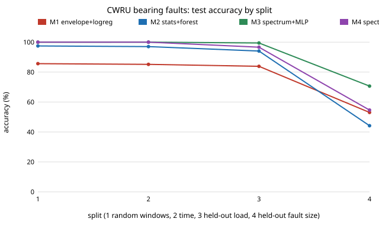

# cwru-split-audit: does 99% accuracy on the CWRU bearing fault dataset survive a test on an unseen bearing?

**Live page:** https://marisstella.app/research/cwru-split-audit/

**Question.** The Case Western Reserve University (CWRU) bearing data is the most used benchmark
in vibration-based bearing fault diagnosis, and papers routinely report 99 to 100% accuracy on
it. How much of that number survives when the test windows share no recording with training, and
when they come from a damaged bearing the model never saw?

**Headline (real data, 40 recordings, 4,643 windows, pre-registered in [`LOG.md`](LOG.md)).**
A log-spectrum MLP and a log-spectrum 1-nearest-neighbour classifier score **100.0%** on the
usual random window split and on a per-recording time split, and the MLP still scores **99.4%**
when a whole motor load is held out. Hold out a **fault size** instead, so every faulty test
window comes from a bearing absent from training, and the same models fall to **70.7%** (MLP,
95% recording-bootstrap interval 56 to 85%) and **54.6%** (1-NN) on a 4-class
normal/inner/ball/outer task. A random forest on ten time-domain statistics goes from 97.5% to
**44.2%**. On the faulty test windows alone the best model is right **68%** of the time against
a chance rate of 33%. Holding out a load does not test generalisation, because the same seeded
bearing is run at all four loads: the split that removes the bearing is the one that bites.



## Why it matters

A practitioner reading "99.9% on CWRU" expects a model that recognises a damaged bearing. What the
random split measures is whether a window resembles other windows of the same 10-second
recording of the same bearing. Bearings on a real machine are new bearings. The leave-one-size-out
number is the closer guide to what a condition-monitoring model will do on a pump, a gearbox or
a robot joint it was not trained on, and on this data it is 44 to 71%.

## Builds on

- **Smith and Randall (2015)** applied three established diagnostic techniques (envelope
  analysis and its refinements) to the entire CWRU data set and categorised the records by how
  clearly each is diagnosed, with recommendations on how the data should be used [1]. They
  diagnose each record with signal processing rather than train a classifier.
- **Hendriks, Dumond and Knox (2022)** address how CWRU should be used as a benchmark [2]. Only
  the title, venue and DOI could be checked from this session (no abstract or full text was
  reachable), so their split recommendations are not compared here; this project should be read
  as an independent check of the same concern, not a claim of priority over it.
- **Zhao et al. (2020)** built an open-source benchmark of deep learning models for rotating
  machinery diagnosis on several public datasets, CWRU among them [3].
- **Zhang et al. (2017)**, the WDCNN paper, trains a wide-kernel CNN on raw CWRU vibration and
  uses AdaBN for domain adaptation across loads [4]: a representative high-accuracy CWRU result.
- **Randall and Antoni (2011)** is the standard tutorial on envelope analysis and defect
  frequencies used for model M1 [5].
- **Kapoor and Narayanan (2023)** catalogue data leakage across ML-based science; random
  splits of temporally or physically grouped samples are one of their leakage types [6].

Tags: sensing, condition monitoring, sim-to-real (the leave-one-bearing-out split is the
question a digital twin trained on seeded faults also has to answer). Related labs: ARPG
(sensing for field robots), Autonomous Systems IRT.

## Method

- **Data.** The 40 standard drive-end recordings at 12 kHz: normal, and inner race, ball and
  outer race (centred, @6:00) faults of 0.007, 0.014 and 0.021 in, each at 0 to 3 hp, from the
  CWRU Bearing Data Center [7]. `data.py` downloads them and checks each against a SHA-256
  recorded on 2026-11-13; the files are not redistributed here.
- **Two data quirks found and handled.** (a) The four normal-baseline files are **48 kHz**, not
  12 kHz: each lasts 10.1 s at 48 kHz, as the fault files do at 12 kHz, and their sharpest lines
  read 90.0 and 180.0 Hz at 12 kHz but 360 and 720 Hz (6th and 12th harmonics of 60 Hz mains)
  at 48 kHz. They are decimated by 4 with a zero-phase FIR filter. A pipeline that skips this
  step hands every classifier a free cue for the normal class. (b) `99.mat` also contains
  `98.mat`'s variables, and neither file has an RPM variable; the key is matched on the file
  number and the nominal speed for the load is used.
- **Windows.** 2048 samples (0.17 s), 50% overlap.
- **Models.** M1: envelope spectrum (Butterworth band 1.5 to 5 kHz, Hilbert envelope) amplitude
  at harmonics 1 to 3 of BPFI, BPFO and 2×BSF for the file's own shaft speed, plus band kurtosis
  and crest factor, logistic regression. The defect multiples come from the CWRU site and are
  checked against the bearing geometry in `test_audit.py`. M2: ten time-domain statistics,
  random forest (300 trees). M3: log FFT magnitude (1024 bins), MLP (256 hidden units, early
  stopping). M4: log FFT magnitude, 1-nearest-neighbour.
- **Splits.** S1 random window split 70/30 stratified by class, 5 seeds. S2 per recording, first
  70% of windows train, last 30% test, one window dropped between. S3 leave one load out (4
  folds, 10 classes). S4 leave one fault size out (3 folds, 4 location classes). There is one
  normal bearing, so S4 splits the normal windows by time as in S2; the faulty-only accuracy
  is fully bearing-disjoint.
- **Intervals.** S1: range over seeds. S2 to S4: 95% bootstrap over recordings (2000 resamples),
  because windows of one recording are not independent.

## Results

From [`experiments/results.txt`](experiments/results.txt) (full confusion matrices in
`experiments/results.json`):

| Split | M1 envelope+logreg | M2 stats+forest | M3 spectrum+MLP | M4 spectrum+1NN |
|---|---|---|---|---|
| S1 random windows (10 classes) | 85.6% | 97.5% | 100.0% | 100.0% |
| S2 time within recording | 85.2% [79, 91] | 97.0% [95, 99] | 100.0% | 100.0% |
| S3 leave one load out | 83.9% [78, 90] | 94.1% [91, 97] | 99.4% [99, 100] | 96.6% [92, 100] |
| S4 leave one fault size out (4 classes) | 53.0% [41, 65] | 44.2% [30, 58] | 70.7% [56, 85] | 54.6% [40, 69] |
| S4, faulty windows only (3 classes) | 52.6% | 39.4% | 68.1% | 50.7% |

Pre-registered hypotheses:

- **H1 (S1 ≥ 98% for M2 and M3): partly refuted.** M3 reaches 100.0%; M2 reaches 97.5%, just
  under the bar.
- **H2 (M3's S4 faulty-only accuracy below 80%): supported**, 68.1%.
- **H3 (M1, physics features, loses fewer points from S1 to S4 than M3): refuted.** M1 drops 32.6
  points (85.6 to 53.0), M3 drops 29.3 (100.0 to 70.7). The envelope features as specified are
  weak even on S1; their S4 errors are spread across all classes, including normal windows
  called ball faults.

Where S4 fails: the spectrum models call almost every held-out ball fault correctly (98 to 99%)
but call outer-race faults inner or ball two times in three, and M4 calls two-thirds of
inner-race faults ball. The random forest calls 99% of held-out inner-race windows ball or outer.

## Reproduce

```
pip install numpy scipy scikit-learn pytest
python3 audit.py              # downloads ~134 MB to ./data (or $CWRU_CACHE), ~1 min on 4 cores
python3 experiments/figure.py
python3 -m pytest -q          # 8 tests, no download needed
```

## Limitations

- One rig, one bearing type, one normal bearing, seeded (EDM) faults rather than naturally
  grown ones. S4 still shares the normal bearing between train and test.
- No convolutional network was trained (no torch in this environment); M3 and M4 stand in for
  data-driven models that learn the spectrum. A CNN on raw windows may do better or worse on S4.
- Hyperparameters were fixed before running and not tuned for any split; tuning on S4 would
  need a nested split by bearing.
- M1 uses one fixed band and no spectral-kurtosis band selection, which [1] shows matters; a
  stronger envelope method is the obvious next baseline.
- With only 3 folds in S4, intervals are wide; the conclusion (a large drop) holds at the low
  and high ends of every interval.

## Next steps

Spectral-kurtosis band selection for M1; a 1-D CNN (WDCNN-style) under the same four splits;
the same audit on the Paderborn dataset, which has naturally damaged bearings and several
bearings per class, so a split by bearing is possible for every class.

## References

BibTeX: [`references.bib`](references.bib).

1. W. A. Smith, R. B. Randall. Rolling element bearing diagnostics using the Case Western Reserve
   University data: A benchmark study. *Mechanical Systems and Signal Processing* 64-65:100-131,
   2015. doi:10.1016/j.ymssp.2015.04.021
2. J. Hendriks, P. Dumond, D. A. Knox. Towards better benchmarking using the CWRU bearing fault
   dataset. *Mechanical Systems and Signal Processing* 169:108732, 2022.
   doi:10.1016/j.ymssp.2021.108732
3. Z. Zhao, T. Li, J. Wu, C. Sun, S. Wang, R. Yan, X. Chen. Deep learning algorithms for rotating
   machinery intelligent diagnosis: An open source benchmark study. *ISA Transactions*
   107:224-255, 2020. doi:10.1016/j.isatra.2020.08.010
4. W. Zhang, G. Peng, C. Li, Y. Chen, Z. Zhang. A new deep learning model for fault diagnosis
   with good anti-noise and domain adaptation ability on raw vibration signals. *Sensors*
   17(2):425, 2017. doi:10.3390/s17020425
5. R. B. Randall, J. Antoni. Rolling element bearing diagnostics—A tutorial. *Mechanical Systems
   and Signal Processing* 25(2):485-520, 2011. doi:10.1016/j.ymssp.2010.07.017
6. S. Kapoor, A. Narayanan. Leakage and the reproducibility crisis in machine-learning-based
   science. *Patterns* 4(9):100804, 2023. doi:10.1016/j.patter.2023.100804
7. Case Western Reserve University Bearing Data Center. https://engineering.case.edu/bearingdatacenter
   (data files and bearing information pages, accessed 2026-11-13).

AI-assisted: the code, analysis and text were produced with an AI coding assistant; every number
above comes from `audit.py` run on the downloaded data. No affiliation with CWRU or the cited
authors is implied.
