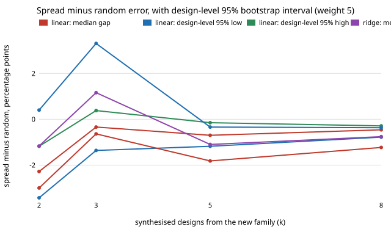

# eda-adaptdesign: does the farthest-point spread's lead over random draws, when adapting a chip-design cost model to a new family, survive resampling the designs themselves? (follow-up to `eda-adaptci`, track 7)

Why it seemed worth doing: `eda-adaptci` put intervals on the spread-against-random gap by resampling (family, split) cells, but the 40 splits of a family reuse the same ~33 designs, and its own limitation said the interval measured split noise, not design-to-design variation. This resamples the designs. Produced with AI assistance (Claude). **Preliminary:** the same 133 small designs in four author-written generator families (Yosys 0.33 generic-cell-count target, no place and route).

**Live page:** https://duncan-haywood.github.io/oss-monorepo/research/eda-adaptdesign/

**Builds on.** `research/eda-adaptci` (dataset, models, choosers and split protocol copied unchanged), `research/eda-adaptfixed`. Models use scikit-learn (Pedregosa et al., 2011, *JMLR* 12:2825-2830); the spread rule is greedy k-centre (Gonzalez, 1985, *Theoretical Computer Science* 38:293-306); the resampling is the ordinary nonparametric bootstrap (Efron, 1979, *Annals of Statistics* 7(1):1-26) applied to designs as the cluster unit. No CU Boulder lab's work is built on and no affiliation is implied.

## Method
Same cells as `eda-adaptci`: held-out family, split seed 0 to 39, k in {2, 3, 5, 8}, linear and ridge surrogates, new-family weight 5, median APE on the fixed 40% test set. New here: in each of 2,000 replicates every family's designs are redrawn with replacement; a design drawn m times counts m times in the test set of every split it belongs to (m = 0 drops it); each cell's median-APE gap (chooser minus random) is recomputed and the replicate's statistic is the median over all 160 cells. The 95% interval is the 2.5 and 97.5 percentiles. Pool designs are not resampled. Random is the per-design median APE over 20 draws (`eda-adaptci` used the median of 20 per-draw medians), so point estimates differ from `eda-adaptci` by up to about 0.4 points. A column "cell" repeats a plain cell bootstrap (2,000 resamples) on this run's own gaps for a like-for-like comparison.

## Reproduce
```bash
pip install numpy scikit-learn
cd research/eda-adaptdesign
PYTHONPATH=src python -m unittest discover -s tests   # about 1 s
python experiments/run.py                             # a few minutes; writes results.txt and results.json
python experiments/figure.py                          # draws experiments/gap_design.svg
```

## Results (from `experiments/results.txt`)
Spread minus random, median gap in percentage points of APE (negative = spread better), 95% intervals:

| model | k | gap | design-level interval | cell-level interval |
|---|---|---|---|---|
| linear | 2 | -2.28 | -3.43 to -1.18 | -3.44 to -1.62 |
| linear | 3 | -0.34 | -1.36 to +0.38 | -0.83 to +0.16 |
| linear | 5 | -0.70 | -1.18 to -0.15 | -0.99 to -0.36 |
| linear | 8 | -0.46 | -0.78 to -0.29 | -0.64 to -0.24 |
| ridge | 2 | -1.17 | -3.00 to +0.40 | -1.89 to -0.54 |
| ridge | 3 | +1.16 | -0.64 to +3.31 | -0.17 to +2.43 |
| ridge | 5 | -1.10 | -1.82 to -0.34 | -1.42 to -0.63 |
| ridge | 8 | -0.76 | -1.23 to -0.37 | -1.04 to -0.48 |

- **Resampling designs widens most intervals** (by up to about 2.5x), as the earlier limitation predicted.
- **What survives:** the spread beats random draws at k = 5 and 8 for both models, and at k = 2 for the linear model. The gap there is small, 0.5 to 1.1 points at k = 5 and 8.
- **What does not:** the linear k = 3 lead and the ridge k = 2 lead now include zero. `eda-adaptci` called the ridge k = 3 loss "real"; under design resampling that interval is -0.6 to +3.3, so it is not established either way.
- **The extremes chooser** is worse than random for the linear model at k = 2 and 3 (design-level +1.3 to +7.6 and +0.5 to +3.0) and better from k = 5, as before; for ridge only k = 5 and 8 exclude zero (see `results.txt`).
- Per-family design intervals (last columns of `results.txt`, from 500 replicates and so noisier) are wide: with about 33 designs per family, one family alone rarely excludes zero.



## Limitations
- Resampling designs of a family treats them as draws from a generator, but the four families are hand-written and share one dataset, so this is a sampling check, not evidence about unseen families; a population of families would need more than four.
- Pool designs are not resampled; the weights and feature scaling are untuned; many intervals are looked at with no multiple-comparison correction.
- A design that is dropped or repeated changes every split's test set at once, which is intended, but test sets are about 13 designs, so medians are coarse.
- Yosys cell counts only; simulated tool runs say nothing about silicon.

## Next steps
Resample the pool as well; add families (needs new generators) to bootstrap over families; repeat with a post-route target once OpenROAD is available.

## Owner steps
None.

## Outside dependencies
None to run (the dataset is committed; produced with Yosys 0.33 in `eda-surrogate`). All code original, MIT.
