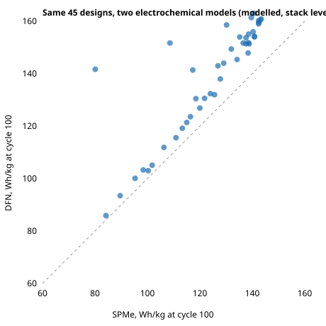

# energy-cell-dfn: do the lithium-ion cell designs found with a fast model still win under the full porous-electrode model?

Track 16 (`PROJECTS.md`), a fidelity check on [`energy-cell`](../energy-cell), taking its first "Next step" (check the winners against a DFN model). `energy-cell` searched four electrode numbers with PyBaMM's single-particle model with electrolyte (SPMe). Here 49 of its designs (the baseline, the best design of each search run, 36 spread evenly over its SPMe ranking, and 3 designs SPMe could not cycle) are re-scored under the full Doyle-Fuller-Newman model (DFN), with the same parameters, protocol and mass model. Produced with AI assistance (Claude).

**Live page:** https://duncan-haywood.github.io/oss-monorepo/research/energy-cell-dfn/

**Headline (modelled, stack level, one parameter set; not a tested cell).** Over the 45 designs both models could cycle, the two models rank cycle-100 energy per kilogram with Spearman correlation **0.86** (0.93 at beginning of life). The SPMe winner (143.4 Wh/kg, a session proposal) is still near the top under DFN: **3rd of 45**, at 160.9 Wh/kg against a DFN best of 163.0 for another design. The design gain survives: the SPMe winner beats the reference cell by **+31% under SPMe and +38% under DFN**. DFN reports more energy than SPMe for almost every design (mean +18.6 Wh/kg, median relative gap 9%), and the gap is far larger for a few designs (up to +127 Wh/kg). SPMe could not cycle 3 designs that DFN cycled normally.

**Builds on.** `research/energy-cell` (code imported unchanged: parameters, mass model, bounds, logged designs); the DFN model of Doyle, Fuller and Newman (1993), *J. Electrochem. Soc.*, and the SPMe reduction as implemented in PyBaMM (Sulzer et al. 2021, *J. Open Research Software*); the `OKane2022` parameter set (O'Kane et al. 2022, *Phys. Chem. Chem. Phys.*). Citations were not re-fetched in this run; check them before reuse. No group in `prompt.md` covers battery design, and none is claimed.

## Method
- `experiments/run.py select` picks the designs deterministically from `energy-cell/experiments/auto.json` and `session.json` (`selected.json`).
- `run.py dfn` scores each under DFN and SPMe with one protocol (100 cycles, 5 A discharge to 2.5 V, 5 A charge to 4.2 V, solvent-diffusion-limited SEI and irreversible lithium plating; score = discharge Wh at cycle 100 per kg of stack). The SPMe baseline reproduces `energy-cell`'s 109.1 Wh/kg (a test checks it). DFN needed 4 to 13 GB of memory per design and did not release it, so each design runs in a fresh process (about 35 s each). Per-design results are in `experiments/dfn.jsonl`.
- `run.py report` writes `experiments/results.txt`; `figure.py` draws the scatter from it.

## Results
See `experiments/results.txt` (sections A to C; every design is listed). In short:
- Baseline: SPMe 109.1, DFN 116.3 Wh/kg at cycle 100.
- The top SPMe designs (140-143 Wh/kg) span roughly 154 to 163 Wh/kg under DFN, so the near-plateau that `energy-cell` found is not flat under DFN: DFN would pick a different design from within it (115 µm, porosities 0.38 / 0.28, N/P ratio 1.3, at 163.0).
- The large disagreements are on designs SPMe scores low or zero: one scores 27.6 under SPMe and 129.9 under DFN. Section "Why SPMe fails" below traces the cause.

## Why SPMe fails (diagnosis, 2026-10-31)
`experiments/diagnose.py`, `diagnose2.py`, `diagnose3.py` re-run the failing designs and keep what `evaluate_with` swallowed (outputs: `diagnose.txt`, `diagnose2.txt`, `diagnose3.txt`). Findings, all modelled with the same parameters and no measured data:
- **The three "0.0" scores are a solver error, not a physical verdict.** PyBaMM raises `SolverError: All steps in the cycle ... are infeasible due to exceeded bounds at initial conditions` after SPMe's first 5 A discharge ends early. In the first cycle, SPMe moves only 2.1 Ah for one of them against 7.9 Ah under DFN (positive-electrode porosity 0.21, 138 µm). `evaluate_with` caught the exception and scored 0, so `energy-cell`'s search read these as infeasible.
- **The two low scores (18.9 and 27.6) are a collapse after the first cycle.** Cycle-1 energy is normal (29.2 and 20.5 Wh), cycle-2 energy is 0.22 and 3.0 Wh. At 5 A the SPMe charge reaches 4.2 V after 0.35 Ah (design `bayes3`, negative porosity 0.204) where DFN charges 5.6 Ah. At a 2 A charge SPMe and DFN agree within a few percent (7.6 against 7.5 Ah for `bayes3`) and there is no collapse. So the failure is a rate effect, and DFN carries 5 A in all five cases.
- **Where it happens.** Over all 48 designs, the relative gap (DFN minus SPMe)/DFN correlates with positive-electrode thickness (Spearman 0.64) and hardly with porosity alone (0.03 for positive, -0.29 negative). The 6 designs with a gap above 30% are all 113 µm or thicker, and 5 of the 6 have positive porosity below 0.25 (11 designs in the set do).
- **What this does not show.** The pattern fits SPMe's reduced electrolyte treatment breaking down at high rate with thick, poorly connected electrodes, but no run here isolates the electrolyte term (for example by comparing electrolyte concentration profiles), and with no measured cell neither model is shown to be the accurate one.
- **Consequence for `energy-cell`.** Its 0-score region (thick electrode, low porosity) was partly an SPMe artefact at the 5 A rate, so a search that treats it as infeasible has pruned designs DFN cycles normally (120 to 140 Wh/kg at cycle 100 here). Re-searching with a charge-rate-aware or DFN score is the natural next step.

## Direct DFN search (2026-11-01)
`experiments/dfn_search.py` runs the `energy-cell` proposers (random, Gaussian-process Bayesian) with the same 30-evaluation budget but scoring every candidate with DFN (cycle-100 Wh/kg). Outputs: `experiments/dfn_search_<proposer><seed>.json`. 2 seeds per proposer, so this shows a size, not a ranking.
| proposer, seed | best DFN Wh/kg | design (positive thickness &micro;m, pos. porosity, neg. porosity, N/P) | zero scores |
|---|---|---|---|
| Bayesian 0 | 164.3 | 135.6, 0.385, 0.268, 1.30 | 0 |
| Bayesian 1 | 164.4 | 128.9, 0.389, 0.286, 1.30 | 0 |
| random 0 | 155.1 | 131.3, 0.383, 0.321, 1.19 | 0 |
| random 1 | 159.7 | 101.2, 0.390, 0.229, 1.28 | 0 |
- The best design the SPMe-guided route reaches (SPMe search, then re-scored under DFN) is 163.0 Wh/kg. Direct DFN Bayesian search finds 164.3-164.4, **about 0.8% more**, in the same region: positive electrode 129-136 &micro;m, positive porosity 0.385-0.39, N/P at the top of the range. So SPMe screening costs little here; the DFN optimum is a nearby point on the same plateau.
- Under DFN no evaluation scored 0 (120 evaluations): the zeros in `energy-cell` were SPMe's, as diagnosed above. `failures.json` (from `classify_failures.py`) re-runs the three SPMe zeros with the failure labels: all three are `solver_error`, infeasible at initial conditions.
- Random search is 3-9 Wh/kg behind Bayesian here, unlike under SPMe where the proposers tied; with 2 seeds, treat as suggestive.
- Not shown: any measured cell; the 1% gap is inside what a parameter uncertainty would move. Each evaluation runs in a fresh process because a single in-process DFN search exceeded 14 GB and was OOM-killed (cost 30 s each).

## Limitations
- 49 designs, one cell, one parameter set, one protocol. The designs were chosen to spread across the SPMe ranking, so the correlation is not the one over the whole search space or over what a search visits.
- Both models use the same degradation submodels and the same parameters; DFN giving more energy is not evidence that it is closer to a real cell. No measured data is used, so neither model is validated here.
- Stack-level mass only (no casing or tabs), as in `energy-cell`.

## Next steps
Isolate SPMe's electrolyte term in the failures (concentration profiles at 5 A); more DFN-search seeds and a tuned GP; compare both models with measured discharge curves.

## Reproduce
`python experiments/run.py select|dfn|report`, then `python experiments/figure.py` (needs numpy, scipy, pybamm; `dfn` needs a lot of RAM headroom and takes about 30 minutes). Tests: `pytest research/energy-cell-dfn/tests`.

## Outside dependencies
PyBaMM and its parameter data. Cell fabrication, cycling and measured parameters are owner steps.
