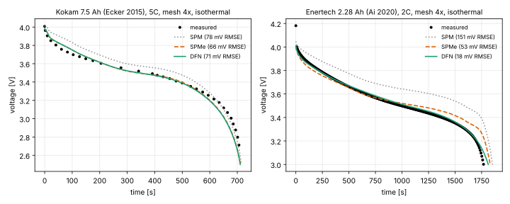

# energy-cell-dfn: do the lithium-ion cell designs found with a fast model still win under the full porous-electrode model?

Track 16 (`PROJECTS.md`), a fidelity check on [`energy-cell`](../energy-cell), taking its first "Next step" (check the winners against a DFN model). `energy-cell` searched four electrode numbers with PyBaMM's single-particle model with electrolyte (SPMe). Here 49 of its designs (the baseline, the best design of each search run, 36 spread evenly over its SPMe ranking, and 3 designs SPMe could not cycle) are re-scored under the full Doyle-Fuller-Newman model (DFN), with the same parameters, protocol and mass model. Produced with AI assistance (Claude).

**Live page:** https://marisstella.app/research/energy-cell-dfn/

**Headline (modelled, stack level, one parameter set; not a tested cell).** Over the 45 designs both models could cycle, the two models rank cycle-100 energy per kilogram with Spearman correlation **0.86** (0.93 at beginning of life). The SPMe winner (143.4 Wh/kg, a session proposal) is still near the top under DFN: **3rd of 45**, at 160.9 Wh/kg against a DFN best of 163.0 for another design. The design gain survives: the SPMe winner beats the reference cell by **+31% under SPMe and +38% under DFN**. DFN reports more energy than SPMe for almost every design (mean +18.6 Wh/kg, median relative gap 9%), and the gap is far larger for a few designs (up to +127 Wh/kg). SPMe could not cycle 3 designs that DFN cycled normally.

**Measured-data check (2026-11-11).** Against published discharge curves of two real cells, SPMe and DFN agree within 0.5 mV at low rate, so the data cannot separate them there; at 2C on the Ai et al. (2020) pouch cell, where the electrolyte drops to 30% of its initial salt, DFN fits the measurement to **18 mV RMSE against SPMe's 53 mV**; at 5C on the Ecker et al. (2015) cell the two differ by 6 mV and both miss by about 70 mV (see "Measured discharge curves").

**Builds on.** `research/energy-cell` (code imported unchanged: parameters, mass model, bounds, logged designs); the DFN model of Doyle, Fuller and Newman (1993), *J. Electrochem. Soc.*, and the SPMe reduction as implemented in PyBaMM (Sulzer et al. 2021, *J. Open Research Software*); the `OKane2022` parameter set (O'Kane et al. 2022, *Phys. Chem. Chem. Phys.*). Citations were not re-fetched in this run; check them before reuse. No group in `prompt.md` covers battery design, and none is claimed.

## Method
- `experiments/run.py select` picks the designs deterministically from `energy-cell/experiments/auto.json` and `session.json` (`selected.json`).
- `run.py dfn` scores each under DFN and SPMe with one protocol (100 cycles, 5 A discharge to 2.5 V, 5 A charge to 4.2 V, solvent-diffusion-limited SEI and irreversible lithium plating; score = discharge Wh at cycle 100 per kg of stack). The SPMe baseline reproduces `energy-cell`'s 109.1 Wh/kg (a test checks it). DFN needed 4 to 13 GB of memory per design and did not release it, so each design runs in a fresh process (about 35 s each). Per-design results are in `experiments/dfn.jsonl`.
- `run.py report` writes `experiments/results.txt`; `figure.py` draws the scatter from it.

## Results
See `experiments/results.txt` (sections A to C; every design is listed). In short:
- Baseline: SPMe 109.1, DFN 116.3 Wh/kg at cycle 100.
- The top SPMe designs (140-143 Wh/kg) span roughly 154 to 163 Wh/kg under DFN, so the near-plateau that `energy-cell` found is not flat under DFN: DFN would pick a different design from within it (115 µm, porosities 0.38 / 0.28, N/P ratio 1.3, at 163.0).
- The large disagreements are on designs SPMe scores low or zero: one scores 27.6 under SPMe and 129.9 under DFN. Section "Why SPMe fails" below traces the cause.

## Why SPMe fails (diagnosis, 2026-10-31)
`experiments/diagnose.py`, `diagnose2.py`, `diagnose3.py` re-run the failing designs and keep what `evaluate_with` swallowed (outputs: `diagnose.txt`, `diagnose2.txt`, `diagnose3.txt`). Findings, all modelled with the same parameters and no measured data:
- **The three "0.0" scores are a solver error, not a physical verdict.** PyBaMM raises `SolverError: All steps in the cycle ... are infeasible due to exceeded bounds at initial conditions` after SPMe's first 5 A discharge ends early. In the first cycle, SPMe moves only 2.1 Ah for one of them against 7.9 Ah under DFN (positive-electrode porosity 0.21, 138 µm). `evaluate_with` caught the exception and scored 0, so `energy-cell`'s search read these as infeasible.
- **The two low scores (18.9 and 27.6) are a collapse after the first cycle.** Cycle-1 energy is normal (29.2 and 20.5 Wh), cycle-2 energy is 0.22 and 3.0 Wh. At 5 A the SPMe charge reaches 4.2 V after 0.35 Ah (design `bayes3`, negative porosity 0.204) where DFN charges 5.6 Ah. At a 2 A charge SPMe and DFN agree within a few percent (7.6 against 7.5 Ah for `bayes3`) and there is no collapse. So the failure is a rate effect, and DFN carries 5 A in all five cases.
- **Where it happens.** Over all 48 designs, the relative gap (DFN minus SPMe)/DFN correlates with positive-electrode thickness (Spearman 0.64) and hardly with porosity alone (0.03 for positive, -0.29 negative). The 6 designs with a gap above 30% are all 113 µm or thicker, and 5 of the 6 have positive porosity below 0.25 (11 designs in the set do).
- **Electrolyte term isolated (2026-11-06, `experiments/diagnose4.py`, output `diagnose4.txt`).** For `bayes3` (113 µm, porosities 0.288 / 0.204, N/P 1.16) over two cycles, SPMe's electrolyte concentration goes **negative** during the 5 A charge: minimum −37 mol/m³ in cycle 1 (initial 1,000 mol/m³ scale, maximum 3,229), and the charge then ends after 0.355 Ah in cycle 2. A negative salt concentration is unphysical and the electrolyte-dependent terms (conductivity, exchange current, potential) are then evaluated outside their valid range. DFN stays positive throughout (minimum 4 mol/m³ at the end of the first discharge, 41 in cycle 2) and carries 5.6 Ah per charge. At a 2 A charge SPMe's minimum is 72 mol/m³ and DFN's is 4 to 22, and the two agree on capacity within 3%. So the collapse is the reduced model's electrolyte transport failing in the thin-pore (negative porosity 0.204) high-rate case, not a degradation effect: the negative-electrode porosity is unchanged (0.204) at the end of every step. One design, one parameter set; the other four failures were not probed this way, and the plating variable name did not exist in this PyBaMM version (26.10.1.1), so plating was not compared.
- **The other four failures, probed the same way (2026-11-07, `experiments/diagnose5.py`, output `diagnose5.txt`; 5 A charge, two cycles, SPMe against DFN; PyBaMM 26.10.1.1, one parameter set).**
  - The 27.6 Wh/kg design (`random1`: 149.6 µm, porosities 0.249 / 0.251, N/P 0.93) repeats the `bayes3` pattern. SPMe's electrolyte concentration goes negative (minimum −25 mol/m³ in cycle 1), the 5 A charge then ends after 0.72 Ah, and cycle 2 discharges 1.0 Ah. DFN charges 5.0 Ah per cycle with a minimum of 1 to 2 mol/m³, never negative. So two of the two low-score designs show the negative-concentration signature.
  - The three zero-score designs cannot be probed this way: SPMe raises the same `SolverError` (infeasible at initial conditions) before it returns any solution, so there is no SPMe concentration to read. DFN carries all three at 5 A, but charges only 1.9 to 5.5 Ah per cycle and its concentration reaches about 0 mol/m³ (rounds to 0 or −0): the two designs with positive porosity 0.20 to 0.21 and negative porosity 0.20 charge 1.9 Ah and 4.5 Ah, the third (negative porosity 0.389) 5.5 Ah. These are close to electrolyte depletion even under DFN, which fits (does not prove) the SPMe failure being the same mechanism.
  - Not done: plating was not compared (variable absent in this PyBaMM version), and no run changes the SPMe electrolyte treatment to see the failure go away, so "electrolyte transport" is still the best-supported explanation, not a tested cause.
- **Electrolyte treatment changed (2026-11-10, `experiments/diagnose6.py`, output `diagnose6.txt` / `diagnose6.json`; hypotheses logged first in `LOG.md`).** Same two low-score designs, 5 A charge, two cycles; Ah of the cycle-2 charge:

  | case | `bayes3` SPMe | `bayes3` DFN | `random1` SPMe | `random1` DFN |
  |---|---|---|---|---|
  | as before (De &times;1, composite conductivity) | 0.36 (ce min &minus;37) | 5.60 (min 4) | 0.72 (min &minus;25) | 4.94 (min 1) |
  | SPMe conductivity `integrated` | 3.19 (min &minus;37) | | 2.19 (min &minus;25) | |
  | electrolyte diffusivity &times;2 | 6.24 (min 404) | 6.35 (min 418) | 5.73 (min 422) | 5.82 (min 383) |
  | electrolyte diffusivity &times;4 | 6.45 (min 673) | 6.54 (min 675) | 5.93 (min 692) | 6.09 (min 675) |

  - Doubling the electrolyte diffusivity (conductivity unchanged) removes the negative concentration and the collapse in both designs: SPMe's cycle-2 charge rises from 0.36 to 6.24 Ah and from 0.72 to 5.73 Ah, within 2% of DFN's at the same diffusivity (DFN moves by 13% and 18%). So the collapse is set by electrolyte salt transport, and the SPMe&ndash;DFN disagreement in this region is confined to the regime where the electrolyte nearly empties.
  - Swapping SPMe's conductivity treatment does not remove it. `composite` is identical to the default; `integrated` (the integrated form of Brosa Planella, Sheikh and Widanage 2021, *Electrochimica Acta* 388, 138524, doi:10.1016/j.electacta.2021.138524, taken from PyBaMM's CITATIONS.bib; the DOI lookup was refused by the proxy in this run) raises the cycle-2 charge to 3.19 and 2.19 Ah but the concentration still goes negative and the gap to DFN stays 43% and 56%. `leading order` is not accepted for SPMe in PyBaMM 26.10.1.1. By the threshold logged in advance (cycle-2 charge below 1 Ah under every option), H1 is not refuted, because `integrated` passes 1 Ah: the potential treatment changes how badly SPMe fails, the diffusion limit decides whether it fails.
  - DFN's reaction distribution (H3) was not measured as planned. The minimum concentration during the cycle-1 charge sits at the first time point, inherited from the discharge and on the positive-electrode side (node 59 of the cell grid), so the negative-electrode |j| max/mean read there (1.16 to 1.69) says nothing about depletion in the negative electrode. Logged as a flawed measurement, not a result.
  - One parameter set (OKane2022), two designs, two cycles; the diffusivity scaling is a sensitivity probe, not a claim about any real electrolyte.
- **What this still does not show.** The pattern fits SPMe's reduced electrolyte treatment breaking down at high rate with thick, poorly connected electrodes, and the 2026-11-10 run ties it to salt diffusion (doubling the diffusivity removes it), but with no measured cell neither model is shown to be the accurate one.
- **Consequence for `energy-cell`.** Its 0-score region (thick electrode, low porosity) was partly an SPMe artefact at the 5 A rate, so a search that treats it as infeasible has pruned designs DFN cycles normally (120 to 140 Wh/kg at cycle 100 here). Re-searching with a charge-rate-aware or DFN score is the natural next step.

## Measured discharge curves (2026-11-11)
Neither model had been checked against a real cell. No measured curve exists for the OKane2022 designs, so `experiments/validate_data.py` uses the two measured sets PyBaMM ships with a matching parameter set: Ecker et al. (2015a, 2015b; Kokam 7.5 Ah graphite/NMC, `Ecker2015`, 1C and 5C) and Ai et al. (2020; Enertech 2.28 Ah graphite/LCO pouch, `Ai2020`, 0.1C to 2C). Files come from `pybamm.DataLoader` (pybamm-data v1.0.2, hash-checked). SPM, SPMe and DFN are run with the published parameters, isothermal and with a lumped thermal model, on PyBaMM's default mesh, twice it and (at the highest rate) four times it. Hypotheses were logged first (`LOG.md`). Output: `experiments/validate_data.txt`, `validate_data.json`, figure `validate_data.svg`.

Voltage RMSE against the measured curve, isothermal, finest mesh run (mV):

| cell, rate | SPM | SPMe | DFN | SPMe vs DFN | DFN min. salt / initial |
|---|---|---|---|---|---|
| Ecker, 1C | 48.4 | 39.6 | 39.5 | 0.5 | 0.86 |
| Ecker, 5C (4x mesh) | 78.2 | 66.5 | 70.6 | 5.7 | 0.40 |
| Ai, 0.1C | 53.1 | 52.1 | 52.1 | 0.4 | 0.97 |
| Ai, 0.5C | 67.6 | 54.9 | 53.1 | 3.4 | 0.84 |
| Ai, 1C | 90.7 | 54.0 | 46.1 | 10.1 | 0.67 |
| Ai, 2C (4x mesh) | 150.9 | 53.4 | **17.9** | 41.5 | 0.30 |

- **At low rate the data cannot tell SPMe from DFN** (H2 supported). At Ai 0.1C and Ecker 1C the two models differ by 0.4 and 0.5 mV, against 40 to 52 mV of error each against the measurement; that error sits in the open-circuit curve and the end-of-discharge knee (over the first 90% of the time it is 7 and 17 mV).
- **At high rate the answer depends on the cell** (H1 split). On the Ai cell at 2C, DFN fits the measured curve to 18 mV against SPMe's 53 mV, and its discharge time to 2.1% against 3.6%, on every mesh: here the electrolyte drops to 30% of its initial concentration and SPMe's reduced electrolyte overestimates the late-discharge voltage. On the Ecker cell at 5C the two models differ by only 5.7 mV, SPMe is 4 mV closer to the data, and both miss by 55 to 70 mV; on the 1x mesh the lumped thermal model removes about 26 mV of that (81 / 86 to 55 / 58 mV), more than the mesh refinement (15 mV) and far more than the choice between the models. The SPMe&ndash;DFN difference grows as the electrolyte empties (0.4 mV at 97% of the initial salt, 10 mV at 67%, 41 mV at 30% on the Ai cell), which matches the mechanism found above.
- **Mesh matters at 5C.** The Ecker 5C errors move by 15 mV between PyBaMM's default mesh and 4x (DFN 85.6, 73.0, 70.6 mV); every other case moves by under 1 mV. A 5C comparison on the default mesh would have reported SPMe and DFN both 15 mV worse than they are.
- **Thermal.** The lumped model helps the Ecker cell at 5C and hurts the Ai cell at 2C (DFN 46 mV against 18 isothermal). The Ai measurements were taken with the cell's surface temperature logged (files `*_discharge_T.txt`), which this run does not use; how the original authors held temperature is not settled here.
- **What this means for the designs above.** Neither measured case reaches the near-zero salt concentration where SPMe failed on the `energy-cell` designs (the lowest is 30%). In the deepest-depletion measured case, the full model is the one that matches the cell, which supports reading DFN, not SPMe, in the thick-electrode region; it does not validate either model at the OKane2022 designs, which no measured curve covers.
- Sources: Ecker et al. 2015a, *J. Electrochem. Soc.* 162, A1836, doi:10.1149/2.0551509jes (parameters); Ecker et al. 2015b, *J. Electrochem. Soc.* 162, A1849, doi:10.1149/2.0541509jes (validation curves); Ai et al. 2020, *J. Electrochem. Soc.* 167, 013512, doi:10.1149/2.0122001JES; SPMe as derived by Marquis et al. 2019, *J. Electrochem. Soc.* 166, A3693, doi:10.1149/2.0341915jes; DFN, Doyle, Fuller and Newman 1993, *J. Electrochem. Soc.* 140, 1526, doi:10.1149/1.2221597. Bibliographic details taken from PyBaMM's `CITATIONS.bib`; `cite_check.py` could not resolve the DOIs in this run (doi.org refused by the proxy), so they are not independently checked.
- Limits: two cells, one published parameter set each, constant-current discharge only, no charge and no ageing; RMSE includes the first rest point and the knee. The Ecker curves are 31 and 33 points (digitised in the PyBaMM data set); the Ai curves are logged at 1 s.

## Direct DFN search (2026-11-01)
`experiments/dfn_search.py` runs the `energy-cell` proposers (random, Gaussian-process Bayesian) with the same 30-evaluation budget but scoring every candidate with DFN (cycle-100 Wh/kg). Outputs: `experiments/dfn_search_<proposer><seed>.json`. 2 seeds per proposer, so this shows a size, not a ranking.
| proposer, seed | best DFN Wh/kg | design (positive thickness &micro;m, pos. porosity, neg. porosity, N/P) | zero scores |
|---|---|---|---|
| Bayesian 0 | 164.3 | 135.6, 0.385, 0.268, 1.30 | 0 |
| Bayesian 1 | 164.4 | 128.9, 0.389, 0.286, 1.30 | 0 |
| random 0 | 155.1 | 131.3, 0.383, 0.321, 1.19 | 0 |
| random 1 | 159.7 | 101.2, 0.390, 0.229, 1.28 | 0 |
- The best design the SPMe-guided route reaches (SPMe search, then re-scored under DFN) is 163.0 Wh/kg. Direct DFN Bayesian search finds 164.3-164.4, **about 0.8% more**, in the same region: positive electrode 129-136 &micro;m, positive porosity 0.385-0.39, N/P at the top of the range. So SPMe screening costs little here; the DFN optimum is a nearby point on the same plateau.
- Under DFN no evaluation scored 0 (120 evaluations): the zeros in `energy-cell` were SPMe's, as diagnosed above. `failures.json` (from `classify_failures.py`) re-runs the three SPMe zeros with the failure labels: all three are `solver_error`, infeasible at initial conditions.
- Random search is 3-9 Wh/kg behind Bayesian here, unlike under SPMe where the proposers tied; with 2 seeds, treat as suggestive.
- Not shown: any measured cell; the 1% gap is inside what a parameter uncertainty would move. Each evaluation runs in a fresh process because a single in-process DFN search exceeded 14 GB and was OOM-killed (cost 30 s each).

## Limitations
- 49 designs, one cell, one parameter set, one protocol. The designs were chosen to spread across the SPMe ranking, so the correlation is not the one over the whole search space or over what a search visits.
- Both models use the same degradation submodels and the same parameters; DFN giving more energy is not evidence that it is closer to a real cell. The measured-data check uses two other cells (Ecker 2015, Ai 2020), not the OKane2022 cell, so the designs themselves are not validated.
- Stack-level mass only (no casing or tabs), as in `energy-cell`.

## Next steps
Compare plating once the variable name is found; measure DFN's negative-electrode reaction distribution during the charge (not at the step start, see diagnose6); find how far the diffusivity can drop before the SPMe winners' ranking changes, since the failing region is set by it; more DFN-search seeds and a tuned GP; fit the Ai cell's temperature data to settle the thermal option; find measured LG M50 curves at 2C or above (the OKane2022 cell) and repeat the measured-data check there; add measured charge curves, since the SPMe collapse happens on charge.

## Reproduce
`python experiments/run.py select|dfn|report`, then `python experiments/figure.py` (needs numpy, scipy, pybamm; `dfn` needs a lot of RAM headroom and takes about 30 minutes). Measured-data check: `python experiments/validate_data.py` (about 10 minutes on 4 cores; downloads the data on first run; two 4x DFN runs at once ran out of a 16 GB machine's memory, so those run one at a time), then `python experiments/validate_figure.py`. Tests: `pytest research/energy-cell-dfn/tests`.

## Outside dependencies
PyBaMM and its parameter data. Cell fabrication, cycling and measured parameters are owner steps.
