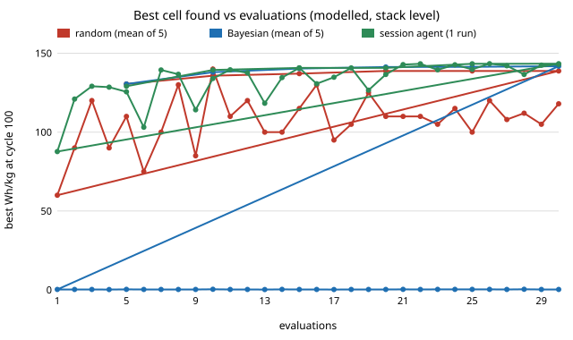

# energy-cell: how much better can a lithium-ion cell get by redesigning its electrodes, and does a smarter search help?

Fourth project of track 16 (`PROJECTS.md`, milestone 3). A PyBaMM single-particle model with electrolyte (SPMe) of a 5 Ah NMC811 / graphite-SiOx cell is scored on the energy it still delivers after 100 charge-discharge cycles at a fixed current, per kilogram of electrode stack. Four numbers are designed (positive electrode thickness, positive and negative porosity, negative-to-positive capacity ratio) and three proposers search with the same 30 evaluations: random search, Gaussian-process Bayesian optimisation, and the session agent (Claude) proposing by hand in three rounds. Produced with AI assistance (Claude).

**Live page:** https://duncan-haywood.github.io/oss-monorepo/research/energy-cell/

**Headline (modelled, stack level, one parameter set; not a tested cell).** The model's reference cell scores **109 Wh/kg at cycle 100**. All three proposers find designs near **141-143 Wh/kg (+30%)**: a thicker positive electrode (about 110-130 &micro;m against 76), a more porous electrode (0.38-0.40 against 0.34) and a negative electrode with about 30% more capacity than the reference (the top of the allowed range). After 30 evaluations the means are random 138.8, Bayesian 141.8 (5 seeds each), and the session agent 143.4 (one run). The seed ranges overlap (random 137.6-140.8, Bayesian 140.3-143.0), so this run shows **no clear difference between proposers**: the search space is four numbers with a broad plateau, so random search is already near the top. The design gain comes from the parameters, not from the proposer.

**Builds on.** The porous-electrode cell model of Doyle, Fuller and Newman (1993), *J. Electrochem. Soc.*, as implemented openly in PyBaMM (Sulzer et al. 2021, *J. Open Research Software*); the SPMe reduction and the `OKane2022` parameter set packaged in PyBaMM (O'Kane et al. 2022, *Phys. Chem. Chem. Phys.*, which fits SEI growth and lithium plating to an NMC811 / graphite-SiOx cell with Chen et al. (2020, *J. Electrochem. Soc.*) electrode data). The comparison of proposers follows the loop in `PROJECTS.md`. Citations were not re-fetched in this run (no network access to the papers); check them before reuse. No group in `prompt.md` covers battery design, and none is claimed.



## Method (`src/energy_cell/`)
- **Cell.** PyBaMM `SPMe` with `SEI: solvent-diffusion limited` and `lithium plating: irreversible`, parameters `OKane2022`, with four overrides: positive thickness *t*; positive and negative porosity; negative thickness = *t* &times; (reference ratio) &times; *r*, so *r* is the negative-to-positive capacity ratio relative to the reference cell. Active-material fraction is `1 - porosity - 0.05` (5% binder and carbon, assumed), so porosity trades active material for electrolyte volume.
- **Test.** 100 cycles of: discharge at 5 A to 2.5 V, charge at 5 A to 4.2 V (constant current only; no constant-voltage hold). Current is the same for every design, so a thicker electrode runs at a lower C-rate.
- **Score.** Discharge energy of cycle 100 (integral of V&middot;I) divided by stack mass, in Wh/kg. Cycle 1 starts from a rested full cell and is not used as the start; "cycle 2" is the start. A design that fails to solve scores 0.
- **Mass** (`stack_mass_kg`): both collectors, both composite layers (active material, 5% inactive at 1,800 kg/m<sup>3</sup>, electrolyte at 1,210 kg/m<sup>3</sup> in pores), separator. No casing, tabs or terminals, so Wh/kg is above any finished cell.
- **Bounds.** Thickness 50-150 &micro;m; porosities 0.20-0.40; ratio 0.90-1.30 of reference.
- **Proposers.** *Random*: uniform. *Bayesian*: 8 random starts then expected improvement from a GP with an RBF kernel (fixed length-scale 0.35 on the unit cube) over 2,000 random candidates. *Session*: 30 designs written by Claude in three rounds of 10 (`experiments/proposals/round*.json`), each round after reading the scores of the previous ones, using its prior about cell physics. This is one run, by one proposer, and is not a reproducible LLM benchmark; no model API was called.

### Checks (`tests/`)
Bounds and clipping; mass rises with thickness and is plausible for a 5 Ah single-layer stack; random search reproducible; Bayesian search at least matches random on a smooth test function in 4 of 5 seeds; replay clips; an end-to-end PyBaMM smoke test.

## Reproduce
```bash
cd research/energy-cell
pip install pytest numpy scipy matplotlib pybamm       # PyBaMM 26.10.1 used
PYTHONPATH=src python -m pytest -q tests               # 6 tests
PYTHONPATH=src python experiments/run.py auto          # ~7 min on 4 cores; random + Bayesian, 5 seeds x 30 evals -> auto.json
PYTHONPATH=src python experiments/run.py session       # evaluates the committed session proposals -> session.json
PYTHONPATH=src python experiments/run.py report        # writes results.txt
python experiments/figure.py                           # search.svg from results.txt
```

## Results (`experiments/results.txt`)
- **Reference cell:** 109.1 Wh/kg at cycle 100 (201.9 at cycle 2, retention 0.54, stack 49.4 g).
- **Best found:** random 140.8, Bayesian 143.0, session 143.4 Wh/kg (+29% to +31%). Retention (cycle 100 over cycle 2) stays between 0.5 and 0.58 across the good designs, so the gain is mostly higher energy per kg at the start, not slower fade.
- **What the landscape looks like.** Thin electrodes (60 &micro;m) score 88; most gain arrives by 100 &micro;m. A negative-to-positive ratio of 1.0-1.1 costs 10-20 Wh/kg against 1.3. Negative porosity 0.22 is clearly worse (118) and about 0.3 is best. The best designs sit at the upper bounds of positive porosity and capacity ratio, so the true optimum may lie beyond them.
- **Failures:** 9 of 300 random and Bayesian evaluations did not solve (scored 0), none of the 30 session designs. The thickest, densest corner (150 &micro;m, porosity 0.2) fails to start.

## Limitations
- **One parameter set, and an aggressively ageing one.** `OKane2022` was fitted to show SEI and plating, and loses about 45% of its energy over 100 cycles in this protocol. Real cells fade far slower; absolute Wh/kg at cycle 100 is not a prediction for a product.
- **No hold, no thermal model, no mechanics.** Constant-current charge only; no heating, no electrode cracking or swelling; no electrolyte depletion beyond what SPMe carries.
- **Stack level, not cell level.** Casing, tabs and terminals are omitted; manufacturing limits on thickness and porosity are not modelled.
- **The optimum is at the bounds.** Wider bounds could change the ranking of designs; the comparison of proposers is for this box only.
- **Proposer comparison is small.** 5 seeds, 30 evaluations, one session run. The seed ranges overlap, so no ordering is claimed. The GP length-scale was fixed, not tuned.
- **Simulated is not built.** Cells are hazards (fire, venting); fabricating or cycling them is an owner step with certified parts and protection, and no safety analysis was done here.

## Next steps
Widen the bounds; add the constant-voltage hold and a milder degradation set; add particle size and loading as variables; check the winners against a DFN model (`pybamm.lithium_ion.DFN`); tune the GP; run more seeds. Link this to `energy-density` for the ceiling and `energy-lcos` for what a cell-level gain is worth in $/kWh.

## Outside dependencies
PyBaMM and its parameter data. Cell fabrication and cycling, and any measured parameters, are owner steps.
