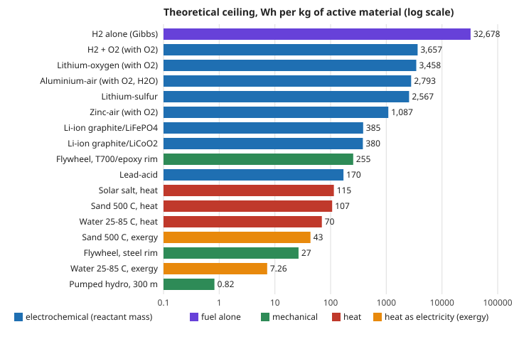

# energy-density: how much energy can each storage technology hold per kilogram, at the most? Theoretical ceilings for batteries, hydrogen, flywheels, pumped hydro and thermal storage, from first principles

First project of track 16, energy supply and dense energy storage (`PROJECTS.md`, milestone 1). Before anyone designs a denser battery, a lighter tank or a cheaper heat store, it helps to know the limit no engineering can beat: the energy that the active material itself can release. This project computes those ceilings in open code from thermodynamics and mechanics (cell voltage and reactant mass for batteries, Gibbs free energy for hydrogen, the strength-to-density ratio for flywheels and pressure vessels, specific heat and the Carnot limit for heat, and *gh* for pumped hydro), and reproduces published theoretical values as a check. Every number is a **ceiling for the active material only**. Real cells, tanks and stores weigh more and deliver less. Produced with AI assistance (Claude).

**Live page:** https://duncan-haywood.github.io/monorepo-projects/research/energy-density/

**Headline.** The arithmetic reproduces five published theoretical specific energies to within 0.3%: lead-acid 170 Wh/kg, zinc-air 1,086, lithium-sulfur 2,567, lithium-oxygen 3,458 and aluminium-air 8,100 (Al only). Seen per atom, **no battery couple here releases more than 1.65 eV per reactant atom** (lead-acid 0.23, Li-ion 0.25 to 0.27, Li-S 1.47, Li-O<sub>2</sub> 1.48, Zn-air 1.65). The 20-fold spread in Wh/kg between lead-acid and Li-O<sub>2</sub> comes from that factor of about 7 and from atoms about 3 times lighter on average (35.7 against 11.5 g/mol), through one identity: **Wh/kg = 26,801 &times; (eV per atom) / (mean atomic mass in g/mol)**. Denser chemistry therefore needs light elements (H, Li, C, O, Al, S) that each release about an electronvolt or more. Other storage holds far less than that per atom. A carbon-fibre flywheel at burst speed holds at most 0.34 eV per atom (756 Wh/kg for an ideal fibre disc; 255 Wh/kg for a realistic composite rim). Sand at 500 &deg;C holds 0.08 eV per atom as heat (107 Wh/kg), of which only 41% could ever come back as electricity. Water lifted 300 m holds 0.0002 eV per atom (0.82 Wh/kg). Thermal and pumped storage win on cost and lifetime, not density, and these ceilings show by how much.

**Builds on.** Standard thermodynamics and mechanics, not any one paper. The cross-check values come from Bruce et al. (2012), Zhou, Chen and Cui (2022), Li and Dai (2014) and Liu et al. (2017) (see References). It builds on none of the CU Boulder groups in `prompt.md` and claims no connection to them.



## Method (`src/energy_density/model.py`)
- **Batteries and fuel cells.** Specific energy = *n* F *E* / &Sigma; *M*. Here *n* is the number of electrons per reaction, F = 96,485.33 C/mol (so 1 mol of electrons through 1 V is 26.80 Wh), *E* the cell voltage and &Sigma; *M* the molar mass of all reactants, from IUPAC 2021 abridged atomic weights. Metal-air and hydrogen cells are also given on the metal or H<sub>2</sub> alone, with oxygen from the air. Per-atom energy = *n E* / number of reactant atoms. Li-ion is graphite (LiC<sub>6</sub>) against half-delithiated LiCoO<sub>2</sub> (the usual practical limit) or against FePO<sub>4</sub>.
- **Flow battery.** Wh per litre of total electrolyte = *c* F *E* / 2, with two equal tanks cycled over the full state of charge.
- **Heat.** Sensible heat *c* &Delta;*T*. Exergy, the most electricity a reversible engine could return against a 20 &deg;C surroundings, is *c* [(*T*<sub>h</sub> &minus; *T*<sub>l</sub>) &minus; *T*<sub>0</sub> ln(*T*<sub>h</sub>/*T*<sub>l</sub>)]. For an ice store, the exergy of its latent heat is *L* (*T*<sub>0</sub>/*T*<sub>melt</sub> &minus; 1) against a 30 &deg;C day.
- **Mechanical.** Lifted mass: *g h*. Flywheel at burst speed: *K* &sigma;/&rho;, with *K* = 0.5 for a thin rim and 1 for an ideal constant-stress disc. Thin spherical pressure vessel: shell mass per enclosed volume = 1.5 *p* &rho; / &sigma; (times a safety factor). Compressed air: ideal-gas isothermal work *p V* ln(*p*/*p*<sub>0</sub>) &minus; (*p* &minus; *p*<sub>0</sub>) *V* per litre of tank.
- **Hydrogen at 700 bar.** Gibbs energy of H<sub>2</sub> (a 100%-efficient fuel cell) times the real-gas density at 700 bar and 288 K, plus an ideal carbon-fibre sphere as the lightest possible tank.

### Inputs and where they come from
| Input | Value | Source |
|---|---|---|
| Lead-acid voltage | 2.04 V | thermodynamic value; PSI exercise and National Academies table (checked 2026-10-19) |
| Li-ion (LiCoO<sub>2</sub>), Li-S, Zn-air voltages | 3.8, 2.2, 1.65 V | Bruce et al. 2012, Table 1 as corrected by the erratum (checked 2026-10-19) |
| Li-ion (LiFePO<sub>4</sub>) voltage | 3.3 V | assumed |
| Al-air, Li-O<sub>2</sub>, H<sub>2</sub>-O<sub>2</sub> voltages | 2.71, 2.96, 1.229 V | standard values, assumed (not checked against a primary source in this run) |
| Vanadium flow battery | 1.26 V; 1.6 and 2.0 mol/L | voltage as quoted in US patent 10,079,401 (checked); concentrations assumed |
| Water, ice | *c* = 4.18 kJ/kgK; *L* = 334 kJ/kg | standard values, assumed |
| Sand | 500 &deg;C top; *c* = 0.8 kJ/kgK | Polar Night Energy's reported operating temperature (checked); *c* assumed |
| Solar salt | *c* = 1.5 kJ/kgK, 290 to 565 &deg;C | assumed |
| Carbon fibre | 4,900 MPa, 1.80 g/cm<sup>3</sup> (fibre); 2,860 MPa at 60% fibre volume (composite) | Toray T700S data sheet (checked 2026-10-19); composite density 1,560 kg/m<sup>3</sup> assumed |
| Steel rim | 1.5 GPa, 7,850 kg/m<sup>3</sup> | assumed |
| H<sub>2</sub> density, 700 bar, 288 K | 40.2 kg/m<sup>3</sup> | US DOE Hydrogen and Fuel Cell Technologies Office, cryogenic H<sub>2</sub> webinar, July 2020 (checked 2026-10-19) |

## Reproduce
```bash
pip install pytest
cd research/energy-density
python -m pytest -q tests                              # 14 tests
PYTHONPATH=src python experiments/run.py               # instant; writes experiments/results.txt
python experiments/figure.py                           # experiments/ceilings.svg from results.txt
```
Standard library only.

## Results (from `experiments/results.txt`; deterministic)
- **A. Batteries, Wh/kg of reactants (eV per atom, mean g/mol).** Lead-acid 170 (0.227, 35.7); Li-ion graphite/LiCoO<sub>2</sub> 380 (0.271, 19.1); graphite/LiFePO<sub>4</sub> 385 (0.254, 17.7); Zn-air 1,087 with O<sub>2</sub>, 1,353 on Zn (1.650, 40.7); Li-S 2,567 (1.467, 15.3); Al-air 2,793 with O<sub>2</sub> and water, 8,076 on Al (1.161, 11.1); Li-O<sub>2</sub> 3,458 with O<sub>2</sub>, 11,431 on Li (1.480, 11.5); H<sub>2</sub>-O<sub>2</sub> 3,657 with O<sub>2</sub>, 32,678 on H<sub>2</sub> (0.819, 6.0).
- **B. Cross-check.** Against published theoretical values: lead-acid +0.1%, Li-S 0.0%, Zn-air +0.1%, Al-air (Al only) &minus;0.3%, Li-O<sub>2</sub> 0.0%. Published Li-only figures for Li-O<sub>2</sub> (about 11,400 to 11,700 Wh/kg) differ only in the voltage used: 11,431 at 2.96 V and 11,586 at 3.0 V.
- **C. Vanadium flow battery.** 27.0 Wh/L of total electrolyte at 1.6 mol/L and 33.8 at 2.0 mol/L, against reported practical figures of 15 to 25 Wh/L.
- **D. Heat.** Water from 25 to 85 &deg;C holds 69.7 Wh/kg of heat but only 7.3 Wh/kg of exergy (10%). Sand from 20 to 500 &deg;C holds 106.7 and 43.5 (41%). Solar salt from 290 to 565 &deg;C holds 114.6 and 66.0 (58%). Ice holds 92.8 Wh/kg of cold, 10.2 of it exergy on a 30 &deg;C day. Heat is a good store of *heat*, and the hotter it is, the more of it can come back as electricity.
- **E. Mechanical.** Water lifted 100, 300 and 600 m holds 0.27, 0.82 and 1.63 Wh/kg (the same number in kWh per m<sup>3</sup>). Flywheels at burst speed hold 756 Wh/kg (ideal T700S fibre disc), 255 (T700S/epoxy rim) and 27 (steel rim). Compressed air at 200 and 300 bar returns at most 23.8 and 39.1 Wh per litre of tank, and only with heat drawn from the surroundings.
- **F. Hydrogen at 700 bar.** H<sub>2</sub> holds 32,678 Wh/kg of Gibbs energy, which is 1,314 Wh per litre of gas. An ideal T700/epoxy sphere at burst pressure would weigh 57.2 kg per m<sup>3</sup> held, so H<sub>2</sub> would be 41.3% of the mass (13,488 Wh/kg of H<sub>2</sub> plus shell). With a safety factor of 2.25 the figures are 23.8% and 7,779 Wh/kg. Real cylindrical tanks with liners and valves are heavier than this ceiling.

## Limitations
- **Ceilings, not designs.** Every figure counts only the active material. A practical Li-ion cell or pack, a flow-battery system, a flywheel with its hub and containment, or a hydrogen tank system weighs a multiple of this. The ratio between practical and theoretical figures is the subject of the next milestone, and none is claimed here.
- **Voltages are equilibrium or nominal values.** Real discharge runs below them, and some of the assumed voltages (LiFePO<sub>4</sub>, Al-air, Li-O<sub>2</sub>, H<sub>2</sub>-O<sub>2</sub>) were not checked against a primary source in this run. The checked ones are marked in the table above.
- **The Li-ion rows are idealised.** They use one stoichiometry each (half the Li cycled in LiCoO<sub>2</sub>), with no electrolyte. Nickel-rich cathodes, silicon anodes and lithium-metal anodes are not modelled.
- **Several inputs are assumed.** Thermal properties are constant over the temperature range. Compressed air is treated as an ideal gas, and the hydrogen density is taken from DOE rather than computed from an equation of state. Pressure vessels are thin ideal spheres with no liner.
- **Mass only, mostly.** Volume ceilings are given only where a density was at hand (flow battery, hydrogen, water, compressed air).
- **No costs.** Cost per kWh, lifetime and round-trip efficiency decide most real choices, especially for grid storage, and they are next steps.

## Next steps
1. `energy-practical`: the gap between ceiling and product. Published cell-, pack- and system-level figures for each technology, each sourced and dated, and the ratio to these ceilings.
2. Volumetric ceilings (Wh/L) for every row, from crystal and liquid densities.
3. Feed the ceilings into a cost-per-kWh-delivered model (track 16, later milestones).

## References
- Bruce, P. G., Freunberger, S. A., Hardwick, L. J. and Tarascon, J.-M. (2012). Li–O<sub>2</sub> and Li–S batteries with high energy storage. *Nature Materials* 11, 19–29. doi:10.1038/nmat3191; erratum doi:10.1038/nmat3237 (corrected Table 1 voltages).
- Zhou, G., Chen, H. and Cui, Y. (2022). Formulating energy density for designing practical lithium–sulfur batteries. *Nature Energy* 7, 312–319. doi:10.1038/s41560-022-01001-0.
- Li, Y. and Dai, H. (2014). Recent advances in zinc–air batteries. *Chemical Society Reviews* 43, 5257–5275. doi:10.1039/C4CS00015C.
- Liu, Y., Sun, Q., Li, W., Adair, K. R., Li, J. and Sun, X. (2017). A comprehensive review on recent progress in aluminum–air batteries. *Green Energy & Environment* 2, 246–277. doi:10.1016/j.gee.2017.06.006.
- Prohaska, T. et al. (2022). Standard atomic weights of the elements 2021 (IUPAC Technical Report). *Pure and Applied Chemistry* 94, 573–600. doi:10.1515/pac-2019-0603. Lead is now an interval; the conventional 207.2 is used.
- Toray Composite Materials America, T700S data sheet (fibre and composite properties; Toray notes the values are not for specification).
- US DOE Hydrogen and Fuel Cell Technologies Office, cryogenic hydrogen storage webinar, July 2020.
- The Li-O<sub>2</sub> 3,457–3,458 Wh/kg cross-check figures are from NASA technical memorandum TM-20205010120 and an IUPUI poster abstract (both checked 2026-10-19).

## Outside dependencies
None. The project is pure Python with the standard library, and every input is in the source with its provenance.
