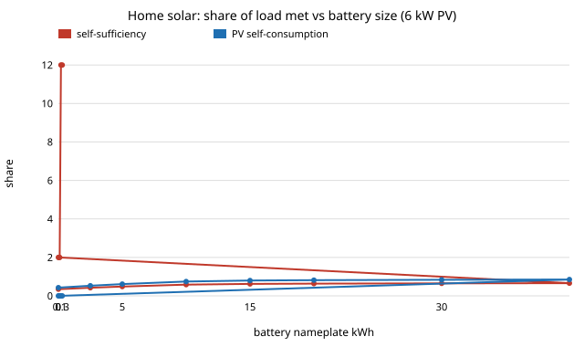

# energy-home: how big should a home's solar array and battery be, and at what price does the battery pay?

Fourth project of track 16 (`PROJECTS.md`, milestone 7, first version: synthetic weather and an invented load, no measured data). A home with rooftop solar sells the surplus at midday and buys back at night. A battery moves midday surplus to the evening, but costs money and loses 10% each trip. This project simulates one year hour by hour for 20 seeded weather years and asks the sizing question a homeowner has: how much of the home's electricity do solar and a battery cover, which size is cheapest, and below what installed battery price does storage beat simply exporting. Produced with AI assistance (Claude).

**Live page:** https://duncan-haywood.github.io/monorepo-projects/research/energy-home/

**Headline (modelled, assumed inputs and synthetic weather).** On an 8,000 kWh/yr home at 40&deg;N, a 6 kW array alone meets **35%** of the load and exports 58% of its output. Adding battery lifts that to **49%, 59% and 62% at 5, 10 and 15 kWh**, then barely moves: the 30th to 40th kWh avoid under 10 kWh of imports a year each. At an export price of $0.05/kWh against $0.30 import, a 10 kWh battery pays only if it costs under **$451/kWh installed** (assumed price $800); at $0.20 export the break-even falls to $143, and with export paid at the import price (net metering) the battery loses money, because of its round-trip loss. The cheapest sizing at low export prices is a small array (2 kW) with no battery. This says where the battery's value comes from (the gap between import and export prices), not that any particular home should buy or skip one.

**Builds on.** Standard solar geometry (Haurwitz 1945 clear-sky model) and the usual self-consumption accounting of residential PV studies; no single paper. It follows from the sizing questions of [`energy-lcos`](../energy-lcos) (storage cost per kWh) and [`energy-thermal`](../energy-thermal). It builds on none of the CU Boulder groups in `prompt.md` and claims no connection to them.



## Method (`src/energy_home/model.py`)
- **Weather (synthetic).** Haurwitz clear-sky horizontal irradiance at 40&deg;N for each hour of 365 days, multiplied by a day type from a seeded three-state Markov chain (clear 1.0, partly cloudy 0.55, overcast 0.2; persistence in `SKY_CHAIN`). These are *not* measured data: the annual PV yield they imply, about 1,090 kWh per kW, is lower than many real sites.
- **PV.** Output = rating &times; irradiance/1000 &times; 0.80 (one lumped performance ratio for tilt, temperature, soiling and inverter).
- **Load.** Invented hourly shape with morning and evening peaks, winter +15% and summer &minus;15%, 10% hourly noise, scaled to exactly 8,000 kWh/yr.
- **Dispatch.** Greedy self-consumption in 1-hour steps: PV serves load first, surplus charges the battery, the battery covers the remaining need, the rest is exported or imported. Battery: 90% usable, 90% round trip (split equally over charge and discharge), charge and discharge power limited to C/2.
- **Cost.** Annualised: capital &times; capital-recovery factor (6%; PV 25 years, battery 15) + imports &times; import price &minus; exports &times; export price. Not included: inverter replacement, degradation, maintenance, taxes, incentives, fixed charges, time-of-use prices, demand charges.
- **Break-even battery price.** Annual bill saving of the battery divided by its capital-recovery factor.

### Checks (`tests/`)
Load is scaled to exactly 8,000 kWh; no sun at midnight, plausible noon peaks, winter below summer; weather is seeded; supply equals demand, PV equals use + charge + export, and battery in/out balances including loss; no PV and no battery means all import; more battery never lowers self-sufficiency and returns diminish; more PV lowers self-consumption; net metering makes the battery's value negative; capital-recovery and cost arithmetic.

### Inputs (all assumed; none checked against a primary source in this run)
| Input | Value |
|---|---|
| Load | 8,000 kWh/yr, invented shape |
| Latitude, cloud chain | 40&deg;N, three day types as above |
| PV | perf ratio 0.80, $2,800/kW installed, 25 years |
| Battery | 90% usable, 90% round trip, C/2, $800/kWh installed, 15 years |
| Tariff | import $0.30/kWh; export $0.00 to $0.30 swept |
| Finance | 6% discount rate |

## Reproduce
```bash
pip install pytest
cd research/energy-home
python -m pytest -q tests                               # 10 tests
PYTHONPATH=src python experiments/run.py                # about 1 minute; writes experiments/results.txt
python experiments/figure.py                            # experiments/battery.svg from results.txt
```
Standard library only.

## Results (from `experiments/results.txt`; deterministic, mean of 20 weather seeds)
- **A. PV only.** Self-sufficiency 13%, 22%, 27%, 31%, 35%, 37%, 39%, 40% at 1, 2, 3, 4, 6, 8, 10, 12 kW; self-consumption falls from 98% to 25%. A bigger array mostly adds midday exports.
- **B. Battery at 6 kW PV.** Self-sufficiency 35%, 42%, 49%, 59%, 62%, 64%, 65%, 66% at 0, 2.5, 5, 10, 15, 20, 30, 40 kWh. Imports avoided per extra nameplate kWh a year: 237, 203, 159, 62, 19, 12, 8 across those steps.
- **C. Cheapest sizing** (grid search, 0 to 12 kW and 0 to 30 kWh). Export $0.00, $0.05, $0.10: 2 kW and no battery (saving $92, $113, $134 a year against grid only, on a $2,400 bill). Export $0.20: 12 kW (the top of the grid), no battery. Export $0.30: 12 kW (top of the grid again): export is paid at import price, so a larger array simply earns more. No cell in the search chose a battery at the assumed $800/kWh.
- **D. Break-even battery price** (10 kWh, 6 kW PV): $553, $451, $348, $143 and &minus;$61 per kWh at export $0.00, $0.05, $0.10, $0.20, $0.30. All below the assumed $800.
- **E. Weather spread** (6 kW, 10 kWh): self-sufficiency 56% to 62% across the 20 years (mean 59%); annual PV output 6,090 to 7,200 kWh.

## Limitations
- **Synthetic weather and load.** No measured irradiance, temperature or household data; the cloud chain is invented and the implied yield is low. Self-sufficiency percentages are for this synthetic home and should not be read as predictions for a real one. Measured hourly data (for example NREL's public TMY files) is the first thing to swap in.
- **Winner at the edge.** Two of five export prices pick 12 kW, the top of the PV grid, so those rows are bounds, not optima.
- **Stylised economics.** One flat tariff, no time-of-use or demand charges, no incentives, no degradation, no inverter replacement. Time-of-use pricing would raise the battery's value and could move the break-even above $800; that is untested here.
- **Greedy dispatch.** No forecast, no grid charging, no backup-power value (resilience is a reason people buy batteries that this model does not price).
- **Simulated is not tested.** Home batteries are a fire hazard and a grid connection needs a licensed electrician and the utility's approval. Nothing here is installation advice; no safety analysis was done.

## Next steps
1. Replace the synthetic year with measured hourly irradiance and a measured household load, and report the range over several sites.
2. Add time-of-use import prices and see whether the break-even rises above $800.
3. Replace the grid search with a sizing tool people can run on their own bill (a candidate for `ventures/`), and use `energy-lcos` prices once sourced.

## Outside dependencies
None. The project is pure Python with the standard library, and every input is in the source or the table above. No weather or price database was used.
