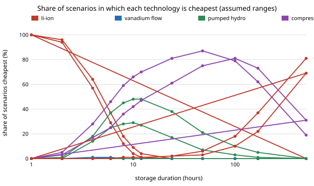

# energy-lcos-mc: how robust is "the cheapest storage technology at each duration" to uncertain costs?

Fifth project of track 16 (`PROJECTS.md`), a follow-up to `energy-lcos`, whose winner map used one point value per input. Real costs are ranges, so this project draws the inputs from assumed ranges 4,000 times and counts how often each technology is cheapest at each duration, from 1 hour to 500 hours. It ranks the uncertain inputs by how much they move cost, and says where a point estimate hides a coin toss. It asks a new question of the model rather than a micro-variant of the last result. Produced with AI assistance (Claude).

**Live page:** https://duncan-haywood.github.io/oss-monorepo/research/energy-lcos-mc/

**Headline (modelled; every range assumed, none sourced).** With all technology inputs, the discount rate (3 to 10%) and the charging price ($10 to $100/MWh) varied, lithium-ion is cheapest in **96%** of scenarios at 2 hours but only **64%** at 4 hours and **18%** at 8 hours. Between 6 and 12 hours **no technology wins more than 48%** of scenarios, so the base case's single winner (cavern compressed air) is not a robust call there. Above 24 hours a cavern store is cheapest in most scenarios (compressed air 61% at 24 h and 81% at 100 h), and at 500 hours hydrogen wins 69%. Charging price is the largest swing in cost for every technology tested at its home duration.



**Builds on.** `energy-lcos` (imported unchanged) and the levelised-cost method behind it. It does not reproduce a published uncertainty analysis. No group in `prompt.md` covers energy storage, and none is claimed.

## Method (`src/energy_lcos_mc/mc.py`)
- Each scenario multiplies every technology's energy cost, power cost and round-trip efficiency by a factor drawn uniformly from an **assumed** range (table in `RANGES`; factory-made Li-ion and flow batteries get narrower cost ranges than site-driven pumped hydro, caverns and hydrogen), and draws one discount rate (3 to 10%) and one charging price ($10 to $100/MWh) shared by all technologies.
- Life, fade, cycle life and O&M stay at the `energy-lcos` base values. The ranges are independent between inputs and technologies.
- For each duration the cheapest technology by `energy-lcos`'s LCOS is counted. Seed 20261020, 4,000 scenarios.
- Section B repeats with the rate and charging price held at 7% and $30/MWh, to show how much of the spread is the shared economic assumptions.
- Section D moves one input at a time to each end of its range for the base winner at four durations.

## Reproduce
```bash
cd research/energy-lcos-mc
python -m pytest -q tests          # 6 tests, uses ../energy-lcos/src
python experiments/run.py          # about 5 s; writes experiments/results.txt
python experiments/figure.py       # experiments/winshare.svg
```
Standard library only.

## Results (`experiments/results.txt`; deterministic)
- **A. Share of scenarios cheapest (%).** Li-ion: 100 at 1 h, 96 at 2 h, 64 at 4 h, 37 at 6 h, 18 at 8 h, 4 at 12 h, 0 from 24 h. Pumped hydro peaks at 48% (10 and 12 h). Compressed air: 36 at 8 h, 61 at 24 h, 75 at 48 h, 81 at 100 h, 73 at 168 h, 31 at 500 h. Hydrogen: 10 at 100 h, 22 at 168 h, 69 at 500 h. Vanadium flow is never above 1%.
- **B. Technology inputs only (rate 7%, charging $30).** Compressed air is cheapest in 59% of scenarios at 8 h and 81% at 24 h, against 36% and 61% in A: letting the rate and charging price vary lowers compressed air's share at 8 to 24 h by about 20 points (it was not separated from the effect of other draws). Hydrogen wins 81% at 500 h.
- **C. Uncertain durations.** No technology has more than 50% of scenarios at 6, 8, 10 and 12 h, and none has more than 80% at 4, 6, 8, 10, 12, 24, 48, 168 and 500 h.
- **D. One at a time.** Charging price moves cost most for all four technologies tested: Li-ion at 4 h $93 to $198/MWh (energy cost next, $83 to $149), pumped hydro at 8 h $83 to $199, cavern compressed air at 24 h $72 to $236, hydrogen at 500 h $183 to $440. Round-trip efficiency has the smallest swing for all four (hydrogen $255 to $220, cavern compressed air $115 to $101).

## Limitations
- **The ranges are assumed.** They are plausible-looking multipliers, not fitted to a cost database, so the shares say how sensitive the *model* is, not how likely any real technology is to win. Wider or narrower ranges move every share.
- **Uniform and independent draws.** Real costs correlate (a cheap electrolyser and a cheap fuel cell go together; a high discount rate hits every capital-heavy option). The effect of correlation on the shares was not tested.
- **Everything else in `energy-lcos` still applies:** a fixed 2,000 discharge-hours a year, no siting limit for caverns or reservoirs, no augmentation, no thermal storage, a constant charging price.
- **Only the cheapest technology is counted,** not how close second place is. A 2% win and a 40% win can sit within a few dollars per MWh.
- Batteries, hydrogen and pressure vessels are hazards; no safety analysis was done. These are cost models, not projects.

## Next steps
1. Replace the assumed ranges with sourced, dated ranges (NREL ATB, published capital-cost surveys) and rerun.
2. Add correlation between inputs, and report the cost gap to second place.
3. Feed the charging price from `energy-mix` instead of drawing it independently.

## Outside dependencies
None to run: standard library plus `energy-lcos`. The cost ranges are assumed, not retrieved from any database.
