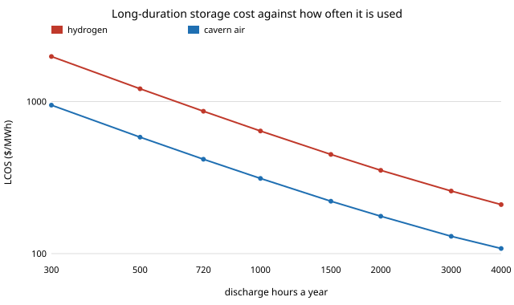

# energy-lcos-realised: how hard does a least-cost zero-emission grid actually cycle its storage, and does the levelised-cost map survive that?

The `energy-lcos` family assumes every store discharges 2,000 hours a year and buys power at $10 to 100/MWh. This project replaces that assumption with what the optimiser in [`energy-mix-sourced`](../energy-mix-sourced) (one-node PyPSA, Germany 2019, sourced 2030 costs) actually does, then re-prices storage at that use. Produced with AI assistance (Claude). **Modelled; one weather year, no grid; cycle life and fade are still the unsourced `energy-lcos` values.**

**Live page:** https://duncan-haywood.github.io/oss-monorepo/research/energy-lcos-realised/

**Headline (all from `experiments/results.txt`).**
- **Batteries are used about as the assumption says; long-duration hydrogen is not.** In the cut-80%, cut-90% and zero-emission systems the Li-ion store is 10 to 14 h long, cycles 122 to 180 times a year and discharges 1,717 to 1,865 h a year (assumed: 2,000), at a volume-weighted charging price of EUR 31 to 38/MWh. That raises its LCOS only 9 to 19% (zero-emission, 14 h: $197 assumed, $231 realised/MWh).
- **The cavern hydrogen store runs 719 h a year** (2.6 cycles, 280 h long, 89 GW of fuel cells), so its own LCOS is **$864/MWh against $383 at the assumed 2,000 h**, a factor of 2.25. Charging is cheap (EUR 18/MWh) but cannot offset that low use. LCOS falls roughly tenfold from 300 to 4,000 h a year (section D), so rare use, not capital cost, is what makes seasonal storage dear.
- **With a tank instead of a cavern the effect is extreme** (section A only): hydrogen runs 103 h a year and the batteries 781 h at EUR 170/MWh charging, because the optimiser holds them as scarcity insurance.
- The assumed map's ordering is unchanged: at every store's duration the sourced LCOS ranks the same technologies cheapest under assumed and realised use (section C), with cavern air first. Cavern air is not in the mix model, so its LCOS is shown at the *hydrogen store's* use, an illustration of ranking, not a prediction of how air would be dispatched.



**Builds on.** [`energy-mix-sourced`](../energy-mix-sourced) (model, imported unchanged), [`energy-lcos-sourced`](../energy-lcos-sourced) (costs, imported unchanged) and [`energy-lcos`](../energy-lcos). No group in `prompt.md` covers energy storage; none is claimed.

## Method
1. `experiments/run.py` solves `energy-mix-sourced` (technology-data head, 2030, 8,760 h, 7% rate) at emission caps 100, 50, 20, 10, 5 and 0% of the gas-only level, for cavern and tank hydrogen storage: 12 LPs.
2. `src/energy_lcos_realised/realised.py` reads each store off the dispatch. *Cycles* = energy leaving the store / store size. *Discharge hours* = energy leaving the store / discharge power. *Duration* = store size / discharge power. *Charge price* = charging-energy-weighted shadow price of the electricity bus (EUR/MWh).
3. `experiments/analyze.py` feeds duration, discharge hours and charge price (converted at the ECB 2025 rate, 1.12998 USD/EUR, as in `energy-lcos-sourced`) into `lcos_at`.

## Reproduce
```bash
cd research/energy-lcos-realised
python -m pytest -q tests            # 4 tests; one solves a 3-week LP
python experiments/run.py 4          # 12 LPs, about 10 to 25 min on 4 cores; writes results.json
python experiments/analyze.py        # writes results.txt
python experiments/figure.py         # hours.svg
```
Needs `pypsa`, `highspy`, `pandas`, `numpy`.

## Limitations
- One weather year and one node: the real use of storage depends on the year (the hydrogen store is set by rare long lulls, so its 719 h is a one-year figure) and transmission would change it.
- The optimiser's use is the *system* optimum. An owner who bids into a market faces the price series, not the planner's cost, and may cycle differently.
- Charging price is the shadow price of the bus, which is zero in 56 to 83 hours of the zero-emission year and rises in scarcity hours; at scarcity-priced charging (the tank case's batteries) the LCOS formula's flat charging price is a rough fit.
- The LCOS model's hydrogen row is cavern-priced, so sections B to D report the cavern cases only.
- Section C prices every technology at one store's use. It tells the ranking, not what a dispatched fleet of mixed technologies would do.
- Cycle life, fade and the discount-rate range remain the `energy-lcos` assumptions; Li-ion life is capped by cycles, which at 120 to 180 a year does not bind.
- Costs are estimates, not quotes; batteries and hydrogen are hazards and no safety analysis was done. Not a grid design or decarbonisation recommendation.

## Next steps
Several weather years for the use figures; add pumped hydro and cavern air to the PyPSA model so their dispatch is realised too; price charging with the market series instead of the planner's shadow price; source cycle life and fade.

## Outside dependencies
Solver HiGHS (open). Costs from PyPSA technology-data via the sibling projects.
