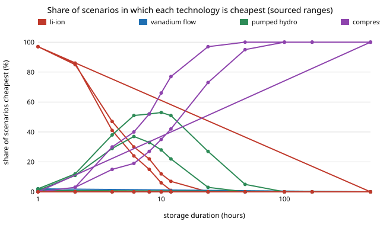

# energy-lcos-sourced: which storage technology is cheapest at each duration once the costs are sourced, not assumed?

Re-run of `energy-lcos` and `energy-lcos-mc` (track 16) with every cost, efficiency, lifetime and fixed-O&M figure read from PyPSA technology-data (Danish Energy Agency; Viswanathan et al. 2022, PNNL-33283) and NREL's Annual Technology Baseline 2024, as the owner asked on 2026-10-21 ("run the numbers"; `research/CLAUDE.md`). The earlier two projects used round numbers I chose and ranges I made up. Produced with AI assistance (Claude).

**Live page:** https://duncan-haywood.github.io/monorepo-projects/research/energy-lcos-sourced/

**Headline (modelled; costs sourced; cycle life, fade, charging price and discount rate not sourced, see Limitations).** With sourced 2030 costs, lithium-ion is the cheapest way to deliver stored energy for 1 to 4 hours ($121/MWh at 4 h), adiabatic compressed air in a cavern from 6 hours up, and the assumed map's hydrogen win at 500 hours disappears (cavern air $258/MWh against hydrogen $425). The point-estimate winners match the assumed map at every duration but 500 h, so the earlier map's *order* survives, but its margins do not: pumped hydro, which the assumed map priced at $30/kWh plus $1,500/kW, costs $81/kWh plus $1,985/kW here. Over the sourced cost spread (NREL ATB scenarios, pumped-hydro site classes, technology-data cost years 2020 to 2050) the 6 to 12 hour range is a three-way contest: at 8 h pumped hydro wins 52% of scenarios, lithium-ion 22% and compressed air 27%. Above 48 hours cavern air wins at least 95%. Cavern air's single sourced value is also its weak point: it loses the 8 hour slot if its cost is 1.33 times the table's, and the 24 hour slot at 2.2 times.



**Builds on.** [`energy-lcos`](../energy-lcos) (model, imported unchanged), [`energy-lcos-mc`](../energy-lcos-mc) (the Monte Carlo design, here with sourced bounds) and [`energy-mix-sourced`](../energy-mix-sourced) (same technology-data tables, same pinned commit). No group in `prompt.md` covers energy storage, and none is claimed.

## Parameters (`data/techdata.csv`, `data/atb.csv`; fetched by `data/fetch_params.py`)
| Input | Source | Used as |
|---|---|---|
| Li-ion | technology-data `battery storage` (EUR 190/kWh) and `battery inverter` (EUR 214/kW, 96% one way), Danish Energy Agency; cost years 2020, 2030, 2050 | base 2030; range 2020 to 2050 |
| Li-ion spread | NREL ATB 2024 v4.0.0 `Utility-Scale Battery Storage`, overnight capital cost at 2, 4, 6, 8, 10 h, Advanced / Moderate / Conservative, 2024 and 2030 | linear fit p + e&middot;h per scenario; widens the range |
| Vanadium flow | `Vanadium-Redox-Flow-bicharger` and `-store`, Viswanathan 2022 (EUR 162/kW, EUR 324/kWh, 12 y, efficiency 0.806 one way) | base 2030; 2020 to 2050 |
| Pumped hydro | `Pumped-Storage-Hydro-bicharger` and `-store`, Viswanathan 2022 (EUR 1,757/kW, EUR 71.8/kWh, 60 y, 0.894 one way) | base |
| Pumped hydro spread | ATB 2024 `Pumped Storage Hydropower` overnight cost by site class, Moderate 2030: $1,730 to $4,501/kW, 0.44 to 1.15 times the median class | multiplies both blocks |
| Compressed air | `Compressed-Air-Adiabatic-bicharger` and `-store`, Viswanathan 2022 (EUR 1,190/kW, EUR 6.85/kWh, 60 y, 0.721 one way) | base; **one value for every year, no spread** |
| Hydrogen | `electrolysis` (EUR 1,886/kW, 0.622) and `fuel cell` (EUR 1,469/kW, 0.50), DEA; `hydrogen storage underground` (EUR 2.67/kWh of H<sub>2</sub>), DEA | base; 2020 to 2050 |
| EUR to USD | ECB reference rate, 2025 annual average, 1.12998 | all technology-data costs; ATB is already USD (2022 dollars, not inflated) |

Round-trip efficiency is the table's one-way efficiency squared (0.8944<sup>2</sup> = 0.80 for pumped hydro, 0.50 &times; 0.622 for hydrogen). Each block's life is the capital-weighted mean of its blocks' lives at the duration being priced; fixed O&M is the sum of each block's fraction times its cost. The technology-data files are GPL-3.0 code with per-row sources, ATB is CC BY 4.0: only the ~900 rows used are committed, with attribution. Pinned: technology-data commit `65244b4c`, ATB `2024/v4.0.0`.

## Reproduce
```bash
cd research/energy-lcos-sourced
python -m pytest -q tests            # 9 tests, uses ../energy-lcos/src
python experiments/run.py            # about 10 s; writes experiments/results.txt
python experiments/figure.py         # experiments/winshare.svg
python data/fetch_params.py          # optional: re-download the sources (network, 100 MB)
```
Standard library only.

## Results (`experiments/results.txt`; deterministic, seed 20261021, 4,000 scenarios)
- **A. Point estimates.** Li-ion wins 1 to 4 h; cavern air 6 to 500 h. Against the assumed map only 500 h changes (it was hydrogen). Cost at 8 h in $/MWh: cavern air 114, Li-ion 133, pumped hydro 143, flow 253, hydrogen 364.
- **B. Sourced spread** (multiples of the 2030 value): Li-ion power 0.38 to 1.69 and energy 0.53 to 1.90; pumped hydro both blocks 0.44 to 1.15; hydrogen power 0.69 to 1.27, energy 0.60 to 1.50; flow up to 1.23; cavern air none.
- **C. Win shares, spread plus rate 3 to 10% plus charging $10 to 100/MWh.** Li-ion 97% at 1 h, 85% at 2 h, 47% at 4 h, 12% at 10 h. Pumped hydro peaks at 53% (10 h). Cavern air 73% at 24 h, 95% at 48 h, 100% from 100 h. Flow and hydrogen never win a scenario in this run.
- **D. Spread only (7%, $30).** Cavern air is cheapest in 52% at 8 h and 77% at 12 h, against 27% and 42% when the rate and charging price vary too.
- **E. Cost year.** At 2020 costs cavern air already wins at 2 h; at 2050 costs Li-ion wins up to 12 h.
- **F. Cavern air break-even.** The single table value would have to be 1.33 times higher at 8 h, 1.69 at 12 h, 2.19 at 24 h, 3.61 at 100 h and 1.83 at 500 h (where hydrogen is second) for it to lose the point-estimate win.
- **G. Unsourced Li-ion inputs.** Halving cycle life raises 4 h cost from $121 to $164/MWh, and 3% a year fade raises 8 h cost from $133 to $150. Neither changes the 8 h winner (cavern air, $114).
- **H. Cross-check.** The technology-data Li-ion cost at 2, 4 and 8 h ($671, $1,100, $1,958/kW) lies between ATB's Advanced and Moderate 2030 figures ($581 to $809, $978 to $1,300, $1,772 to $2,283/kW).

## Limitations
- **Cavern compressed air has one sourced estimate** (Viswanathan 2022's adiabatic design) and no spread, so the shares overstate its robustness; F gives the multiple at which it loses. It is also site-limited: caverns need suitable geology, and the model has no siting limit.
- **Not sourced here:** cycle life and annual fade (still the `energy-lcos` values; G sweeps Li-ion's), the 2,000 discharge-hours-a-year budget, the 3 to 10% discount rate and the $10 to 100/MWh charging price (scenario sweeps, not uncertainty bands), and the vanadium flow and hydrogen fixed-O&M beyond the table.
- **The spread is not a probability distribution.** It is the lowest and highest estimate of each cost found in two sources, drawn uniformly and independently, so shares say how robust the winner is to the range of published figures, not how likely a technology is to win. Costs are not correlated and the ATB (2022 dollars) and technology-data (2025 euros, converted at one rate) are not inflation-aligned.
- ATB's pumped-storage site classes include "ONR" variants whose meaning I did not look up; I used all classes. ATB does not state the duration of its pumped-storage plant in the extracted rows, so only the class *ratios* are used.
- Cost estimates, not quotes. Batteries, hydrogen and caverns are hazards; no safety analysis was done.

## Next steps
Add a second sourced estimate for cavern air and hydrogen (for example Lazard's LCOS or the DOE Long-Duration Storage Shot cost targets) to give them a spread; source cycle life and fade from the same reports; correlate the draws; feed the charging price from `energy-mix-sourced`.
