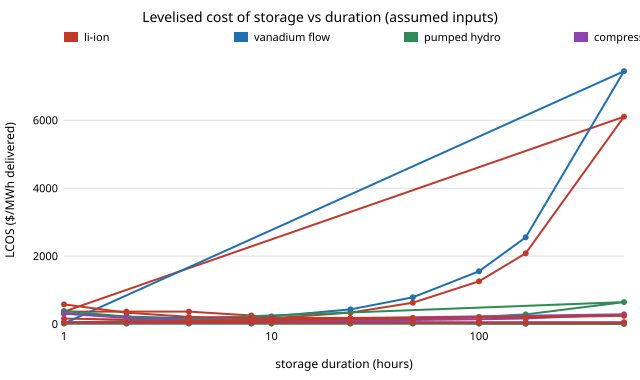

# energy-lcos: which energy-storage technology is cheapest per MWh delivered, at 1 hour, 1 day and 3 weeks of storage?

Third project of track 16 (`PROJECTS.md`, milestone 4, first version). Storage that is cheap per kWh of capacity is not cheap to deliver from: a battery's cost grows in step with its duration, while a salt cavern's barely does, but the cavern store needs expensive power equipment and loses more energy. This project computes the levelised cost of storage (LCOS, $ per MWh delivered over the system's life) for five technologies from capital cost, efficiency, life, fade and charging power cost, and asks where the cheapest option changes as duration runs from 1 hour to 500 hours. Produced with AI assistance (Claude).

**Live page:** https://duncan-haywood.github.io/oss-monorepo/research/energy-lcos/

**Headline (modelled; every input assumed, none checked against a primary source in this run).** With round typical costs, lithium-ion is cheapest up to about **4 hours** ($116/MWh at 4 h) and cavern compressed air or pumped hydro take over from **4 to 5 hours**; cavern hydrogen is cheaper than lithium-ion above **11 hours** but only beats cavern compressed air above **308 hours** (about 13 days; $240 against $287/MWh at 500 h). At 24 hours lithium-ion costs about **3 times** a cavern store ($337 vs $109/MWh) and at a week about 13 times. Which technology is cheapest at 8 to 10 hours moves with the discount rate and the price of charging power, so only the long-duration conclusion (storage energy cost beats power cost) is robust to the assumptions swept here. For lithium-ion to win at 24 hours its installed energy cost would need to fall from $200 to **$43/kWh**.

**Builds on.** The levelised-cost method used across the storage literature, and the question posed by Ziegler et al. (2019), *Joule*, on the cost long-duration storage must reach. It does not reproduce their numbers. Prices are round assumptions, not NREL Annual Technology Baseline values. It builds on none of the CU Boulder groups in `prompt.md` and claims no connection to them.



## Method (`src/energy_lcos/model.py`)
For a store of discharge power *P* and duration *D*:
- **Capital** = power cost ($/kW) + energy cost ($/kWh) &times; *D*, per kW of discharge power.
- **Use.** A fixed budget of 2,000 discharge-hours a year, at most one full cycle a day: cycles a year = min(365, 2000/*D*). Assumed.
- **Life** = min(calendar life, cycle life / cycles a year); the last year is pro-rated.
- **Energy delivered** each year = cycles &times; *D* &times; (1 &minus; fade &times; (year &minus; 0.5)); no augmentation.
- **Costs** each year: fixed O&M plus charging power at $30/MWh divided by round-trip efficiency. Everything discounted at 7%.
- **LCOS** = present value of cost / present value of MWh delivered.

### Checks (`tests/`)
With no discount, fade, O&M or charging cost, LCOS equals capital over lifetime energy exactly; charging cost scales as 1/efficiency; fade and discount rate raise cost; a part-year life is pro-rated; cycle life limits life; winners at 1 h and 500 h; the crossover search.

### Inputs (all assumed round typical utility-scale values; none was checked against a primary source in this run)
| Technology | Energy $/kWh | Power $/kW | Round trip | Life, y | Cycle life | Fade /y | O&M $/kW-y |
|---|---|---|---|---|---|---|---|
| Li-ion (LFP) | 200 | 100 | 0.85 | 15 | 6,000 | 1.5% | 8 |
| Vanadium flow | 300 | 600 | 0.70 | 20 | 15,000 | 0.5% | 10 |
| Pumped hydro | 30 | 1,500 | 0.78 | 50 | 50,000 | 0 | 15 |
| Compressed air (cavern) | 10 | 1,000 | 0.55 | 40 | 20,000 | 0 | 15 |
| Hydrogen (cavern) | 3 | 1,800 | 0.35 | 25 | 10,000 | 0 | 25 |

Hydrogen's power cost covers electrolyser and fuel cell or turbine per kW of discharge.

## Reproduce
```bash
pip install pytest
cd research/energy-lcos
python -m pytest -q tests                              # 9 tests
PYTHONPATH=src python experiments/run.py               # under a second; writes experiments/results.txt
python experiments/figure.py                           # experiments/lcos.svg from results.txt
```
Standard library only.

## Results (from `experiments/results.txt`; deterministic)
- **A. LCOS ($/MWh).** At 1 h: Li-ion 159, flow 314, pumped hydro 383, compressed air 303, hydrogen 578. At 4 h: 116, 171, 129, 118, 209. At 24 h: 337, 431, 126, 109, 179. At 168 h: 2,081, 2,553, 283, 163, 197. At 500 h: 6,104, 7,445, 644, 287, 240.
- **B. Life.** Calendar life, not cycle life, sets the life of every technology at every duration in this model: even daily cycling stays under each cycle limit.
- **C. Crossovers.** Li-ion to pumped hydro 4.9 h, to cavern compressed air 4.2 h, to cavern hydrogen 10.8 h; compressed air to hydrogen 308 h.
- **D. Sensitivity.** Winners at 2, 4, 8, 24, 100 and 500 h. Base: Li-ion, Li-ion, compressed air, compressed air, compressed air, hydrogen. At a 3% discount rate pumped hydro wins at 4 and 8 h (capital-heavy storage gains most from cheap money); at charging power $100/MWh pumped hydro wins at 8 and 24 h and compressed air at 100 and 500 h (hydrogen's low efficiency costs it); with 500 discharge-hours a year, lightly used stores still go the same way at 8 h and above. Li-ion wins at 2 h in every case.
- **E. What Li-ion would need.** To tie the best alternative its energy cost would have to be 207, 117, 95, 43 and 25 $/kWh at 4, 8, 10, 24 and 48 h.

## Limitations
- **Every number is assumed.** Capital costs, efficiencies and lives are round values from memory of the general range of published estimates, with no source checked and no date. The conclusions are about the structure of the cost (energy-cost-dominated against power-cost-dominated), not about any real project's price. The first next step is a dated, sourced dataset (`PROJECTS.md` milestone 2).
- **Caverns and reservoirs need geology.** Compressed-air and hydrogen cavern costs apply only where a suitable salt formation exists, and pumped hydro needs a site; the model gives no siting limit, so their wins are upper bounds on how much of the grid they can serve.
- **A fixed use pattern.** 2,000 discharge-hours a year at every duration is an assumption; real long-duration stores run when prices or weather call, not on a schedule, and their value includes more than energy shifted.
- **No augmentation, no residual value, no tax, no degradation of efficiency, constant charging price.** Charging price in practice depends on when the store charges. Hydrogen is modelled as a single block with one efficiency.
- **Excluded technologies.** Thermal storage, iron-air, sodium-ion and others are not in the set.
- **Simulated is not built.** These are cost models, not projects. Pressure vessels, hydrogen and batteries are hazards; no safety analysis was done.

## Next steps
1. Replace each assumed input with a sourced, dated figure (milestone 2) and report the range, not a point value.
2. Make the price of charging power depend on when the store charges, using the supply-mix model of milestone 5.
3. Add thermal storage (building on `energy-thermal`) and a siting limit for caverns.

## Outside dependencies
Nothing the project could not run itself: standard library only. All prices are assumed inputs, not retrieved from any database.
