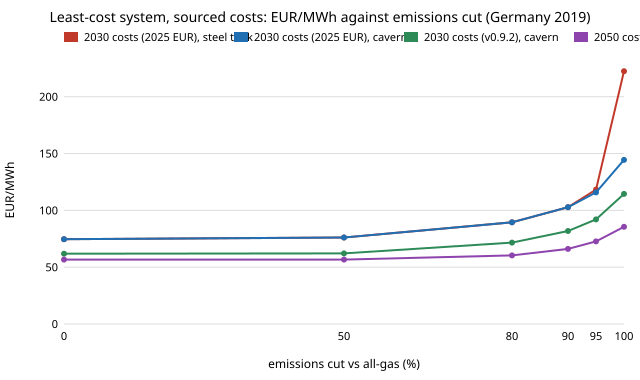

# energy-mix-sourced: how much of the cost of a zero-emission German power system is the storage assumption, once costs are sourced rather than assumed?

Re-run of `energy-mix` (track 16, milestone 5) with every cost, lifetime, fixed O&M, efficiency, fuel price and CO<sub>2</sub> intensity read from the PyPSA technology-data tables instead of round numbers I chose, as the owner asked on 2026-10-21 ("run the numbers"; `research/CLAUDE.md`). Same one-node PyPSA model of Germany's 2019 hourly load, solar, onshore wind, gas turbine, Li-ion and hydrogen storage under an emissions cap. Produced with AI assistance (Claude). **Modelled, one weather year, no grid; the only input not from the cost table is the 7% discount rate.**

**Live page:** https://duncan-haywood.github.io/monorepo-projects/research/energy-mix-sourced/



## Headline (all numbers from `experiments/results.txt`, 42 deterministic LPs)
- **Zero emissions costs EUR 222/MWh with a steel hydrogen tank and EUR 144/MWh with underground (cavern) storage** on 2030 costs in 2025 euros, against EUR 75 for the unconstrained least-cost system. The sibling project's assumed-cost figure was $177. Same model, one storage line changed from EUR 60/kWh to EUR 2.7/kWh.
- **Storage type, not the cost year, is the largest swing.** With the tank the model stores only 1.3 TWh of hydrogen and buys 1,440 GWh of batteries; with caverns it stores 24.9 TWh and 501 GWh of batteries. The last 5% of emissions costs about EUR 6,100/t CO<sub>2</sub> with the tank and EUR 1,700/t with caverns (derived: cost difference between the 5% and 0% caps over the emissions avoided, at 0.341 t/MWh<sub>e</sub> = 0.198 t/MWh<sub>th</sub> / 0.58).
- **Cost year matters too.** With caverns, zero emissions is EUR 114.5/MWh on the technology-data v0.9.2 2030 costs (older, 2015 and 2020 euros) and EUR 85.5 on its 2050 costs (batteries EUR 79/kWh, electrolysers EUR 1,000/kW). The 2025-euro 2030 set is dearer than v0.9.2's 2030 set everywhere (see the table), which reflects at least in part the later currency year (2025 against 2010 to 2020 euros); I did not separate that from real cost changes.
- **Without batteries** zero emissions costs EUR 254 (tank) or 162 (cavern); **without hydrogen** EUR 223 (so the tank is worth about EUR 0 at this cost); with neither storage, EUR 2,008, i.e. not a real option.
- **Discount rate** (the one unsourced input), tank case at zero emissions: 3% gives EUR 152, 7% EUR 222, 10% EUR 282.
- **Against the sibling's assumed costs:** its 80% cut was $113 and 95% was $144; here the tank case gives EUR 89.5 and 118 and the cavern case 89.5 and 116. Costs fall at every cap, and the gap is largest at 100%, where hydrogen storage cost dominates.

## Parameters (`data/params.csv`; extracted by `data/fetch_params.py` at pinned revisions)
| Input | Source row (2030, 2025 EUR) | Value |
|---|---|---|
| Utility solar | technology-data `solar-utility`, Danish Energy Agency | EUR 482/kW, life 40 y, FOM 2.5% |
| Onshore wind | `onwind`, DEA | EUR 1,383/kW, 30 y, FOM 1.2%, VOM EUR 1.8/MWh |
| Gas turbine | `CCGT`, DEA | EUR 1,109/kW, 58% efficient, VOM EUR 5.6/MWh |
| Gas fuel, CO<sub>2</sub> | `gas`, World Bank 2025 commodity prices; stoichiometry | EUR 28.4/MWh<sub>th</sub>, 0.198 t/MWh<sub>th</sub> |
| Battery | `battery storage`, `battery inverter`, DEA | EUR 190/kWh, EUR 214/kW, 96% each way |
| Electrolyser | `electrolysis`, private communications and IEA (as cited in the table) | EUR 1,886/kW<sub>e</sub>, 62% |
| Fuel cell | `fuel cell`, DEA | EUR 1,469/kW<sub>e</sub>, 50% |
| H<sub>2</sub> tank | `hydrogen storage tank type 1 including compressor`, DEA | EUR 60/kWh, 30 y |
| H<sub>2</sub> cavern | `hydrogen storage underground`, DEA | EUR 2.7/kWh, 100 y |

Revisions: `head_2030` is commit `65244b4c` of PyPSA/technology-data (`costs_2030.csv`); `v092_2030` and `v092_2050` are release v0.9.2 (`costs_2030.csv`, `costs_2050.csv`). The complete table, with unit, currency year and primary source per row, is `data/params.csv`. The numbers are facts from those sources; the repository's code is GPL-3.0 and each row keeps its own source, so only the ~100 values used are reproduced here, with attribution, and the file is not vendored. Not from the table: 7% discount rate (PyPSA-Eur default, swept above), 2019 load and capacity factors (Open Power System Data / ENTSO-E, from `energy-mix`).

## Method (`src/energy_mix_sourced/model.py`)
As `energy-mix`: 8,760 hours, one node, annualised capex plus fixed O&M as objective, cyclic storage, perfect foresight, emissions cap as a share of serving all load with gas. Changes: parameters come from the table, battery charge and discharge each pay half the inverter cost at the inverter efficiency, wind and gas carry variable O&M, and hydrogen storage is either the steel tank or the cavern. Costs stay in the euros published; none is inflated.

### Checks (`tests/`, 7 tests, about 15 s)
Every basis has every parameter the model reads; each row is pinned to a revision and a primary source; the annualisation arithmetic; costs fall from the 2030 to the 2050 tables; the cavern is more than ten times cheaper per kWh than the tank; the hourly bus balance and the cap hold on a two-week slice; a tighter cap is never cheaper and a zero cap uses no gas. **Not done: a check against a published whole-system result.** The cavern case (EUR 85 to 144/MWh at zero emissions) is in the range energy-system studies of Germany report, but I did not locate and verify a specific figure to compare with, so this is a plausibility statement, not a validation.

## Reproduce
```bash
pip install pypsa highspy pandas numpy pytest
cd research/energy-mix-sourced
python -m pytest -q tests
python data/fetch_params.py                      # optional; params.csv is committed
python experiments/run.py 4                      # 42 solves; about 45 min on 4 cores
python experiments/figure.py                     # cost.svg from results.txt
```

## Limitations
- **Cavern storage is a geological resource, not a cost line.** The 25 TWh the model buys needs suitable salt formations near load and the electrolysers; the model has no siting, no transport and no limit. Treat the cavern case as a bound.
- Currency years differ between sets (v0.9.2 mixes 2010 to 2020 euros; the commit set is 2025 euros), so compare within a set. Euros are not converted to dollars.
- One weather year, one node, no imports, no offshore wind, no hydro or biomass, no demand flexibility, no firm clean supply; perfect foresight flatters seasonal storage. Capacity factors come from actual generation and so include curtailment.
- Costs are single central values from one compilation; no uncertainty ranges. The tables carry projections, not market prices.
- Simulated, not a decarbonisation recommendation or a grid design.

## Next steps
1. Several weather years, to find the year that sets the hydrogen store.
2. Cap cavern capacity at a published potential and re-solve.
3. Add offshore wind, a firm clean source and a second node.

## Outside dependencies
PyPSA, HiGHS, pandas; PyPSA technology-data (fetched, not vendored); the sibling `energy-mix/data/de2019.csv`.

MIT.
