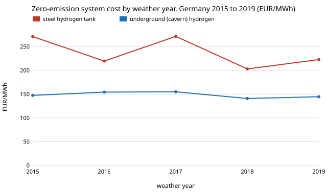

# energy-mix-years: which weather year sets the hydrogen store of a zero-emission German power system, and how much does the cost depend on it?

Follow-up to `energy-mix-sourced` (track 16, milestone 5), its first "next step": that project solved one year (2019). Here the identical model and cost table are re-solved on 2015 to 2019 hourly demand, solar and onshore-wind capacity factors from Open Power System Data / ENTSO-E, to see how much one weather year can mislead. Produced with AI assistance (Claude). **Modelled, one node, no grid, each year solved on its own; the only input not from a source is the 7% discount rate.**

**Live page:** https://duncan-haywood.github.io/oss-monorepo/research/energy-mix-years/



## Headline (all numbers from `experiments/results.txt`, 20 deterministic LPs, 2030 costs in 2025 euros)
- **Zero emissions costs EUR 203 to 271/MWh with a steel hydrogen tank and EUR 141 to 155 with caverns across the five years.** The tank case moves by about EUR 68 between years (2018 cheapest, 2017 and 2015 dearest at 271); the cavern case by about EUR 14. Single-year 2019 gives 222 and 144, so it sat inside both ranges; it reproduces `energy-mix-sourced` to the digit.
- **The year sets the store.** With a tank, hydrogen storage is 1.1 to 5.6 TWh (2015 the largest, 2016 the smallest), with batteries 1.0 to 1.7 TWh. With caverns it is 23.7 TWh (2018) to 35.9 TWh (2016, 2017 close at 35.8), against 24.9 TWh from 2019 alone: a store sized on 2019 would be roughly a third short of 2016's need.
- **At a 95% emissions cut the year barely matters and the tank case buys no hydrogen at all**: EUR 118 to 133 (tank) and 115 to 127 (cavern), 0 TWh of hydrogen with a tank in every year.
- Solar, wind and gas capacities swing widely (e.g. zero-emission solar 228 GW in 2019 against 583 GW in 2016 with a tank), so the cost optimum is flat in the mix; treat capacity splits as unreliable, costs and storage size as the findings.

## Data (`data/prepare.py`)
OPSD time series 2020-10-06 (60-min, ENTSO-E Transparency Platform, CC BY 4.0). Capacity factor = actual generation / installed capacity, gaps interpolated; 29 February 2016 is dropped so every year has 8,760 hours. Annual load 479 to 499 TWh. Capacity factors include curtailment already in the generation data.

## Method (`src/energy_mix_years/model.py`)
Imports `energy_mix_sourced.model` unchanged (same parameters, `head_2030` basis, 7% rate, cyclic storage, perfect foresight, emissions cap as a share of serving all load with gas) and swaps only the hourly input.

### Checks (`tests/`, 4 tests)
Each year has 8,760 hours, in range factors and no gaps; annual demand and mean capacity factors are in the published range; the 2019 file matches `energy-mix`'s; a two-week slice serves load with zero gas at a zero cap. The 2019 re-solve matches the sibling's committed result (EUR 222.5 and 144.4/MWh). **Not done: a comparison with a published multi-year German study.**

## Reproduce
```bash
pip install pypsa highspy pandas numpy pytest
cd research/energy-mix-years
python -m pytest -q tests
python data/prepare.py time_series_60min_singleindex.csv   # optional; the CSVs are committed
python experiments/run.py 4        # 20 solves, about 1 hour on 4 cores
python experiments/figure.py
```

## Limitations
- Five years, each solved separately; one system built for all five at once (the real planning problem) was not solved and would need at least the largest store.
- One node, no imports, offshore wind, hydro, biomass or demand flexibility; cavern storage is not sited or limited (25 to 36 TWh is a bound, not a plan).
- Capacity factors use installed capacity as reported, so a year's factor depends on how capacity grew within it.
- Central cost values only; the 7% discount rate is unsourced.
- Simulated, not a decarbonisation recommendation.

## Next steps
1. Solve all five years jointly with one capacity set.
2. Cap cavern capacity at a published potential.
3. Offshore wind, a firm clean source and a second node.

## Outside dependencies
PyPSA, HiGHS, pandas; OPSD time series (CSV derived, committed); sibling `energy-mix-sourced` code and cost table.

MIT.
