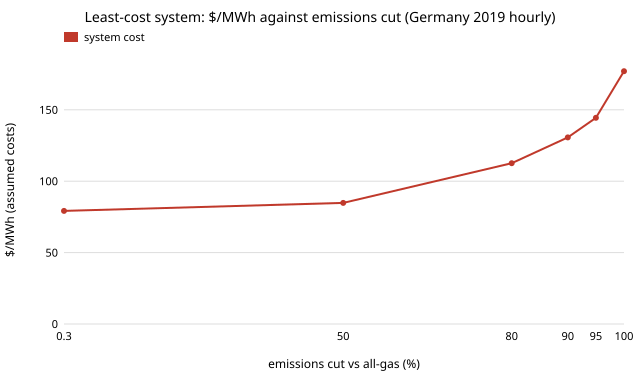

# energy-mix: what is the cheapest mix of solar, wind, gas and storage that cuts a power system's emissions, and what does the last 5% cost?

Fifth project of track 16 (`PROJECTS.md`, milestone 5, first version). A single-node PyPSA model of Germany's 2019 hourly electricity demand, with solar, onshore wind, a gas turbine (the firm supply), a lithium-ion battery and hydrogen storage, all sized together at least annual cost under an emissions cap. Sweeping the cap from none to zero shows how the cost, the mix and the storage change, and sensitivity runs show which storage matters at which cap. Produced with AI assistance (Claude).

**Live page:** https://duncan-haywood.github.io/oss-monorepo/research/energy-mix/

**Headline (modelled; every cost assumed, one weather year, no grid).** With the assumed costs, serving 2019 demand from gas alone costs **$79/MWh**. A 50% emissions cut adds $5.6/MWh (an implied $30/t CO<sub>2</sub>) using wind alone; 80% costs $113/MWh, 90% $131, 95% $144 and 100% **$177/MWh**, built from 155 GW solar, 284 GW wind, 106 GWh battery and **10.6 TWh of hydrogen storage**. The implied cost of abatement climbs from $30/t (to 50%) to $250, $489, $740 and **$1,765/t** for the last 5%. At zero emissions the hydrogen tank's price matters most: $152, $177 and $254/MWh at a quarter, 1&times; and 4&times; the assumed tank cost. Without hydrogen, batteries alone reach zero emissions at $287/MWh with 2.2 TWh of battery; with neither, the model needs 7.6 TW of wind ($2,432/MWh), i.e. it is not a real option. These are properties of the assumed inputs, not a forecast for any grid.

**Builds on.** PyPSA (Brown, H&ouml;rsch and Schlachtberger 2018, *J. Open Research Software*) for the optimisation and HiGHS as the solver; the question of how storage cost and duration shape a wind-and-solar system, posed by Ziegler et al. (2019), *Joule*. Costs follow the style of `energy-lcos`. Hourly demand and wind and solar output are from the Open Power System Data time-series package (ENTSO-E Transparency Platform, CC BY 4.0). It builds on none of the CU Boulder groups in `prompt.md` and claims no connection to them.



## Method (`src/energy_mix/model.py`)
- **One node, one year.** 8,760 hours of 2019 German load (mean 56 GW, peak 76 GW). No transmission, imports or exports, no reserve margin, no ramping limits, perfect foresight of the year.
- **Supply.** Solar and onshore wind with hourly capacity factors; gas turbine with fixed cost and fuel at $35/MWh<sub>th</sub> / 55% (variable $64/MWh); the cap is on gas emissions at 0.37 t/MWh<sub>e</sub>, as a share of serving all load with gas.
- **Storage.** Li-ion: power ($150/kW) and energy ($200/kWh) sized separately, 92% each way. Hydrogen: electrolyser ($600/kW, 70%), tank ($15/kWh), fuel cell ($900/kW, 50%), sized separately. Both cyclic over the year.
- **Cost.** Annualised overnight cost at a 7% rate over each asset's life plus fixed O&M; the objective is total annual cost; reported as $/MWh of load.
- **Capacity factors.** Hour-by-hour ENTSO-E actual generation divided by installed capacity (`data/prepare.py`). Actual output includes curtailment and grid constraints, so the factors are somewhat low, and one year is not a climate.

### Checks (`tests/`)
Data are one valid 2019 year with plausible mean capacity factors; annualisation arithmetic; cost never above the gas-only cost; hourly bus balance and the cap are respected; a tighter cap is never cheaper; a zero cap uses no gas and cheaper storage never costs more. Solves use a two-week slice to run in seconds.

### Inputs (all assumed round numbers, not checked against NREL ATB or similar in this run)
Costs and efficiencies as above; 7% discount rate; lives 15 to 30 years; fixed O&M 0 to 2.5% of capex.

## Reproduce
```bash
pip install pypsa highspy pandas numpy pytest
cd research/energy-mix
python -m pytest -q tests                      # 6 tests, about 20 s
python data/prepare.py time_series_60min_singleindex.csv   # optional; data/de2019.csv is committed
PYTHONPATH=src python experiments/run.py 4      # 4 processes; about 20 min; writes results.json and results.txt
python experiments/figure.py                    # cost.svg from results.txt
```

## Results (from `experiments/results.txt`; deterministic LP)
- **A. Emissions cap.** Cost $79, $85, $113, $131, $144, $177/MWh at caps 100%, 50%, 20%, 10%, 5%, 0% of all-gas emissions. Solar first appears below 50% (92 GW at 20%); wind carries the first half. Hydrogen storage 0, 0, 0.6, 1.6, 3.1, 10.6 TWh; curtailment 0%, 10%, 19%, 21%, 23%, 25%.
- **B. Zero emissions, storage costs.** Hydrogen tank &times;0.25 / &times;4: $152 / $254 (base $177). Battery energy &times;0.25: $163, and the optimum becomes 1.7 TWh of battery with 9.5 TWh of hydrogen; &times;4: $181, battery 2.6 GWh. No hydrogen: $287. No battery: $181 (the battery is worth $4/MWh). Neither: $2,432 (7.6 TW wind, 97% curtailed), meaning no practical solution.
- **C. At a 90% cut (10% cap).** Cheaper batteries displace hydrogen entirely ($119 at &times;0.25 with 1.2 TWh of battery); without hydrogen $138; without a battery $133 (same as base); with neither storage $155. Hydrogen tank &times;4 $138, &times;0.25 $125.
- **D. Abatement cost.** $/t between caps: 30 (100&rarr;50%), 250 (to 20%), 489 (to 10%), 740 (to 5%), 1,765 (to 0%).

## Limitations
- **Assumed costs.** None is sourced and dated, and the answer is dominated by them (see B). A real study must use a cost source with dates, and report ranges.
- **One weather year, one country, one node.** 2019 may not contain the worst multi-week lull; no transmission or imports, which in Europe smooth wind variance; no offshore wind, hydro, biomass or demand flexibility; no sector coupling (heat, transport).
- **Hydrogen is a seasonal fix by construction.** Cyclic storage with perfect foresight is optimistic; the 10.6 TWh result assumes the tank and the year are known in advance.
- **Gas stands in for firm supply.** Nuclear, geothermal or other firm sources would change the last 10%; this project does not compare them.
- **Not a decarbonisation recommendation.** Simulated, not tested; no grid or safety analysis, and designs here are research.

## Next steps
1. Replace assumed costs with sourced, dated ones (NREL ATB, Danish Energy Agency) and report a range.
2. Run several weather years and look for the one that sets the hydrogen tank.
3. Add offshore wind, a second node and transmission, and a firm clean source as the alternative to hydrogen.
4. Feed the cost-per-duration results of `energy-lcos` and the thermal store of `energy-thermal` in.

## Outside dependencies
PyPSA, HiGHS, pandas and the OPSD/ENTSO-E data. Any real cost data, and anything about the grid, is an owner step.
