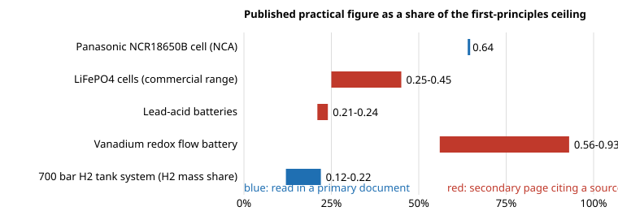

# energy-practical: how close do real batteries, flow cells and hydrogen tanks get to their first-principles ceilings?

Second project of track 16, energy supply and dense energy storage (`PROJECTS.md`, milestone 2). `energy-density` computed what each storage technology could hold at the very most. This project sets published practical figures beside those ceilings, so the gap is a number with a source and a date. It is a small, honest dataset, not a survey: **only figures read during this run are included**, each marked *primary* (read in the data sheet or agency record) or *secondary* (read on a page that cites a source this run did not open). Produced with AI assistance (Claude).

**Live page:** https://duncan-haywood.github.io/monorepo-projects/research/energy-practical/

**Headline.** Practical products hold **a fifth to two thirds of the reactant-mass ceiling** for batteries, and a hydrogen tank system is far further from its ceiling. A Panasonic NCR18650B cell (data sheet) stores 243 Wh/kg, 0.64 of the 380 Wh/kg that graphite/LiCoO<sub>2</sub> reactants could release. Commercial LiFePO<sub>4</sub> cells (95 to 172 Wh/kg) reach 0.25 to 0.45 of 385, and lead-acid batteries (35 to 40 Wh/kg) 0.21 to 0.24 of 170. For hydrogen at 700 bar, the US DOE's 2023 projected status for a 5.6 kg system, 1.71 kWh/kg, means **hydrogen is 5.1% of the system's mass (109 kg total)**, against 23.8% to 41.3% for an ideal carbon-fibre sphere: 0.12 to 0.22 of the ceiling. The mass gap comes mostly from what a ceiling leaves out (inactive mass, packaging, safety margin). Round-trip efficiency, a separate cost of real storage, runs from 50% (compressed air) to 85% (advanced lead-acid) in the PNNL table used here.

**Builds on.** `energy-density` (ceilings) and the sources below. It builds on none of the CU Boulder groups in `prompt.md` and claims no connection to them.



## Method (`src/energy_practical/`)
- `data.py` holds each published figure, its unit, source, and `how` it was read. `model.py` divides it by the matching ceiling from `energy-density`, imported, not retyped.
- The ratio is only taken when both sides share a basis. A cell's Wh/kg is on cell mass; the ceiling is on reactant mass. That mismatch is the point (it is the gap), but it means the ratio mixes inactive mass, voltage loss and incomplete utilisation. **This project does not split the gap into those parts.**
- Hydrogen is compared by mass share, since the DOE counts the lower heating value of H<sub>2</sub> (33.33 kWh/kg, standard value, assumed) and the ceiling counts Gibbs energy.

## Sources (all read 2026-10-20 unless stated)
| Figure | Source | Read as |
|---|---|---|
| NCR18650B: 243 Wh/kg, 676 Wh/L, 3.6 V, 3350 mAh, max 48.5 g | Panasonic/Sanyo data sheet v13.11 R1 (2012); energy density "based on bare cell dimensions" | primary |
| LiFePO<sub>4</sub> 95 to 172 Wh/kg, 227 to 396 Wh/L | Lithium Werks cell data via Wikipedia "Lithium iron phosphate battery" | secondary |
| Lead-acid 35 to 40 Wh/kg, 80 to 90 Wh/L | May, Davidson and Monahov (2018), *J. Energy Storage*, via Wikipedia "Lead-acid battery" | secondary |
| Vanadium flow 15 to 25 Wh/L of electrolyte | Wikipedia (as in `energy-density`), no primary source traced | secondary |
| 700 bar H<sub>2</sub> system 1.71 kWh/kg, 0.86 kWh/L, 5.6 kg usable | US DOE Hydrogen Program Record 24006, 28 April 2025, Table 1 (2023 status; projected from finite-element and cost analysis, not measured) | primary |
| Round-trip efficiency (Li-ion 83, lead-acid 85, flow 75, pumped hydro 81, CAES 50, flywheel 81 %) | PNNL GridPIQ "Energy Storage System Efficiency", citing Manuel (2014), IEC (2011) and Viswanathan et al. (2013); medians of cited ranges | secondary |

## Reproduce
```bash
pip install pytest
cd research/energy-practical
python -m pytest -q tests                                   # 6 tests (needs ../energy-density/src)
PYTHONPATH=src:../energy-density/src python experiments/run.py   # writes experiments/results.txt
python experiments/figure.py                                # experiments/gap.svg
```

## Results (from `experiments/results.txt`)
See the headline and figure. The NCR18650B ratio uses the LiCoO<sub>2</sub> ceiling although the cell is NCA, the closest couple modelled. The flow-battery ratio (0.56 to 0.93) is against the 1.6 mol/L ceiling and the practical range's concentration is unknown, so it is the weakest row.

## Limitations
- Five product families and one hydrogen system, not a survey. Cycle life, volumetric ceilings, pack-level figures, pumped hydro, flywheels and thermal stores are not covered.
- Five of seven data rows are secondary. Wikipedia pages were the route to the sources, so the numbers are only as good as those pages' citations, which this run did not open (the May et al. paper is paywalled).
- Manufacturer data sheets are for reference and carry no warranty; the DOE hydrogen figure is a projection; a data sheet value is not a tested one. Marketing claims (for example CATL's 205 Wh/kg) are not used.
- No safety analysis: batteries and pressure vessels are hazards, and nothing here is a design.

## Next steps
1. Open the primary sources behind the secondary rows (May et al. 2018; Preger et al. 2020 for LFP cycle life) and upgrade or drop them.
2. Add pack-level figures (teardown studies) to split cell-to-pack inactive mass from the cell-level gap.
3. Add volumetric ceilings to `energy-density` so Wh/L can be compared too.
4. Feed cycle life and round-trip efficiency into `energy-lcos`.

## Outside dependencies
None to run (standard library plus `energy-density`). Every number comes from a source above; new data would need documents this run could not open.
