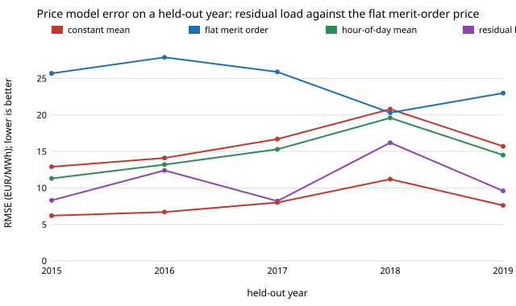

# energy-price-residual: does residual load explain German day-ahead electricity prices out of sample, and how far off was the flat merit-order model?

Track 16 (energy), next step 2 of [`energy-thermal-real`](../energy-thermal-real) ("replace the merit-order model with one that fits the real series ... and test it out of sample"). That project showed the one-fuel merit-order price of [`energy-thermal-hourly`](../energy-thermal-hourly) is a flat EUR 54.6/MWh with today's fleet. Here the price is instead a non-decreasing function of **residual load** (load minus solar minus onshore wind), fitted on some years and scored on one held-out year. Produced with AI assistance (Claude). No CU Boulder group's work is built on; no connection is claimed.

**Live page:** https://duncan-haywood.github.io/monorepo-projects/research/energy-price-residual/



## Headline (hourly German day-ahead prices, 2015 to 2019, EUR/MWh)
All numbers are in `experiments/results.txt` (deterministic, stdlib only).

- **Residual load predicts the price shape well on a year it never saw.** Fitted on 2015 to 2018 and tested on 2019: correlation 0.87, RMSE 9.6, against 14.5 for an hour-of-day mean, 15.7 for the training mean and 23.0 for the flat merit-order price. Leave-one-year-out over all five years: correlation 0.78 to 0.90, and RMSE 8.2 to 16.2 against 11.3 to 19.6 for the best non-residual model (hour of day) in every year.
- **The flat merit-order price is worse than predicting the training mean in 4 of 5 years** (RMSE 20.3 to 27.9 against 12.9 to 20.8; only 2018, when prices ran high, is a tie at 20.3 against 20.8). It has no shape, so it cannot say when electricity is cheap.
- **What matters for a storage buyer is the cheap quarter of hours, and the fit gets it within about EUR 4 to 9/MWh.** Errors of the predicted cheapest-quarter mean against the actual one: +6.9, +9.2, +5.3, -3.7, -5.1 for 2015 to 2019 (actual 16.2 to 22.4). The hour-of-day mean overstates the cheap hours by up to 12; the flat model by 32 to 38. The fit is usable, not precise.
- **Most of the remaining error is the price level, not the shape.** Adding the test year's mean price back (`resid+`, an oracle, not a forecast) cuts RMSE to 6.2 to 11.2 and the 2019 cheap-quarter error to +0.9. Year-to-year level moves with fuel and carbon prices, which residual load does not contain: 2018 (mean 44.4) is the hardest year (RMSE 16.2 against 8.2 to 12.4 elsewhere) and its in-sample fit is also the loosest (10.7 against 5.8 to 7.2).
- **Negative prices are only partly captured.** The step fit predicts a negative level in some hours (44 to 245 a year) but does not match the actual count (66 to 211) hour by hour; with the oracle level the count is 43 to 152. Do not read it as a negative-price forecast.

What this says: for this price series, a one-variable monotone function of residual load beats the flat merit-order price and the calendar baselines, so [`energy-thermal-real`](../energy-thermal-real)'s model-vs-market gap is closed to roughly the size of the fuel-price level. What it does not say: anything about 2020 onward (the 2021 to 2022 gas spike is outside the data), or that residual load causes the price.

## Method
`src/energy_price_residual/model.py`; `experiments/run.py`.
1. **Data (committed, no download):** hourly load and solar and onshore-wind capacity factors from [`energy-mix-years`](../energy-mix-years), hourly day-ahead price and installed capacity from [`energy-thermal-real`](../energy-thermal-real) (Open Power System Data, ENTSO-E Transparency Platform, CC BY 4.0). 8,760 hours a year, 2015 to 2019.
2. **Residual load** = load - capacity factor x installed GW, for solar and onshore wind, with the year's mean installed capacity.
3. **Fit:** isotonic regression (pool adjacent violators, own implementation) of price on residual load over the training years pooled, so price is non-decreasing in residual load and there are no other tuned parameters.
4. **Baselines:** the training mean; the flat EUR 54.6/MWh merit-order price; the training mean by hour of day (UTC).
5. **Scoring on the held-out year:** RMSE, Pearson correlation, the mean of the cheapest quarter of the predicted prices against the actual one, and the count of hours predicted below zero. Two schemes: **A**, chronological (2015 to 2018 -> 2019, no future leakage); **B**, leave one year out (the training set then includes later years, so it tests generalisation across years, not forecasting).
6. **Oracle level (`resid+`):** the fit plus the held-out year's mean price minus the fit's mean, to separate shape from level. It uses information a forecaster would not have.

## Inputs
| Input | Value | Source |
|---|---|---|
| Hourly day-ahead price | Germany 2015 to 2019 | OPSD (2020) / ENTSO-E, CC BY 4.0, via `energy-thermal-real` |
| Hourly load, solar and wind capacity factors | as `energy-mix-years` | OPSD, same package |
| Installed solar, onshore wind | 37.9 to 49.5 GW, 28.4 to 44.2 GW (yearly mean) | OPSD, via `energy-thermal-real` |
| Flat merit-order price | EUR 54.6/MWh | `energy-thermal-hourly` (gas marginal cost) |
| **Not from a source** | none for the result; the choice of residual load as the only regressor and of monotone shape is a modelling choice, tested here | |

## Reproduce
```
cd research/energy-price-residual
PYTHONPATH=src:../energy-thermal-real/src python experiments/run.py > experiments/results.txt   # a few seconds
python experiments/figure.py                                                                     # writes experiments/rmse.svg
python -m pytest tests                                                                           # 5 tests
```

## Tests and checks
5 tests: residual-load arithmetic; the isotonic fit is monotone, pools violations to their mean and is exact on monotone data; RMSE and the cheapest-quarter mean on hand-checkable inputs; every year has 8,760 rows. Price data are checked against published annual averages in `energy-thermal-real`.

## Limitations
- 2015 to 2019 only: no 2020 to 2024 data (the OPSD and ENTSO-E hosts were unreachable from the run container, so the first next step of `energy-thermal-real` is still open). The model is not tested on the 2021 to 2022 spike, where fuel price, not residual load, drove the price.
- Five years, so each held-out score is one year; there is no confidence interval. Differences of 1 to 2 EUR/MWh RMSE between close models should not be read as ranking.
- Leave-one-year-out (B) trains on later years; only A is a forecast, and it is one year.
- Load and renewable output are realised values, not forecasts; the real day-ahead price was set on forecasts.
- Onshore wind and solar only: offshore wind, imports and exports, hydro and must-run plant are not in the regressor. Coupling to neighbouring markets is why prices flatten at high residual load.
- The step fit extrapolates flat beyond the training range of residual load.
- Hourly price only; no ramping, start-up costs or intraday effects.

## Next steps
1. Add 2020 to 2024 when the data are reachable, and include a fuel-price index (gas, carbon) as a second regressor to see how much of the level error it removes.
2. Feed the fitted price into the sand-store and heat-pump comparison of `energy-thermal-real` to see whether its winners survive a modelled rather than real price.
3. Add net imports and offshore wind to the residual and test whether the cheap-quarter error falls.

## Outside dependencies
None: Python standard library only; data are the committed CSVs of two sibling projects.
