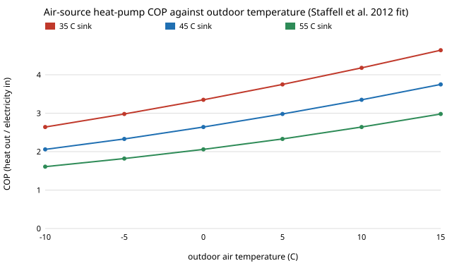

# energy-store-cop: does a weather-dependent heat-pump COP change the sand-store vs heat-pump verdict?

Track 16 (energy), next step 2 of [`energy-store-flip`](../energy-store-flip) ("a measured heat-pump COP by temperature"; the heat exchanger is not added here). The earlier comparisons ([`energy-thermal-real`](../energy-thermal-real), [`energy-store-flip`](../energy-store-flip)) charge the air-source heat pump the November to March mean price divided by one table COP of 3.6. This project replaces that with hourly prices divided by an hourly COP that follows the weather. Produced with AI assistance (Claude). No CU Boulder group's work is built on; no connection is claimed.

**Live page:** https://duncan-haywood.github.io/monorepo-projects/research/energy-store-cop/

## Headline (German day-ahead prices and weather 2015 to 2019, house scale, EUR/kWh of heat)
All numbers are in `experiments/results.txt` (deterministic, stdlib only, about 40 s).

- **The table's COP of 3.6 is a floor-heating COP.** The heat-weighted seasonal COP from real hourly temperatures is 3.52 to 3.67 for a 35 °C sink, 2.79 to 2.91 for 45 °C and 2.18 to 2.28 for a 55 °C radiator sink. The 35 °C case reproduces the table; the others make the pump dearer to run.
- **A realistic COP widens the store's margin but does not remove the price-year effect.** Weekly cycling, store-capex multiplier at which the verdict flips (2015 to 2019): table 1.16, 1.20, 1.20, 0.59, 1.02; 45 °C sink 1.25, 1.29, 1.33, 0.71, 1.15; 55 °C sink 1.37, 1.40, 1.48, 0.86, 1.30. In 2018 the pump still wins weekly cycling at every sink (margin +0.011 on the table, +0.008 at 45 °C, +0.004 at 55 °C).
- **Daily cycling:** the store already won by 0.012 to 0.027; with a 45 to 55 °C sink the flip multiplier is 2.4 to 4.1 (table 2.1 to 3.5).
- **Choices that barely matter:** weighting the heat by heating degrees rather than flat over November to March moves the weekly margin (at 45 °C) by 0 to 0.0008 EUR/kWh; the heating base temperature (12, 15, 18 °C) moves the flip multiplier by at most 0.06.

What this says: the sand store's weekly-cycling case is somewhat stronger than the flat-COP model showed, if the house heats at 45 to 55 °C, and the 3.6 in the cost table should be read as an optimistic COP for the pump. It does not say the store beats a pump in practice: the heat exchanger, the 2000 full-load hours, a real unit's defrost and part-load behaviour and levies are outside the model.

## Method
`src/energy_store_cop/model.py`; `experiments/run.py`.
1. Everything but the pump's energy cost is `energy-store-flip` unchanged (cost table `head_2030`, cheapest quarter of each cycle window for the store, capital part of the pump).
2. Pump energy cost per kWh of heat = Σ w<sub>t</sub> · p<sub>t</sub> / COP(T<sub>t</sub>) / Σ w<sub>t</sub> over the year's 8,760 hours; p is the real day-ahead price, w the heat demand proportional to max(0, 15 °C − T) (`cop_hdd`), or 1 in November to March (`cop_flat`).
3. COP = 6.81 − 0.121 ΔT + 0.000630 ΔT², ΔT = T<sub>sink</sub> − T<sub>air</sub>, floored at a 15 K lift and at COP 1. A fixed sink is used (35, 45, 55 °C), not a heating curve.
4. Flip multipliers by bisection on the store's capex, as in `energy-store-flip`.

## Inputs
| Input | Value | Source |
|---|---|---|
| Hourly prices | Germany 2015 to 2019 | OPSD (2020) / ENTSO-E, CC BY 4.0, via `energy-thermal-real` |
| Hourly air temperature | 2015 to 2019, 5 cities | ERA5 reanalysis (Hersbach et al. 2020) through the [Open-Meteo archive API](https://open-meteo.com/en/docs/historical-weather-api), CC BY 4.0; `data/fetch.py` |
| COP regression | 6.81, 0.121, 0.000630 | Staffell et al. (2012), *Energy Environ. Sci.* 5, 9291, as implemented in PyPSA-Eur's `DecentralHeatingCopApproximator` and used by when2heat (Ruhnau et al. 2019, *Energy Policy* 125, 704). I confirmed the coefficients in the PyPSA-Eur code; I did not re-derive them from the paper |
| Store and pump costs | head_2030 | PyPSA technology-data, via `energy-thermal-cost` |
| **Not from a source** | city weights 3.6 / 1.8 / 1.5 / 1.1 / 0.7 (Berlin, Hamburg, Munich, Cologne, Frankfurt: rounded populations, millions); base temperature 15 °C (swept 12 to 18); sink 35 / 45 / 55 °C (swept) | choices of this project |



## Reproduce
```
cd research/energy-store-cop
python data/fetch.py                  # optional: refetch the weather (needs network; slow behind a proxy)
python experiments/run.py > experiments/results.txt   # 40 s
python -m pytest tests                                # 7 tests
```

## Tests and checks
7 tests: the COP fit gives 3.747 at a 30 K lift; COP falls with a colder source and a hotter sink and never drops below 1; temperature files are 8,760 hours and plausible; seasonal COP lies between 2 and 5 and falls with the sink temperature; `table` mode reproduces `energy-store-flip`'s margin exactly; a colder sink gives cheaper pump energy; a flip multiplier is a zero of the margin. The check against a published figure is the 35 °C seasonal COP (3.52 to 3.67) landing on the cost table's 3.6.

## Limitations
- Five cities weighted by rounded populations stand in for national weather; the heat demand is a degree-hour proxy, not a building model, and ERA5 is a reanalysis, not station data.
- The COP is a published regression for a generic air-source unit; defrost, part-load cycling, the 2 to 3 K gap between ambient and evaporator and a heating curve (lower sink temperature in mild weather) are not modelled. A heating curve would raise the seasonal COP, between the 35 and 45 °C rows.
- The pump's capacity is still sized by 2000 full-load hours; at low temperature a real unit needs a back-up heater, which is not costed.
- The store side is unchanged: no heat exchanger, resistive charging at 0.99, wholesale prices, no levies, five price years.

## Next steps
1. A heating curve (sink temperature falling with outdoor temperature) and a back-up heater at low temperature.
2. Add the heat exchanger cost to the store (`energy-thermal-cost` says it favours the pump) and see whether 2015 to 2017 survive.
3. Cost ranges from the technology-data source columns in place of an assumed spread (`energy-store-flip` step 1).

## Outside dependencies
Code and data of `energy-store-flip` and the projects it imports, in this repository; the Open-Meteo archive for the temperature files (committed, so no network is needed to run). Python standard library only.

MIT.
