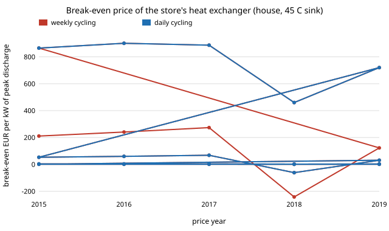

# energy-store-hx: how much can the sand store's heat exchanger cost before a heat pump wins again?

Track 16 (energy), next step 2 of [`energy-store-cop`](../energy-store-cop) ("add the heat exchanger cost to the store and see whether 2015 to 2017 survive"). The earlier comparisons cost the sand store without any equipment to take heat out of the sand. No sourced price for a sand-to-water exchanger exists in the cost table, so rather than invent one this project sweeps the price and reports the **break-even exchanger price** per price year. Produced with AI assistance (Claude). No CU Boulder group's work is built on; no connection is claimed.

**Live page:** https://duncan-haywood.github.io/monorepo-projects/research/energy-store-hx/

## Headline (German day-ahead prices and weather 2015 to 2019, house scale, 10,000 kWh of heat a year, 45 °C sink)
All numbers are in `experiments/results.txt` (deterministic, stdlib only, under a second).

- **Weekly cycling: 2015 to 2017 survive an exchanger of 211, 241 and 274 EUR per kW of peak discharge; 2019 survives 123; 2018 never wins, even with a free exchanger** (−242). At a 35 °C sink the breaks-even are 139 to 182 (2019: 31); at a 55 °C sink 307 to 397 (2018 still −113; 2019: 246).
- **Daily cycling is robust:** 460 to 901 EUR/kW at 45 °C, 358 to 825 on the table's flat 3.6 COP. Even 2018 tolerates 460.
- **What that is in money:** at 100 EUR/kW and 5 kW of peak, the exchanger adds 0.0032 EUR per kWh of heat. The weekly store's margin over the pump in the good years is 0.004 to 0.009.
- **If the house is sized for fewer full-load hours** (peak 10 kW at 1,000 h, 20 kW at 500 h) the break-even per kW halves and quarters: weekly 2015 falls from 211 to 105 and 53 EUR/kW.
- The store-capex multiplier at which the verdict flips (weekly, 45 °C) falls from 1.25/1.29/1.33/0.71/1.15 with no exchanger to 1.13/1.17/1.21/0.59/1.03 at 100 EUR/kW and 1.01/1.05/1.09/0.47/0.91 at 200.

What this says: whether weekly cycling survives depends on a number nobody here has sourced (what a sand-to-water exchanger costs per kW). If it is under about 100 EUR/kW, 2015 to 2017 survive and 2019 is marginal; if it is over 275, none do. Daily cycling survives anything below about 450 EUR/kW. This is a bound, not a verdict that the store is worth building.



## Method
`src/energy_store_hx/model.py`; `experiments/run.py`.
1. The store and pump costs, the hourly COP and the prices are `energy-store-cop` unchanged (cost table `head_2030`, `cop_hdd` mode, Staffell et al. 2012 COP, ERA5 temperatures).
2. Exchanger cost per kWh of heat = c · P · (annuity(4 %, 35 y) + FOM) / Q, with c in EUR/kW, P = Q / 2000 h the peak discharge (the pump's own sizing rule) and Q = 10,000 kWh/y.
3. Because the cost is linear in c, the break-even is c* = −diff / hx_cost(1 EUR/kW). A negative c* means the store loses at zero exchanger cost. The flip multiplier is bisection on the store's capex as before.

## Inputs
| Input | Value | Source |
|---|---|---|
| Everything in `energy-store-cop` | see its README | prices OPSD/ENTSO-E (CC BY 4.0), ERA5 via Open-Meteo, Staffell et al. (2012), PyPSA technology-data |
| Exchanger lifetime and FOM | 35 years, 1.075 %/y | borrowed from the table's `Sand-charger` row (Viswanathan et al. 2022); the committed `params.csv` has no discharger rows |
| Upper anchor | 725 EUR/kW | PyPSA technology-data master, `Sand-discharger` investment 725,191.7 EUR/MW (2025 EUR, Georgiou 2018). It is a heat-to-electricity block, not an exchanger; I fetched it on 2026-10-23 |
| **Not from a source** | exchanger price per kW (**swept 0 to 200, break-even solved**); peak discharge = annual heat / 2000 h (swept 2000, 1000, 500 h) | choices of this project; I found no sourced sand-to-water exchanger price (a web search for the Danish Energy Agency's district-heating substation figure did not surface one) |

## Reproduce
```
cd research/energy-store-hx
python experiments/run.py > experiments/results.txt   # under 1 s
python experiments/figure.py
python -m pytest tests                                # 6 tests
```

## Tests and checks
6 tests: a zero-price exchanger reproduces `energy-store-cop`'s diff and flip multiplier exactly; the exchanger cost matches a hand calculation (500 EUR over 10,000 kWh at the annuity) and is linear in price and inverse in full-load hours; the break-even is a zero of the diff; a dearer exchanger lowers the flip multiplier; 2018 weekly is negative at zero price.

## Limitations
- The exchanger price is not sourced; the answer is a threshold the reader compares with a quote. A plate exchanger for water at house scale is a small item, but I have not cited a figure, so I do not claim one.
- Peak discharge power is the house's peak load by the pump's 2000 h rule. A sand store's discharge rate is limited by the sand-side heat transfer, which can force a larger, dearer exchanger or a slower delivery; not modelled. Pumping power and discharge losses are not costed.
- Lifetime and FOM are borrowed, and a distribution/pumping side the pump does not need (a water loop) is not added.
- All limitations of `energy-store-cop` stand: five weighted cities, a degree-hour demand proxy, a fixed sink, wholesale prices without levies, five price years.

## Next steps
1. Source a sand-to-water exchanger price (a catalogue or a quote) and place it on the break-even axis.
2. Model the sand-side discharge limit (heat transfer from packed sand) to set the exchanger size and the delivery rate.
3. The heating curve and back-up heater from `energy-store-cop` step 1.

## Outside dependencies
Code and data of `energy-store-cop` and the projects it imports, in this repository. Python standard library only.

MIT.
