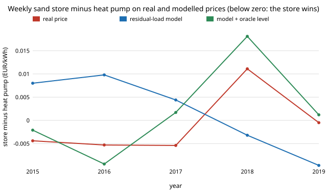

# energy-store-modelprice: does the sand-store vs heat-pump verdict survive a modelled electricity price instead of the real one?

Track 16 (energy), next step 2 of [`energy-price-residual`](../energy-price-residual) ("feed the fitted price into the sand-store and heat-pump comparison of `energy-thermal-real` to see whether its winners survive a modelled rather than real price"). [`energy-thermal-real`](../energy-thermal-real) found a house-sized sand heat store beats an air-source heat pump on real German day-ahead prices for daily cycling (all 5 years) and mostly for weekly cycling; [`energy-price-residual`](../energy-price-residual) fitted a residual-load price curve. Here the same cost model is fed the curve's prices, each year fitted on the other four. Produced with AI assistance (Claude). No CU Boulder group's work is built on; no connection is claimed.

**Live page:** https://duncan-haywood.github.io/oss-monorepo/research/energy-store-modelprice/



## Headline (German day-ahead prices 2015 to 2019, wholesale, EUR/kWh of heat)
All numbers are in `experiments/results.txt` (deterministic, stdlib only, about 20 s).

- **Clear verdicts survive; marginal ones do not.** Against the real-price verdict (tie band 0.002 EUR/kWh), the residual-load model gets the same verdict in **32 of 40** scale x cycle x year cells; the flat merit-order price of `energy-thermal-hourly` gets **21 of 40**. Daily cycling (store wins) and monthly and seasonal storage (store loses by 0.10 to 1.5) are right in every cell at both scales (30 of 30); the misses are all weekly cycling, where the real margin is only -0.005 to +0.011.
- **Weekly cycling is where the model fails, and it fails in sign.** House weekly: real diff -0.004, -0.005, -0.005, +0.011, -0.000 (2015 to 2019); modelled +0.008, +0.010, +0.004, -0.003, -0.010. The model gets 0 of 5 years, and 2 of 5 at district scale. Cause: the leave-one-year-out fit predicts the *price level* of the other years, so it overstates 2015 to 2017 (mean 0.036 to 0.040 against 0.029 to 0.035 real) and understates 2018 and 2019. Adding back the held-out year's mean (an oracle, not a forecast) restores 4 of 5.
- **The break-even moves little.** House daily break-even store price (the price at which the store ties the pump, given that series' heat-pump price) is 0.038 to 0.039 from the modelled series against 0.037 to 0.039 real. The modelled cheap-quarter daily price is off by +0.005 to +0.010 (2015 to 2017, too high) and -0.008 to -0.005 (2018, 2019, too low).
- **Using the model only to *schedule* charging costs little.** If the store picks its charge hours by the modelled price but pays the real price, its cost of electricity is 0.0004 to 0.0011 EUR/kWh above perfect foresight for daily cycling and 0.0006 to 0.0010 for weekly (mean +0.0007 and +0.0009), and the verdicts are essentially unchanged (diff* column of section D). Scheduling by the flat merit-order price, which cannot rank hours, costs +0.0041 (daily) and +0.0143 (weekly), and moves the house weekly margin to +0.007 to +0.051 (the pump wins in all five years, against two in the real series).

What this says: a residual-load model is good enough to *operate* a store and to rule out monthly and seasonal storage, but not to *decide* whether weekly cycling beats a heat pump, because that margin is smaller than the year-to-year price-level error. What it does not say: anything about 2020 onward (the 2021 to 2022 gas spike is outside the data), or that a household can buy at wholesale.

## Method
`src/energy_store_modelprice/model.py`; `experiments/run.py`.
1. **Price sources per held-out year** (hourly, EUR/kWh): `real` (OPSD/ENTSO-E); `resid` (isotonic residual-load fit, trained on the other four years, as `energy-price-residual` scheme B); `resid+` (the same plus the held-out year's mean, an oracle); `merit` (flat EUR 54.6/MWh, `energy-thermal-hourly`).
2. **Cost model:** exactly `energy-thermal-real`'s: PyPSA technology-data head_2030 store and heat-pump costs ([`energy-thermal-cost`](../energy-thermal-cost)); the store buys the cheapest quarter of each cycle window, the pump pays the November to March mean. Planning price = those two figures from the chosen series.
3. **Verdict:** sign of store minus pump, with |diff| <= 0.002 EUR/kWh called a tie; agreement is with the real-price verdict.
4. **Executed charging:** rank hours by the modelled series, pay the real price in the chosen hours (ties in a flat series break by hour order, so `merit` there is close to "charge in the first hours of each window").

## Inputs
| Input | Value | Source |
|---|---|---|
| Hourly prices, load, capacity factors | Germany 2015 to 2019 | OPSD (2020) / ENTSO-E, CC BY 4.0, via `energy-thermal-real`, `energy-mix-years` |
| Price model | isotonic fit on residual load | `energy-price-residual` |
| Store and heat-pump costs | house 10 MWh/a, district 5 GWh/a | PyPSA technology-data, via `energy-thermal-cost` |
| **Not from a source** | charge fraction 0.25 (swept 1/8 to 1/2 in `energy-thermal-real`); tie band 0.002 EUR/kWh; hour-order tie-break | assumptions, labelled |

## Reproduce
```
cd research/energy-store-modelprice
python experiments/run.py > experiments/results.txt   # 20 s
python experiments/figure.py                          # writes experiments/weekly.svg
python -m pytest tests                                # 6 tests
```

## Tests and checks
6 tests: executed-price helper on hand-checkable inputs (equals the plain cheapest mean when plan = actual; pays the actual, not the planned, price); verdict bands; price sources have 8,760 hours, the oracle's mean equals the real mean and `merit` is flat; the store's cost rises with its price and the pump's does not; the real-price verdict reproduces `energy-thermal-real`'s headline (daily house diff -0.012 to -0.027 in all five years).

## Limitations
- Five years; each cell is one year. 32/40 against 21/40 is a count over correlated cells (the same five price years), not a significance test, and the ±0.002 tie band is my choice.
- The model is fitted on the same five years (leave-one-year-out), so it sees later years; only `energy-price-residual` scheme A is a forecast, and it is one year.
- Realised load and renewables, not forecasts; wholesale price, no levies. The weekly margin is inside the cost model's own uncertainty (technology-data costs), so a real-world weekly verdict would rest on costs as much as on prices.
- 2015 to 2019 only; no 2020 to 2024 data (OPSD and ENTSO-E hosts are unreachable from the run container, and no fuel or carbon price series is committed), so the level error is not decomposed into fuel and carbon.
- `merit` executed-charging figures depend on the hour-order tie-break.

## Next steps
1. Add a fuel/carbon-price regressor to the residual-load fit once 2020 onward data are reachable, and test whether the weekly verdict becomes right.
2. Put a confidence interval on the weekly margin by varying the technology-data capital costs, to see how much of the margin is price and how much cost.
3. Score a true forecast: train on 2015 to 2018, decide 2019, and report the verdict and regret.

## Outside dependencies
Data and code of `energy-price-residual`, `energy-thermal-real`, `energy-thermal-hourly`, `energy-thermal-cost`, `energy-thermal` and `energy-mix-years` in this repository. Python standard library only.

MIT.
