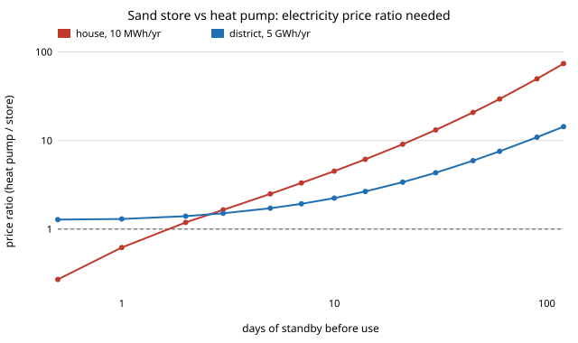

# energy-thermal-cost: how much cheaper must a store's electricity be than a heat pump's for a sand heat store to deliver heat for less?

Track 16 (energy), next step 2 of [`energy-thermal`](../energy-thermal) ("add costs for sand, insulation, heater and exchanger, every price sourced and dated, and a cost per kWh delivered"). That project sized a resistance-charged sand store and found it returns only a fraction of the electricity as heat, so it needs cheaper electricity than a heat pump. It left the capital cost out, so the answer to "is it worth building?" was open. Here every capital cost, lifetime, fixed O&M and efficiency is read from PyPSA technology-data (Danish Energy Agency; Viswanathan et al. 2022, PNNL-33283), as the owner asked on 2026-10-21 ("run the numbers"; `research/CLAUDE.md`), and the store is sized by the `energy-thermal` transient model, imported unchanged. Produced with AI assistance (Claude).

**Live page:** https://marisstella.app/research/energy-thermal-cost/



**Corrected 2026-11-18 (quality audit 2026-11-17, high; [audit file](../../portfolio/quality/audits/2026-11-17-energy-thermal-cost.json)).** Until this date `store_lcoh` billed every cycle as a first charge from 10 &deg;C to 500 &deg;C and sized the store with cold insulation, though a cycling store only discharges to its cut-off temperature and keeps its insulation warm. It now runs each store to cyclic steady state (`cycle_steady` in `src/energy_thermal_cost/cost.py`): each charge lifts the sand from where the last cycle left it, and the store is sized on the cycle that repeats. That moved the headline a long way. The house daily store returns 0.81 of its electricity as heat, not 0.63, and the ratio fell from 2.1 to 0.6: **cycled daily at house size, the store now costs less than a heat pump at the same electricity price.** Weekly went from 5.0 to 3.3, district daily from 2.2 to 1.3, and seasonal storage barely moved (120 to 119). The old rule is still there as `accounting="first-charge"`. The five projects that import `cost.py` (energy-thermal-hourly, energy-thermal-real, energy-store-flip, energy-store-modelprice, energy-store-cop) pin it explicitly, so their committed results still reproduce, and they carry the same overstatement until each is rerun (Next steps, 0).

## Headline (modelled; costs sourced; electricity prices, cycle counts and the missing heat exchanger are not, see Limitations)
All numbers are in `experiments/results.txt` (deterministic, stdlib only). The store charges at EUR 0.05/kWh; "ratio" is how many times dearer the heat pump's electricity must be before it costs as much per kWh of heat as the store (capital, fixed O&M and electricity all included).

- **At house size a sand store cycled daily is cheaper than a heat pump even when the heat pump's electricity costs only 0.6 times as much as the store's. Cycled weekly, the heat pump's electricity has to cost about 3.3 times the store's before the two break even; monthly about 13 times; seasonally about 119 times** (house, 10 MWh a year; stores of 0.3, 2.2, 15 and 222 m<sup>3</sup>). The store's capital cost is small when it cycles (EUR 0.009 per kWh of heat daily) and large when it stands: seasonally it is EUR 1.53 per kWh. The heat pump's whole cost at the same price is EUR 0.076 per kWh, of which EUR 0.062 is its own capital, and that capital is why a daily store can win at equal prices. The loss of heat in standby, not the sand, is what makes long storage uneconomic.
- **At district size (5 GWh a year) the ratios are 1.3, 1.9, 4.4 and 37** for daily, weekly, monthly and seasonal storage. A central heat pump's capital is a smaller share of its cost, so a daily store does not win at equal prices here. Scale makes seasonal storage about three times cheaper, and it is still far from cheap.
- **How long can a sand store stand and still win?** If the heat pump's electricity is 3 times dearer than the store's: 5 days at house size, 14 at district size. At 5 times: 10 and 30 days. At 10 times: 21 and 60 days (section D, on a grid of standby days, so each figure is the last grid point that still wins).
- **Sand against hot water.** With the 2025 table, a house-sized hot-water tank is much dearer than sand (ratio 9.1 daily, because the table's decentral tank costs EUR 528/kWh). On the older v0.9.2 table (EUR 19/kWh, 2015 euros) it is 1.4 daily, still worse than sand's 0.6 (section F). At district size the central tank is cheap (EUR 3.8/kWh) and, now that its small daily losses are billed as losses, it beats sand at every cycle length: 1.1, 1.3, 2.4 and 17 against sand's 1.3, 1.9, 4.4 and 37. Before the correction sand won for daily and weekly storage.
- **What moves the answer** (section C): the heat pump's full-load hours and COP, the discount rate, and above all the store's own electricity price. Daily house-size ratios run from -0.2 (8% discount rate) to 2.5 (store electricity EUR 0.10/kWh). A negative ratio means the heat pump's *capital* alone exceeds the store's whole cost, so the store wins at any heat pump price. That happens for the daily and weekly house store at 1,000 full-load hours or with store electricity at EUR 0.02/kWh, and for the daily one at an 8% discount rate. Tripling the house store's capital cost moves the weekly ratio from 3.3 to 5.5, and ten times moves it to 13, so the weekly result does not hinge on the sand store's price.

What this says: a sand store pays off as a short-cycle store that buys cheap hours, not as a seasonal one, and the price spread it needs shrinks as it cycles more. At house size and daily cycling it may need no spread at all, because the house heat pump's own capital is what it competes with. What it does not say: the spread exists. The ratio is measured against a flat price; real tariffs, wholesale prices or surplus solar are `energy-tou` and `energy-mix` territory and are not read here.

## Method
`src/energy_thermal_cost/cost.py` computes levelised cost of heat (EUR per kWh delivered) as annualised capital (annuity at 4% plus the table's fixed O&M percentage) plus electricity.
- **Store:** sized (`size_steady`, bracketed above by `energy_thermal.size_for_delivery`) so that on its repeating cycle it still holds `annual heat / cycles` after `standby` days (sphere, 0.5 m of mineral wool, 500 to 100 &deg;C for sand and 90 to 40 &deg;C for water, ambient 10 &deg;C). Capital = usable capacity at full charge (kWh) times the table's cost per kWh, plus a charger sized to charge in a quarter of the cycle period at the charger row's cost per kW (sand: `Sand-charger`; water: the resistive-heater row). Electricity = heat put in per cycle over the charger efficiency, at cyclic steady state: `cycle_steady` repeats charge (the sand set instantly to 500 &deg;C), standby, discharge to a mean of 100 &deg;C and idle until the next charge, keeping the insulation's heat, until the heat in and the heat out change by less than one part in a million from one cycle to the next (3 to 7 cycles here). The volume is the smallest that delivers one cycle's heat on that repeating cycle. The single cold first charge is left out; over a 35-year life it adds well under 1% to a daily store's electricity.
- **Heat pump / resistive heater:** sized to peak = annual heat / 2,000 full-load hours; COP and costs from the table (decentral for the house, central for the district).
- **Break-even price:** `p = COP x (store cost - heat pump capital)`, the electricity price at which the two levelised costs are equal; "ratio" divides it by the store's price.
- Cycles per year: daily 300, weekly 52, monthly 12, seasonal 1; the scan in sections D and E uses `min(300, 365 / standby days)`.

## Inputs
| Input | Value | Source |
|---|---|---|
| Sand store capital | EUR 8,425/MWh (2025 euros; EUR 6,701 in v0.9.2, 2020 euros), 0.33%/yr O&M, 35 yr | technology-data row `Sand-store`; primary source Viswanathan et al. (2022), PNNL-33283, p.100 |
| Sand charger | EUR 181/kW, 1.07%/yr O&M, 99% efficient | row `Sand-charger`; Georgiou (2018) cost split, Viswanathan et al. (2022) |
| Hot-water tank | decentral EUR 528/kWh (EUR 19.4 in v0.9.2), central EUR 3.8/kWh | rows `decentral/central water tank storage`; Danish Energy Agency |
| Air-source heat pump | decentral EUR 1,135/kW<sub>th</sub>, COP 3.6; central EUR 1,144/kW<sub>th</sub>, COP 3.2 | rows `decentral/central air-sourced heat pump`; Danish Energy Agency |
| Resistive heater (water-store charger) | EUR 134/kW decentral, 80 central | rows `decentral/central resistive heater` |
| Discount rate | 4% (swept 2% to 8%) | the table's own value for the decentral rows; a choice |
| Not from a source | store electricity price 0.05 (swept 0.02 to 0.10); 2,000 full-load hours (swept 1,000 to 3,000); 0.5 m insulation (swept); cycle counts; charge time = quarter cycle; house 10 MWh/yr and district 5 GWh/yr | assumptions, labelled and swept in section C |

`data/params.csv` holds every row used, with revision, currency year and primary source; `data/fetch_params.py` regenerates it from pinned revisions (`v0.9.2` and commit `65244b4c`). Costs are in the euros of the table's currency year (2025 for the main run); the sibling `energy-mix-sourced` found the same tables dearer in 2025 than 2015/2020 euros.

## Reproduce
```
cd research/energy-thermal-cost
PYTHONPATH=src:../energy-thermal/src python experiments/run.py   # writes experiments/results.txt (about 2 minutes)
python experiments/figure.py                                      # writes experiments/ratio.svg
python -m pytest tests                                            # 14 tests
```

## Tests and checks
14 tests: the annuity factor against the textbook value (7%, 25 years: 0.08581) and its zero-rate and one-year limits; table rows read correctly; the heat-pump cost by hand; the sand store holds 1600 x 800 x 400 / 3.6e6 = 142 kWh/m<sup>3</sup>; the sizing reproduces `energy-thermal`'s published anchor (222 m<sup>3</sup> for 10 MWh after 120 days, 26% of the heat put in returned); thick insulation approaches the no-leak bound from below; the total is the sum of its parts; the break-even price equalises the two costs. Four were added with the 2026-11-18 correction: a store that loses nothing is billed exactly rho c V (500 - 100) once its first cycle is past; the house daily store's heat out per heat in lies between the cold-start value and 1, at 0.815 (the audit's independent 40-cycle run gave 0.82); the store's capital, charger and electricity parts are recomputed by hand from the table rows; and an unknown medium or accounting rule is refused. A seeded return to billing from ambient and a 10x store-cost error both fail them (the audit had found the second one passing). No whole-system figure for a sand store in a house exists to check against.

## Limitations
- **The sand-store capital is a utility-scale figure** (Viswanathan et al. 2022 model large stores) at an unstated temperature swing; I applied it per kWh of usable capacity at 400 K. A house-sized store of 0.3 to 222 m<sup>3</sup> would likely cost more per kWh. Section C multiplies it up to ten times for the house; at district size it is used as is. Insulation thickness is not costed separately (the table's figure is a whole storage block).
- **No heat exchanger or discharge equipment is costed** (no sourced figure for a sand-to-water exchanger, and the table's `Sand-discharger` converts to electricity). This favours the store. Peak discharge power is not checked.
- **A flat electricity price.** Whether a spread of 2 to 5 times exists for hours that suit a store is the next question. Heat pump COP is a constant annual average, with no winter drop.
- **Instant discharge at the end of standby**, and the store is charged once per cycle; real stores deliver across the period and lose heat while doing so.
- The decentral hot-water tank cost changes 27-fold between the two table revisions (EUR 19 to EUR 528/kWh); the house water results are only as good as one of them, which is why both are shown.
- The thermal model's limits carry over (sphere, radial conduction, assumed material properties); see [`energy-thermal`](../energy-thermal). Not a safety analysis: a 500 &deg;C store is a hazard and building one is an owner step.
- No CU Boulder group's work; no connection is claimed.

## Next steps
0. Rerun the five projects that import `cost.py` with `accounting="steady"` (each pins `"first-charge"` today, see the correction note at the top) and rewrite their headlines. Their committed results overstate a cycling store's electricity by the same margin as this project's did.
1. Read the store's electricity price from an hourly price or surplus series (`energy-mix-sourced` shadow prices, or a time-of-use tariff from `energy-tou`) and let the store charge only in cheap hours, so the ratio is replaced by a bill.
2. Cost the heat exchanger and discharge power with a sourced figure, and add a temperature-dependent COP.
3. A second capital estimate for the sand store at house scale (a commercial price, quoted and dated) to replace the multiplier.

## Outside dependencies
PyPSA technology-data tables (fetched at pinned revisions, committed as `data/params.csv`); the `energy-thermal` model in this repository. Python standard library only.

MIT.
