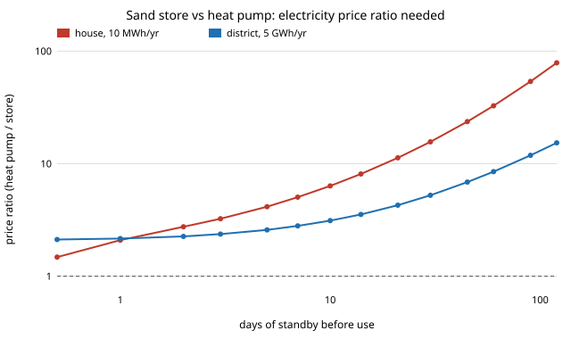

# energy-thermal-cost: how much cheaper must a store's electricity be than a heat pump's for a sand heat store to deliver heat for less?

Track 16 (energy), next step 2 of [`energy-thermal`](../energy-thermal) ("add costs for sand, insulation, heater and exchanger, every price sourced and dated, and a cost per kWh delivered"). That project sized a resistance-charged sand store and found it returns only a fraction of the electricity as heat, so it needs cheaper electricity than a heat pump. It left the capital cost out, so the answer to "is it worth building?" was open. Here every capital cost, lifetime, fixed O&M and efficiency is read from PyPSA technology-data (Danish Energy Agency; Viswanathan et al. 2022, PNNL-33283), as the owner asked on 2026-10-21 ("run the numbers"; `research/CLAUDE.md`), and the store is sized by the `energy-thermal` transient model, imported unchanged. Produced with AI assistance (Claude).

**Live page:** https://duncan-haywood.github.io/oss-monorepo/research/energy-thermal-cost/



## Headline (modelled; costs sourced; electricity prices, cycle counts and the missing heat exchanger are not, see Limitations)
All numbers are in `experiments/results.txt` (deterministic, stdlib only). The store charges at EUR 0.05/kWh; "ratio" is how many times dearer the heat pump's electricity must be before it costs as much per kWh of heat as the store (capital, fixed O&M and electricity all included).

- **A sand store cycled daily needs a heat pump's electricity to be about 2 times dearer; weekly about 5 times; monthly about 16 times; seasonal about 120 times** (house, 10 MWh a year; 0.3 m<sup>3</sup>, 2.3, 15 and 222 m<sup>3</sup>). The store's capital cost is small when it cycles (EUR 0.011 per kWh of heat daily) and large when it stands: seasonally it is EUR 1.53 per kWh, against EUR 0.076 for the heat pump at the same price. The loss of heat in standby, not the sand, is what makes long storage uneconomic.
- **At district size (5 GWh a year) the ratios are 2.2, 2.8, 5.3 and 38** for daily, weekly, monthly and seasonal storage. Scale helps seasonal storage by a factor of three, and still does not make it cheap.
- **How long can a sand store stand and still win?** If the heat pump's electricity is 3 times dearer than the store's: 2 days at house size, 7 at district size. At 5 times: 5 and 21 days. At 10 times: 14 and 60 days (section D).
- **Sand against hot water.** With the 2025 table, a house-sized hot-water tank is much dearer than sand (ratio 12 daily, because the table's decentral tank costs EUR 528/kWh); on the older v0.9.2 table (EUR 19/kWh, 2015 euros) it is 4.2 daily, still worse than sand's 2.1 (section F). At district size the central tank is cheap (EUR 3.8/kWh) and wins for monthly and seasonal storage (ratio 4.5 and 19 against sand's 5.3 and 38) while sand wins for daily and weekly.
- **What moves the answer** (section C): the heat pump's full-load hours and COP, the discount rate, and above all the store's own electricity price. Daily house-size ratios run from 1.3 (8% discount rate) to 3.6 (3,000 full-load hours). With 1,000 full-load hours, or electricity at EUR 0.02/kWh for the store, the heat pump's *capital* alone exceeds the store's whole cost (negative ratio), so the store wins at any heat pump price. Tripling the house store's capital cost moves the weekly ratio from 5.0 to 7.3 and ten times to 15, so the weekly result does not hinge on the sand store's price.

What this says: a sand store pays off as a short-cycle store that buys cheap hours, not as a seasonal one, and the price spread it needs shrinks as it cycles more. What it does not say: the spread exists. The ratio is measured against a flat price; real tariffs, wholesale prices or surplus solar are `energy-tou` and `energy-mix` territory and are not read here.

## Method
`src/energy_thermal_cost/cost.py` computes levelised cost of heat (EUR per kWh delivered) as annualised capital (annuity at 4% plus the table's fixed O&M percentage) plus electricity.
- **Store:** sized with `energy_thermal.size_for_delivery` so it still holds `annual heat / cycles` after `standby` days (sphere, 0.5 m of mineral wool, 500 to 100 &deg;C for sand and 90 to 40 &deg;C for water, ambient 10 &deg;C). Capital = usable capacity at full charge (kWh) times the table's cost per kWh, plus a charger sized to charge in a quarter of the cycle period at the charger row's cost per kW (sand: `Sand-charger`; water: the resistive-heater row). Electricity = heat put in per cycle over the charger efficiency.
- **Heat pump / resistive heater:** sized to peak = annual heat / 2,000 full-load hours; COP and costs from the table (decentral for the house, central for the district).
- **Break-even price:** `p = COP x (store cost - heat pump capital)`, the electricity price at which the two levelised costs are equal; "ratio" divides it by the store's price.
- Cycles per year: daily 300, weekly 52, monthly 12, seasonal 1; the scan in sections D and E uses `min(300, 365 / standby days)`.

## Inputs
| Input | Value | Source |
|---|---|---|
| Sand store capital | EUR 8,425/MWh (2025 euros; EUR 6,701 in v0.9.2, 2020 euros), 0.33%/yr O&M, 35 yr | technology-data row `Sand-store`; primary source Viswanathan et al. (2022), PNNL-33283, p.100 |
| Sand charger | EUR 181/kW, 1.07%/yr O&M, 99% efficient | row `Sand-charger`; Georgiou (2018) cost split, Viswanathan et al. (2022) |
| Hot-water tank | decentral EUR 528/kWh (EUR 19.4 in v0.9.2), central EUR 3.8/kWh | rows `decentral/central water tank storage`; Danish Energy Agency |
| Air-source heat pump | decentral EUR 1,135/kW<sub>th</sub>, COP 3.6; central EUR 1,144/kW<sub>th</sub>, COP 3.2 | rows `decentral/central air-sourced heat pump`; Danish Energy Agency |
| Resistive heater (water-store charger) | EUR 134/kW decentral, 80 central | rows `decentral/central resistive heater` |
| Discount rate | 4% (swept 2% to 8%) | the table's own value for the decentral rows; a choice |
| Not from a source | store electricity price 0.05 (swept 0.02 to 0.10); 2,000 full-load hours (swept 1,000 to 3,000); 0.5 m insulation (swept); cycle counts; charge time = quarter cycle; house 10 MWh/yr and district 5 GWh/yr | assumptions, labelled and swept in section C |

`data/params.csv` holds every row used, with revision, currency year and primary source; `data/fetch_params.py` regenerates it from pinned revisions (`v0.9.2` and commit `65244b4c`). Costs are in the euros of the table's currency year (2025 for the main run); the sibling `energy-mix-sourced` found the same tables dearer in 2025 than 2015/2020 euros.

## Reproduce
```
cd research/energy-thermal-cost
PYTHONPATH=src:../energy-thermal/src python experiments/run.py   # writes experiments/results.txt
python experiments/figure.py                                      # writes experiments/ratio.svg
python -m pytest tests                                            # 10 tests
```

## Tests and checks
10 tests: the annuity factor against the textbook value (7%, 25 years: 0.08581) and its zero-rate and one-year limits; table rows read correctly; the heat-pump cost by hand; the sand store holds 1600 x 800 x 400 / 3.6e6 = 142 kWh/m<sup>3</sup>; the sizing reproduces `energy-thermal`'s published anchor (222 m<sup>3</sup> for 10 MWh after 120 days, 26% of the heat put in returned); thick insulation approaches the no-leak bound from below; the total is the sum of its parts; the break-even price equalises the two costs. No whole-system figure for a sand store in a house exists to check against.

## Limitations
- **The sand-store capital is a utility-scale figure** (Viswanathan et al. 2022 model large stores) at an unstated temperature swing; I applied it per kWh of usable capacity at 400 K. A house-sized store of 0.3 to 222 m<sup>3</sup> would likely cost more per kWh. Section C multiplies it up to ten times for the house; at district size it is used as is. Insulation thickness is not costed separately (the table's figure is a whole storage block).
- **No heat exchanger or discharge equipment is costed** (no sourced figure for a sand-to-water exchanger, and the table's `Sand-discharger` converts to electricity). This favours the store. Peak discharge power is not checked.
- **A flat electricity price.** Whether a spread of 2 to 5 times exists for hours that suit a store is the next question. Heat pump COP is a constant annual average, with no winter drop.
- **Instant discharge at the end of standby**, and the store is charged once per cycle; real stores deliver across the period and lose heat while doing so.
- The decentral hot-water tank cost changes 27-fold between the two table revisions (EUR 19 to EUR 528/kWh); the house water results are only as good as one of them, which is why both are shown.
- The thermal model's limits carry over (sphere, radial conduction, assumed material properties); see [`energy-thermal`](../energy-thermal). Not a safety analysis: a 500 &deg;C store is a hazard and building one is an owner step.
- No CU Boulder group's work; no connection is claimed.

## Next steps
1. Read the store's electricity price from an hourly price or surplus series (`energy-mix-sourced` shadow prices, or a time-of-use tariff from `energy-tou`) and let the store charge only in cheap hours, so the ratio is replaced by a bill.
2. Cost the heat exchanger and discharge power with a sourced figure, and add a temperature-dependent COP.
3. A second capital estimate for the sand store at house scale (a commercial price, quoted and dated) to replace the multiplier.

## Outside dependencies
PyPSA technology-data tables (fetched at pinned revisions, committed as `data/params.csv`); the `energy-thermal` model in this repository. Python standard library only.

MIT.
