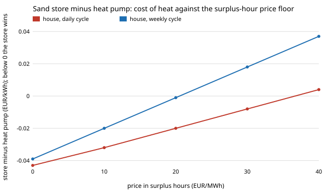

# energy-thermal-hourly: if a sand heat store buys electricity only in the cheap hours of a German price series, when does it beat a heat pump?

Track 16 (energy), next step 1 of [`energy-thermal-cost`](../energy-thermal-cost) ("read the store's electricity price from an hourly price or surplus series and let the store charge only in cheap hours"). That project found a sand store needs the heat pump's electricity to be about 2 times dearer (daily cycling) to 120 times (seasonal) than its own, against an assumed flat EUR 0.05/kWh. Here the prices come from real hourly German load, solar and wind (2015 to 2019), run through a one-fuel merit order with gas costs from PyPSA technology-data, and the store buys only the cheapest quarter of the hours in each cycle. Produced with AI assistance (Claude).

**Live page:** https://duncan-haywood.github.io/monorepo-projects/research/energy-thermal-hourly/



## Headline (modelled price; hours, fleets and costs sourced; no taxes or network charges, see Limitations)
All numbers are in `experiments/results.txt` (deterministic, stdlib only).

- **With about 190 GW of solar and 140 GW of wind (the cost-optimal fleet for an 80% emissions cut in `energy-mix-sourced`), a sand store cycled daily or weekly beats a heat pump in all five weather years** (house, 10 MWh a year): EUR 0.027 against 0.071 per kWh of heat daily, 0.032 weekly (2019). The store pays EUR 0.010 and 0.003/kWh against the pump's winter EUR 0.032, because the surplus hours that exist in such a system are cheap. **Monthly and seasonal storage still lose** (EUR 0.12 and 1.53 per kWh) however cheap the electricity, since the cost is capital and standby loss, as in `energy-thermal-cost`.
- **With today's fleet shape the store loses.** With the 34 GW solar and 6 GW wind of the uncapped optimum there are no surplus hours, the price is flat at EUR 0.055/kWh and the store costs more than the pump at every cycle length. At the 50% cap fleet (102 GW and 73 GW) daily cycling wins in 2 of 5 years at house size (a difference of EUR 0.002/kWh in 2019, a tie in effect) and 1 of 5 at district size.
- **A per-kWh levy ends it.** Adding EUR 0.10/kWh of taxes and network charges to both prices (the heat pump pays it on the electricity, the store on a lower-priced but still full-levy purchase) makes the store lose in **0 of 5** years in every cell of section C. Even EUR 0.05 flips the 80%-cap house result to a loss of EUR 0.023/kWh daily (section D). The store's whole advantage is a wholesale price gap, and a flat charge per kWh removes it because the store, losing heat, buys more kWh per kWh delivered.
- **The result hinges on what surplus hours pay.** Raising the price in surplus-renewable hours from 0 to EUR 20/MWh makes the weekly store tie (difference EUR -0.001/kWh) and 30 to 40 EUR/MWh makes it lose (section E, figure). Daily cycling survives to about EUR 35/MWh.
- Price from gas costs does not matter much: a CO<sub>2</sub> price of 0 to 200 EUR/t moves the daily difference only from EUR -0.043 to -0.034/kWh, because the store's gain is in the surplus hours, not the gas hours.

What this says: a sand store is a way to use surplus electricity from a system with far more wind and solar than Germany has, and only where those hours are passed through to the store's meter. What it does not say: that such hours will be priced that way, or that a house should build one.

## Method
`src/energy_thermal_hourly/prices.py`; `experiments/run.py`.
1. **Hours:** hourly load, solar and onshore-wind capacity factors for Germany, 2015 to 2019 (8,760 h each; Open Power System Data time series 2020-10-06, ENTSO-E Transparency Platform data, CC BY 4.0), as prepared by [`energy-mix-years`](../energy-mix-years).
2. **Fleets:** solar and wind GW are the cost-optimal capacities at the emissions caps of `energy-mix-sourced` (cap 1.0, 0.5, 0.2, 0.1, 0.05, 0.0 of the uncapped emissions; its `results.json`), scaled by the capacity factors.
3. **Price:** in an hour where load exceeds solar plus wind, gas sets it at its marginal cost, EUR 54.6/MWh (fuel EUR 28.4158/MWh<sub>th</sub> divided by CCGT efficiency 0.58, plus EUR 5.6104 variable O&M; technology-data commit 65244b4c, World Bank 2025 fuel price). Otherwise it is the surplus floor, 0 in the base case (swept in section E).
4. **Store charging:** the store of `energy-thermal-cost` (sand, sized by `energy-thermal`, unchanged) buys the cheapest quarter of the hours in each of 365 (daily), 52, 12 or 1 cycle windows, the same quarter-of-the-cycle charger it was costed with. Its mean price replaces the flat EUR 0.05.
5. **Heat pump:** pays the mean price over November to March (flat heat demand within those months); sensitivity uses all-year and December to February.
6. Levelised cost of heat, capital, O&M and efficiencies, and house (10 MWh a year) and district (5 GWh) scales are exactly those of `energy-thermal-cost`.

## Inputs
| Input | Value | Source |
|---|---|---|
| Hourly load, solar and wind capacity factors | Germany 2015 to 2019 | Open Power System Data (2020), ENTSO-E Transparency Platform; via `energy-mix-years` |
| Solar and wind capacity | 34/6, 102/73, 189/137, 258/160, 302/198, 228/479 GW | cost-optimal results of `energy-mix-sourced` at each cap |
| Gas marginal cost | EUR 54.6/MWh | technology-data CCGT and gas rows; World Bank (2025) |
| Store, charger, heat pump costs | as `energy-thermal-cost` | PyPSA technology-data; Viswanathan et al. (2022) |
| **Not from a source** | surplus-hour floor (0 base; swept 0 to 40 EUR/MWh); one-fuel merit order, no storage, no grid; charging a quarter of each cycle (swept 1/8 to 1/2); flat winter heat demand; per-kWh levy (swept 0 to 0.20) | assumptions, labelled and swept |

## Reproduce
```
cd research/energy-thermal-hourly
PYTHONPATH=src:../energy-thermal-cost/src:../energy-thermal/src python experiments/run.py   # about a minute
python experiments/figure.py                                                                # writes experiments/floor.svg
python -m pytest tests                                                                      # 4 tests
```

## Tests and checks
4 tests: the gas marginal cost by hand (with and without a CO<sub>2</sub> price); each year has 8,760 hours and 2019 load sums to about 500 TWh (the ENTSO-E figure for Germany); with no fleet the price is the gas cost every hour and with a huge fleet it is nearly zero; the cheapest-hours mean equals the minimum, the median half and the annual mean at the limits. The store and heat pump costs are checked in `energy-thermal-cost`. No published hourly price series is compared against: the modelled price is not a day-ahead price and does not reproduce one (real prices have spikes, negative hours and fuel-price variation this model lacks).

## Limitations
- **The price is modelled, not observed.** A one-fuel merit order with no storage, no grid and no must-run plant gives only two price levels. The fleets are optimal for a system with batteries and hydrogen, which would raise the price in surplus hours; the flat-floor sweep (section E) shows how much that matters. Real day-ahead prices (for example from ENTSO-E) were not fetched; a run with real prices is the obvious next step.
- **No taxes, levies or network charges** in the base case. Section D and C show a levy of EUR 0.05 to 0.10/kWh removes the result. Whether a store can be charged at wholesale cost (an interruptible tariff, or on-site surplus) is not modelled.
- Heat demand is flat within November to March; no temperature series was used, so the heat pump's price is not weighted to cold, still, expensive hours (which would raise it and favour the store).
- All of `energy-thermal-cost`'s limits carry over: the sand-store capital is a utility-scale figure, no heat exchanger is costed (favours the store), the heat pump COP is constant, the store discharges instantly at the end of standby.
- One country, five weather years, one cost table.
- No CU Boulder group's work; no connection is claimed.

## Next steps
1. Replace the modelled price with real day-ahead prices (ENTSO-E or OPSD) for the same years, and compare the two on the cheapest-hour means.
2. Weight the heat pump's price by a heating-degree series from a weather dataset.
3. Model the levy structure: a lower rate for flexible loads, and a store charged from on-site solar.

## Outside dependencies
Data committed in `energy-mix-years` and `energy-mix-sourced`; the `energy-thermal` and `energy-thermal-cost` models in this repository. Python standard library only.

MIT.
