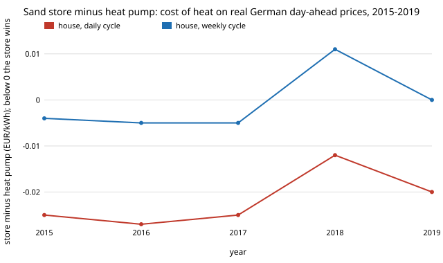

# energy-thermal-real: on real German day-ahead prices, does a sand heat store beat a heat pump, and was the modelled price right?

Track 16 (energy), next step 1 of [`energy-thermal-hourly`](../energy-thermal-hourly) ("replace the modelled price with real day-ahead prices for the same years, and compare the two on the cheapest-hour means"). That project priced electricity with a one-fuel merit order and concluded a sand store loses with a fleet like today's because there are no surplus hours. Here the same store and heat-pump costs are run on the actual hourly day-ahead price, 2015 to 2019 (Open Power System Data, ENTSO-E Transparency Platform). Produced with AI assistance (Claude).

**Live page:** https://duncan-haywood.github.io/monorepo-projects/research/energy-thermal-real/



## Headline (real wholesale prices, no taxes, network charges or retail margin)
All numbers are in `experiments/results.txt` (deterministic, stdlib only).

- **On real wholesale prices a house-sized sand store cycled daily beats an air-source heat pump in all 5 years** (EUR 0.045 to 0.062 against 0.070 to 0.074 per kWh of heat; difference EUR -0.012 to -0.027). **Weekly cycling wins in 4 of 5 years** (2018 loses by EUR 0.011; 2019 is a tie, -0.000). **Monthly and seasonal storage lose in every year** (EUR 0.18 to 0.20 and 1.6 per kWh) because their cost is capital and standby loss, not electricity: even free electricity would not save them (negative break-even price in section C). District scale gives the same ordering.
- **The modelled price of `energy-thermal-hourly` was wrong for today's fleet.** With each year's installed solar and onshore wind (38 to 50 GW and 28 to 44 GW) the merit-order model has no surplus hour, so its price is a flat EUR 54.6/MWh every hour. Real day-ahead prices averaged EUR 29 to 44/MWh, had 66 to 211 negative-price hours a year, and varied by hour. The earlier conclusion "with today's fleet the store loses" came from that flat model; on real prices the store wins at wholesale cost. The model also cannot say anything about shape: its hourly series is constant, so its correlation with the real series is undefined.
- **The win is a wholesale price gap, and a levy removes it.** The break-even price at which a daily store ties the pump is EUR 0.031 to 0.039/kWh, against real cheapest-quarter prices of 0.021 to 0.032; weekly is only 0.021 to 0.027 against 0.018 to 0.028. A levy of EUR 0.10/kWh on both prices makes the store lose in **0 of 5** years in every cell (section D), as in `energy-thermal-hourly`. Whether a store can buy at wholesale (an interruptible tariff, or on-site surplus) is the open question this project does not answer.
- Prices rose in 2018 and 2019 relative to 2015 and 2016, and the store's margin narrowed with the cheap-hour price (2018: daily -0.012); the result is not a fixed property of one year.

What this says: at wholesale cost, daily and weekly sand storage is competitive with a heat pump in Germany's 2015 to 2019 price series. What it does not say: that a household can buy electricity at those prices, or that a house should build a sand store.

## Method
`src/energy_thermal_real/prices.py`; `experiments/run.py`; data prepared by `data/prepare.py`.
1. **Prices:** hourly day-ahead price, `AT_price_day_ahead` until 30 Sept 2018 (Germany, Austria and Luxembourg shared one bidding zone) and `DE_LU_price_day_ahead` afterwards, from OPSD time_series 2020-10-06 (CC BY 4.0). Gaps are interpolated (51 hours in 2015, 2 or 3 in other years); 29 Feb 2016 is dropped so every year has 8,760 hours aligned to [`energy-mix-years`](../energy-mix-years). Annual means (31.9, 29.2, 34.7, 44.4, 37.7 EUR/MWh) agree with the published German day-ahead averages to within EUR 1/MWh (tested).
2. **Store and heat pump:** exactly the costs of [`energy-thermal-cost`](../energy-thermal-cost) (PyPSA technology-data head_2030), house (10 MWh a year) and district (5 GWh) scale, as in `energy-thermal-hourly`.
3. **Charging:** the store buys the cheapest quarter of the hours in each of 365, 52, 12 or 1 cycle windows; the heat pump pays the November to March mean.
4. **Model check:** the `energy-thermal-hourly` price is rebuilt with each year's mean installed solar and onshore wind (OPSD) and gas at EUR 54.6/MWh, and compared with the real series.
5. **Break-even:** the store's cost is linear in the price it pays, so the price at which it ties the pump is solved exactly from two evaluations.

## Inputs
| Input | Value | Source |
|---|---|---|
| Hourly day-ahead price | Germany 2015 to 2019 | Open Power System Data (2020), ENTSO-E Transparency Platform, CC BY 4.0 |
| Installed solar, onshore wind | 37.9 to 49.5 GW, 28.4 to 44.2 GW | same package, yearly mean |
| Hourly load and capacity factors (months, model check) | as `energy-mix-years` | same package |
| Store, charger, heat pump costs; gas marginal cost | as `energy-thermal-cost`, `energy-thermal-hourly` | PyPSA technology-data; World Bank (2025); Viswanathan et al. (2022) |
| **Not from a source** | charging the cheapest quarter of each cycle (swept 1/8 to 1/2); flat Nov-Mar heat demand; per-kWh levy (0 and 0.10) | assumptions, labelled |

## Reproduce
```
cd research/energy-thermal-real
python data/prepare.py path/to/time_series_60min_singleindex.csv   # optional; the CSVs are committed (writes to the current directory)
PYTHONPATH=src:../energy-thermal-hourly/src:../energy-thermal-cost/src:../energy-thermal/src python experiments/run.py   # 20 s
python experiments/figure.py                                       # writes experiments/real.svg
python -m pytest tests                                             # 4 tests
```

## Tests and checks
4 tests: every year has 8,760 hours aligned to the load series; annual mean prices match the published German day-ahead averages (31.6, 29.0, 34.2, 44.5, 37.7 EUR/MWh) within EUR 1/MWh; 2019 installed PV is near 49 GW; correlation, negative-hour count and the bisection helper on hand-checkable inputs. The store and heat pump costs are checked in `energy-thermal-cost`.

## Limitations
- **Wholesale only.** No taxes, levies, network charges or retail margin; section D shows a EUR 0.10/kWh levy ends the result. A real household or district buying at a retail or industrial tariff faces a different price.
- Day-ahead prices, not intraday or balancing; the store is assumed to see the day-ahead price in advance (perfect foresight over each cycle window, which flatters weekly and longer cycles).
- A price-taker: the store's demand does not move the price.
- 2015 to 2019 only, a period before the 2021 to 2022 gas-price spike; those years are not in this OPSD package vintage. The conclusion may differ in later years.
- The DE-AT-LU / DE-LU zone change in October 2018 is spliced without adjustment.
- Heat demand is flat within November to March; no temperature series (so the pump's price is not weighted to cold hours).
- All limits of `energy-thermal-cost` carry over (utility-scale sand-store capital, no heat exchanger costed, constant COP).
- No CU Boulder group's work; no connection is claimed.

## Next steps
1. Extend to 2020 to 2024 prices (a newer OPSD or ENTSO-E pull), including the 2022 spike.
2. Replace the merit-order model with one that fits the real series (must-run plant, coal and lignite, a residual-load price curve fitted to 2015 to 2019) and test it out of sample.
3. Weight the heat pump's price by a heating-degree series; model a levy structure with a lower rate for flexible loads.

## Outside dependencies
Data committed in `data/`; the `energy-thermal`, `energy-thermal-cost`, `energy-thermal-hourly` and `energy-mix-years` projects in this repository. Python standard library only.

MIT.
