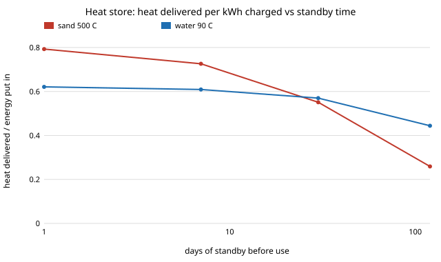

# energy-thermal: can a house-sized sand heat store carry summer heat into winter, and what does it cost in electricity compared with a heat pump?

Second project of track 16 built (`PROJECTS.md`, milestone 6, first version: a sand store only, no pipes, no ground). A sand store charged to 500 &deg;C by resistance heating is cheap to build and holds 142 kWh of usable heat per cubic metre. This project asks the question that decides whether it is worth building: how much of that heat is still there after the store stands, and what does the loss do to the electricity bill against a heat pump that needs no store? It is a transient finite-volume model of a spherical store in a spherical insulation shell, checked against analytic cases, and a hot-water tank is run through the same code for comparison. Produced with AI assistance (Claude).

**Live page:** https://duncan-haywood.github.io/monorepo-projects/research/energy-thermal/

**Headline (modelled, assumed inputs).** A sand store sized to still give 10 MWh of heat (roughly a house's winter share) after 120 days of standing needs **222 m<sup>3</sup> (7.5 m across) with 0.5 m of mineral wool, against 70 m<sup>3</sup> if it did not leak**, and returns only **26% of the electricity put in as heat** (0.5 m wool; 36% with 1 m, 18% with 0.25 m). A heat pump at COP 4 would have to use electricity **15 times dearer** than the store's for the store to win on running cost alone, before paying for 222 m<sup>3</sup> of sand and a heat exchanger. Left for a day or a week, the same sand store returns 79% and 73%, so it is a *days-scale* store, not a seasonal one at house size. Scale helps a lot: at 1,000 m<sup>3</sup> (district size) and 0.5 m of wool, 43% of the usable heat is left after 180 days. A hot-water tank with the same insulation loses less per day (its cool-side insulation conducts less in this model), but holds 2.5 times less heat per cubic metre.

**Builds on.** Standard heat-conduction theory, not any one paper. The sand-store idea follows commercial sand batteries such as Polar Night Energy's (500 &deg;C operating temperature, as quoted in [`energy-density`](../energy-density)); this project does not model their product. It builds on none of the CU Boulder groups in `prompt.md` and claims no connection to them. House-scale heat demand links to track 12 (`house-energy`); this project uses a round 10 MWh and does not read that project's model.



## Method (`src/energy_thermal/model.py`)
- **Geometry.** A sphere of storage medium inside a spherical insulation shell (30 equal shells of medium, 12 of insulation). A sphere has the least surface per volume, so losses are a best case for a real cylinder or box. Radial conduction only.
- **Equations.** Finite volume in spherical shells. Conductance between neighbouring shells is 4&pi;*k* / (1/*r*<sub>a</sub> &minus; 1/*r*<sub>b</sub>), with the interface handled as two resistances in series. Outside, a surface film (10 W/m<sup>2</sup>K) to ambient at 10 &deg;C. Backward Euler in 6-hour steps with a tridiagonal solve.
- **Charging** is instantaneous and uniform (an idealisation). **Usable heat** is what the medium can still give before its *mean* temperature falls to a cut-off (100 &deg;C for sand into a hydronic loop, 40 &deg;C for water), as if a heat exchanger reached the whole bed. The insulation's own stored heat is not counted.
- **Water** uses a very large effective conductivity to stand in for convective mixing.
- **Heat pump.** COP = 0.45 &times; Carnot at 35 &deg;C sink and 0 &deg;C source (3.96). Assumed.
- **Break-even price ratio** = COP / (heat delivered per kWh put in): how many times dearer the heat pump's electricity must be than the store's for the store to cost less per kWh of heat, ignoring capital cost.

### Checks (`tests/`)
The charged energy equals &rho;*cV*&Delta;*T*; energy is conserved with the outside shut off; with a well-mixed medium and massless insulation the mean temperature matches the exact lumped decay within 0.15 &deg;C over 20 days; the steady conductance is within 6% of the analytic spherical shell; larger stores and thicker insulation keep more heat; the volume solver meets its target; heat-pump COP falls with lift.

### Inputs (all assumed typical values; none was checked against a primary source in this run)
| Input | Value |
|---|---|
| Sand | 1,600 kg/m<sup>3</sup> bulk, 800 J/kgK, 0.30 W/mK (dry, loose) |
| Water | 970 kg/m<sup>3</sup>, 4,180 J/kgK |
| Mineral wool | 100 kg/m<sup>3</sup>, 840 J/kgK; 0.08 W/mK around the sand store (a hot-side average), 0.045 around the water tank |
| Temperatures | sand 500 to 100 &deg;C, water 90 to 40 &deg;C, ambient 10 &deg;C |
| Target | 10,000 kWh of heat after standby (a round number for a winter's share, not from a house model) |
| Heat pump | Carnot fraction 0.45; 35 &deg;C sink; 0 &deg;C source |

## Reproduce
```bash
pip install pytest
cd research/energy-thermal
python -m pytest -q tests                              # 9 tests
PYTHONPATH=src python experiments/run.py               # about 4 s; writes experiments/results.txt
python experiments/figure.py                           # experiments/standby.svg from results.txt
```
Standard library only.

## Results (from `experiments/results.txt`; deterministic)
- **A. Capacity.** Sand 500 to 100 &deg;C: 142 kWh/m<sup>3</sup>, 89 kWh/t. Water 90 to 40 &deg;C: 56 kWh/m<sup>3</sup>, 58 kWh/t.
- **B. Standing loss.** Usable heat left (sand, 0.5 m wool): 1 m<sup>3</sup> none after 30 days; 10 m<sup>3</sup> 31% after 30 days and none after 90; 100 m<sup>3</sup> 67%, 29% and none at 30, 90 and 180 days; 1,000 m<sup>3</sup> 85%, 64% and 43%. Cooling time constants run from 11 days (1 m<sup>3</sup>) to 190 days (1,000 m<sup>3</sup>). Doubling the insulation thickness helps less than a factor of ten in volume does. The full table (both media, three thicknesses) is in the file.
- **C. Sized for 10 MWh after 120 days.** Sand: 317, 222 and 161 m<sup>3</sup> with 0.25, 0.5 and 1 m of wool (no-loss size 70). Water: 327, 250 and 218 m<sup>3</sup> (no-loss size 178).
- **D. Against a heat pump.** Heat returned per kWh of electricity: sand 0.18, 0.26, 0.36 and water 0.34, 0.44, 0.51 for the three thicknesses; break-even price ratios 22, 15, 11 (sand) and 12, 9, 8 (water).
- **E. Standing time.** Sand, 0.5 m wool: 0.79 returned after 1 day, 0.73 after 7, 0.55 after 30, 0.26 after 120. Water: 0.62, 0.61, 0.57, 0.44. The water figures start lower because heat below the 40 &deg;C cut-off is counted as unusable, and 50 K of 80 K is.

## Limitations
- **Idealised charging and discharge.** Uniform instant charge and a heat exchanger that reaches the whole bed. A real sand bed charges from the inside out and is stratified, so usable heat and losses will differ. This model's numbers are for the store as an insulated lump with conduction inside, not for a built design.
- **A sphere, no ground, no pipes.** Real stores add end and ground losses, and pipes, fans and penetrations add more, so real standby losses are higher.
- **Constant, assumed properties.** Insulation conductivity rises with temperature and with moisture, sand conductivity depends on moisture and packing, and all of these are assumed values.
- **Not a house model.** The 10 MWh target is a round number. Comparing sand with water used different insulation conductivities, which favours water; the gap is not a verdict on the media.
- **Running cost only.** Capital cost, the heat exchanger, resistance heater life and electricity prices are not modelled, and none is claimed. The price ratios say how big the price gap must be before capital cost even enters.
- **Simulated is not tested.** Hot stores at 500 &deg;C are a fire and burn hazard, and no safety analysis was done. Building or testing one is an owner step with proper engineering.

## Next steps
1. Charge and discharge as a transient with a flowing heat-exchange fluid and a stratified bed, instead of an instant uniform charge.
2. Add costs for sand, insulation, heater and exchanger, every price sourced and dated, and a cost per kWh delivered (feeds `energy-lcos`).
3. Pair the store with an hourly house load and a heat pump (`energy-home`), and with district-heat demand.

## Outside dependencies
None. The project is pure Python with the standard library, and every input is in the source or the table above.
