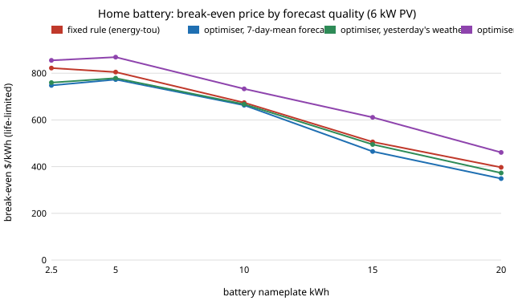

# energy-tou-lp-forecast: how much of an optimal home-battery controller's gain survives a realistic forecast?

Track 16 (energy), next step 1 of [`energy-tou-lp`](../energy-tou-lp) ("add forecast error (persistence or a seasonal forecast) to the rolling controller, to see how much of the $200 a year survives"). That project showed a rolling LP with a *perfect* 36 h forecast beats the best fixed rule by about $200 a year. A real controller does not know tomorrow's cloud or load. This project feeds the same LP forecasts built from past hours only and charges it the bill it actually earns.

**Live page:** https://duncan-haywood.github.io/monorepo-projects/research/energy-tou-lp-forecast/

**Headline (modelled; assumed tariff, synthetic weather).** For 10 kWh behind 6 kW of PV on the assumed three-band tariff, the best fixed rule saves **$694 a year** and the perfect-forecast rolling LP **$892**. With *yesterday's weather* as the forecast the LP saves **$726**; with the *mean of the last seven days* it saves **$691**. So 84% to 101% of the optimiser's $198 advantage disappears: the break-even price is **$667** and **$663/kWh** (life-limited) against the rule's **$674** and the perfect forecast's **$733**. On life-limited break-even the naive-forecast optimiser is *below* the fixed rule at every size from 2.5 to 20 kWh (it cycles 20% to 30% more for a similar saving). Forecasts that are the truth plus multiplicative noise keep 75% of the gain at 10% noise and 39% at 25%, and at 100% noise the optimiser loses to the rule. What this says: the value of optimal dispatch in `energy-tou-lp` is the value of a good forecast, not of a clever LP. It does not say how good a commercial weather forecast is.

**Builds on.** [`energy-tou-lp`](../energy-tou-lp) (LP, rolling window, wear, life limit; reused unchanged), [`energy-tou`](../energy-tou) (tariff, fixed rule) and [`energy-home`](../energy-home) (weather, load, battery). Receding-horizon control under forecast error is standard model-predictive control; no single paper is reproduced. No CU Boulder group's work; no connection is claimed.



## Method (`src/energy_tou_lp_forecast/model.py`)
At the start of each day the controller forecasts PV output and load for the next 36 h, solves the `energy-tou-lp` LP on the forecast, and follows the first 24 h of set-points. During execution the set-points are clipped by what exists: PV charging by the PV surplus actually available, discharge by the actual load and the actual state of charge, charging by capacity. The bill is computed from actual PV and load. The wear charge in the optimiser is $0.05 per kWh delivered, as `energy-tou-lp` used for its comparisons.

Forecasts (each sees only hours before the forecast origin; a test changes the future and checks the forecast does not move):
- **perfect:** the truth (reproduces `energy-tou-lp`'s rolling plan; a test checks it).
- **persistence:** the same hour yesterday. **week_mean:** the mean of the same hour over the last seven days. Hours of the window beyond the first 24 use the most recent known day.
- **noisy:** truth &times; (1 + &sigma; &middot; N(0,1)), floored at 0, for &sigma; = 0.1 to 1.0. An abstract skill dial, not a model of a weather service.

### Checks (`tests/`, 5)
A perfect forecast equals `energy-tou-lp`'s rolling LP; forecasts use past data only; with no battery the bill equals the no-battery bill; persistence and week-mean never beat the perfect forecast; zero noise equals perfect and heavy noise costs more.

## Reproduce
```bash
pip install pytest numpy scipy
cd research/energy-tou-lp-forecast
python -m pytest -q tests                    # needs ../energy-tou-lp, ../energy-tou, ../energy-home
PYTHONPATH=src:../energy-tou-lp/src:../energy-tou/src:../energy-home/src python experiments/run.py   # about 5 min; writes results.txt
python experiments/figure.py                 # experiments/forecast.svg
```

## Results (`experiments/results.txt`; deterministic, mean of 10 weather seeds, TOU tariff)
- **A. Controller by forecast (10 kWh).** Saving per year over no battery / life-limited break-even $/kWh / cycles per year / annual bill / share of the rule-to-perfect gap: best rule $694 / $674 / 226 / $671 / 0%; persistence $726 / $667 / 291 / $639 / 16%; seven-day mean $691 / $663 / 271 / $674 / &minus;1%; noise 100% $544 / $528 / 221 / $822 / &minus;76%; noise 50% $669 / $648 / 264 / $697 / &minus;13%; noise 25% $771 / $694 / 300 / $595 / 39%; noise 10% $843 / $718 / 326 / $523 / 75%; perfect $892 / $733 / 343 / $473 / 100%. (Annual saving rises with the forecast, but the life-limited break-even gains less than the saving, because a better forecast also cycles more.)
- **B. By size (life-limited break-even $/kWh; rule / seven-day mean / persistence / perfect).** 2.5 kWh $822 / $748 / $760 / $855; 5 $805 / $773 / $779 / $869; 10 $674 / $663 / $667 / $733; 15 $506 / $465 / $495 / $611; 20 $397 / $349 / $373 / $461. Persistence beats the seven-day mean at every size, and both are below the fixed rule at every size, by $7 to $74/kWh.

## Limitations
- **Naive forecasts only.** Persistence and a seven-day mean are the weakest sensible forecasts; a numerical weather model plus a load model would sit between these and the perfect case. The noise rows say what a given multiplicative skill is worth, not which skill a vendor delivers. Published forecast errors were not pulled in; that is the next step.
- **The synthetic weather's day-to-day persistence is not real weather's.** `energy-home` draws each day's sky from a three-state Markov chain (daily clear-sky index lag-1 autocorrelation 0.50 over 5 seeds), against 0.29 to 0.36 in PVGIS typical-year data for three US sites; [`energy-tou-lp-tmy`](../energy-tou-lp-tmy) repeats the comparison on that data, with a clear-sky-index forecast, and finds the same conclusion (an earlier version of this line said the days were independent; they are not).
- **Execution is a simple clip,** with no re-planning inside the day. A controller that re-plans hourly on the observed state would recover some of the loss.
- **Start-up days** (the first week has less history) are included in the year, so the history-based forecasts are slightly handicapped; it is a small share of the year.
- **Assumed tariff, synthetic weather and load, crude cycle-count life,** all inherited from `energy-tou-lp`; none of it is measured data or a real utility rate.
- **Simulated is not tested.** Home batteries are a fire hazard and a grid connection needs a licensed electrician and the utility's approval. Nothing here is installation advice; no safety analysis was done.

## Next steps
1. Replace the synthetic weather by measured hourly data (NREL TMY or a public irradiance series) and add a clear-sky-index forecast, which is the standard cheap forecast.
2. Re-plan hourly on the observed state, to see how much of the loss is execution rather than forecast.
3. Take published day-ahead PV and load forecast errors (normalised RMSE) and place them on the noise scale.

## Outside dependencies
NumPy and SciPy (HiGHS) plus the sibling projects `energy-tou-lp`, `energy-tou` and `energy-home`; every price is assumed.
