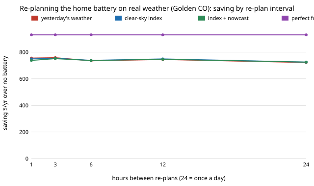

# energy-tou-lp-replan: how much of the home-battery optimiser's forecast loss does re-planning every few hours recover?

Track 16 (energy), next step 2 of [`energy-tou-lp-tmy`](../energy-tou-lp-tmy) ("re-plan hourly on the observed state, to separate the execution loss from the forecast loss"). That project planned once a day and committed 24 h, so a plan could not react when the day turned out cloudier or sunnier than forecast. Here the same LP re-plans every 24, 12, 6, 3 or 1 hours from the battery's real state of charge, with a forecast that sees the hours since midnight, on PVGIS typical-year irradiance at Golden CO, Phoenix AZ and Seattle WA.

**Live page:** https://duncan-haywood.github.io/oss-monorepo/research/energy-tou-lp-replan/

**Headline (modelled; assumed tariff, load and costs; PVGIS-ERA5 typical years; 10 kWh, 6 kW PV; 3 load seeds).** Re-planning every 3 to 12 hours instead of once a day adds **$10 to $36 a year** to the realistic controllers (Golden, clear-sky-index forecast: $725 at 24 h, $749 at 12 h, $754 at 3 h; Seattle $678 to $713; Phoenix $780 to $797). The perfect-forecast controller saves $930, $881 and $853, so re-planning closes at most about **17 percentage points** of the rule-to-perfect gap (Golden: &minus;5% of the gap at 24 h, 8% hourly; Seattle 26% to 40%; Phoenix 53% to 60%). Most of the loss is therefore *forecast* loss, not execution loss. A nowcast (the clear-sky index of the last three sunlit hours, relaxing to yesterday's index) does *not* beat the plain clear-sky-index forecast here, and re-planning hourly is no better than every three hours. At Golden every re-planned realistic controller saves $738 to $758 against the rule's $734, a margin of $4 to $24 a year, but all of them have a life-limited break-even price ($650 to $660 per kWh hourly) below the rule's $713 because they cycle more. It does not say what a numerical weather forecast would do.

**Builds on.** [`energy-tou-lp-tmy`](../energy-tou-lp-tmy) (weather, clear-sky-index forecast, execution rule; a test checks that `step=24` reproduces its bill), [`energy-tou-lp`](../energy-tou-lp) (the LP, unchanged), [`energy-tou`](../energy-tou), [`energy-home`](../energy-home). Smart persistence: Inman, Pedro and Coimbra (2013), *Progress in Energy and Combustion Science* 39, 535-576. Receding-horizon (model predictive) control is the standard framing for re-planning with fresh state. Weather: PVGIS, European Commission Joint Research Centre. No CU Boulder group's work; no connection is claimed.



## Method (`src/energy_tou_lp_replan/model.py`)
At every `step`-th hour the controller forecasts PV and load for 36 h from the hours already observed, solves the `energy-tou-lp` LP from the actual state of charge, executes the first `step` hours clipped by what physically exists, and is billed on actual PV and load. Forecasts: **persistence** (same hour yesterday), **smart** (last 24 h clear-sky index times the Haurwitz curve), **nowcast** (index of the last three sunlit hours, relaxing with time constant &tau; = 3 h to the 24 h index), **perfect**. Load forecast: yesterday's load unless marked. The re-plan interval is the only thing that varies. Hourly re-planning makes the smart and persistence forecasts use the freshest 24 h window.

### Checks (`tests/`, 8)
`step=24` reproduces `energy-tou-lp-tmy` for three forecasts; the nowcast uses past data only and reduces to the smart forecast when &tau; &rarr; 0; a perfect forecast gains under 1% from re-planning; with no battery the bill does not depend on the step.

## Reproduce
```bash
pip install pytest numpy scipy
cd research/energy-tou-lp-replan
python -m pytest -q tests
PYTHONPATH=src:../energy-tou-lp-tmy/src:../energy-tou-lp/src:../energy-tou/src:../energy-home/src python experiments/run.py   # about 15 min on 4 cores; writes results.txt
python experiments/figure.py       # experiments/replan.svg
```

## Results (`experiments/results.txt`; deterministic)
- **A. Saving over no battery ($/yr; steps 24 / 12 / 6 / 3 / 1 h).** Golden: persistence 722 / 745 / 735 / 758 / 755; smart 725 / 749 / 738 / 754 / 749; nowcast 725 / 746 / 737 / 751 / 738; perfect 930; best fixed rule 734. Phoenix: smart 780 / 795 / 794 / 797 / 795; perfect 881; rule 669. Seattle: smart 678 / 708 / 705 / 713 / 711; perfect 853; rule 618.
- **B. Share of the rule-to-perfect gap, 24 h &rarr; hourly.** Golden persistence &minus;6% &rarr; 11%, smart &minus;5% &rarr; 8%, nowcast &minus;5% &rarr; 2%; Phoenix 53&ndash;55% &rarr; 56&ndash;62%; Seattle 26% &rarr; 34&ndash;40%. Cycles rise by 20 to 30 a year with hourly re-planning, and the life-limited break-even price is flat or falls (Golden smart $673 &rarr; $656): the extra saving is paid for in wear.
- **C. Load forecast.** With a perfect load forecast the nowcast saves $15 to $20 more at every interval (Golden $740 at 24 h, $771 at 3 h); the load forecast is a similar order of loss to the re-plan interval.
- **D. Nowcast time constant at Golden, hourly.** &tau; = 1 / 3 / 6 / 12 h: $742 / 738 / 735 / 732. A shorter memory is better, so the nowcast is closer to "the last hour continues" than to a persistence of the sky state. All within $10, inside the seed noise.

Differences of under about $10 a year (the non-monotone steps at Golden, and 1 h against 3 h) are within what three load seeds and one typical year can resolve; they are not a finding.

## Limitations
- One typical year per site, three load seeds; the TMY joins months from different years. No interval estimate was computed, so small differences are not significant.
- Smart persistence and a three-hour nowcast only. No numerical weather forecast, which is where hour-to-hour cloud information would come from; the results bound what *no* NWP achieves.
- Load is synthetic (`energy-home`) and the tariff, battery cost, efficiency, wear charge and 4,000-cycle life are assumed, inherited from `energy-tou-lp`. &tau; = 3 h and the 50 W/m<sup>2</sup> sunlit threshold are my choices; &tau; was swept (D) only at Golden.
- The LP plans a 36 h window each time without terminal value for stored energy, which may make very frequent re-plans slightly myopic; not tested.
- **Simulated is not tested.** Home batteries are a fire hazard and a grid connection needs a licensed electrician and the utility's approval. Nothing here is installation advice. Produced with AI assistance.

## Next steps
1. Add an archived NWP day-ahead irradiance forecast (NOAA HRRR or GFS) at the same sites.
2. Add a terminal value of stored energy to the LP and test whether it fixes the hourly-versus-3-hourly dip.
3. Replace the synthetic load with a measured household series and ground-station irradiance (NREL NSRDB).

## Outside dependencies
NumPy and SciPy (HiGHS), the sibling projects `energy-tou-lp-tmy`, `energy-tou-lp`, `energy-tou` and `energy-home`. Every price is assumed.
