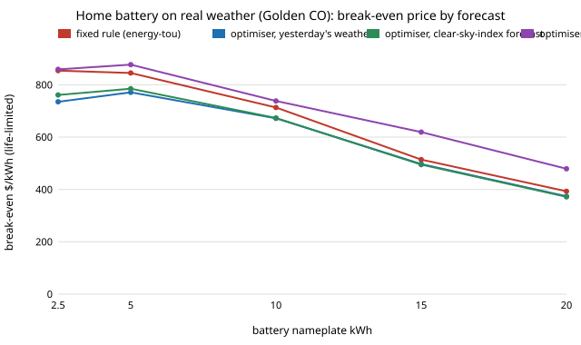

# energy-tou-lp-tmy: does a clear-sky-index forecast rescue the optimal home-battery controller on real weather?

Track 16 (energy), next step 1 of [`energy-tou-lp-forecast`](../energy-tou-lp-forecast) ("replace the synthetic weather by measured hourly data ... and add a clear-sky-index forecast, which is the standard cheap forecast"). That project found that a rolling LP fed yesterday's weather lost most of its advantage over a fixed rule, on seeded synthetic weather. Was that an artefact of the synthetic sky? This project reruns it on hourly irradiance from PVGIS typical-year files for three US climates, with the standard cheap PV forecast added.

**Live page:** https://duncan-haywood.github.io/monorepo-projects/research/energy-tou-lp-tmy/

**Headline (modelled; assumed tariff, load and costs; irradiance from PVGIS-ERA5 typical years).** For 10 kWh behind 6 kW of PV, the perfect-forecast rolling LP saves **$929 / $880 / $852 a year** at Golden CO / Phoenix AZ / Seattle WA, against the best fixed rule's **$734 / $668 / $618**. With *yesterday's weather* it saves $722 / $785 / $677; with a *clear-sky-index forecast* (yesterday's clear-sky index times the known clear-sky curve) $725 / $780 / $678. So the forecasts keep **&minus;6% to &minus;5%** of the optimiser's gain over the rule at Golden (the rule wins), **53% to 55%** at sunny Phoenix and **25% to 26%** at cloudy Seattle. The clear-sky forecast is clearly a better *forecast* (hourly nRMSE 0.55 against 0.63 at Golden, 0.60 against 0.68 at Seattle) and still does not change the *bill* by more than $5 a year, and a perfect load forecast on top adds only $15 to $18. At Golden the realistic optimisers' life-limited break-even price ($672 to $677/kWh) is below the fixed rule's ($713) because they cycle 24% more for no extra saving. What this says: on real weather the value of optimal dispatch still depends on forecast skill that cheap forecasts do not supply, and it depends on the climate. It does not say how a numerical weather forecast would do (next steps).

**Builds on.** [`energy-tou-lp-forecast`](../energy-tou-lp-forecast) (execution rule and forecast framework), [`energy-tou-lp`](../energy-tou-lp) (LP, wear, life limit; reused unchanged), [`energy-tou`](../energy-tou) (tariff, fixed rule) and [`energy-home`](../energy-home) (battery, load shape, Haurwitz clear-sky model). Clear-sky model: Haurwitz (1945); the clear-sky-index persistence forecast is the standard "smart persistence" benchmark of solar forecasting (Inman, Pedro and Coimbra 2013, *Progress in Energy and Combustion Science* 39, 535-576). Weather: PVGIS, European Commission Joint Research Centre. No CU Boulder group's work; no connection is claimed.



## Data (`data/*.csv`)
Hourly global horizontal irradiance (W/m<sup>2</sup>, UTC) of the PVGIS typical meteorological year (TMY) at each site, downloaded 2026-10-21 from the PVGIS 5.2 `tmy` endpoint (`https://re.jrc.ec.europa.eu/api/v5_2/tmy?lat=<lat>&lon=<lon>&outputformat=csv`, ERA5-based, 2005 to 2020 source years), keeping only the time and `G(h)` columns. PVGIS data are free to use with attribution (&copy; European Union, 2001-2026). A TMY is twelve real months from different years joined together, so day-to-day weather is real inside a month and discontinuous at month boundaries.

| Site | Latitude, longitude | UTC offset used | Annual GHI in file (kWh/m<sup>2</sup>) | Mean daily clear-sky index |
|---|---|---|---|---|
| Golden CO | 39.74, &minus;105.18 | &minus;7 | 1,619 | 0.79 |
| Phoenix AZ | 33.45, &minus;112.07 | &minus;7 | 2,142 | 0.95 |
| Seattle WA | 47.61, &minus;122.33 | &minus;8 | 1,234 | 0.64 |

Hours are re-indexed to local standard time (no daylight saving), so the tariff's hours line up with the sun.

## Method (`src/energy_tou_lp_tmy/model.py`)
PV output is 6 kW &times; 0.8 &times; GHI/1000, as `energy-home`. At each local midnight the controller forecasts PV and load for 36 h, solves the `energy-tou-lp` LP on the forecast, follows 24 h of set-points clipped by what physically exists, and is billed on actual PV and load (the `energy-tou-lp-forecast` execution rule; a test checks that a perfect forecast reproduces that project's result). Wear charge $0.05 per kWh delivered in the optimiser.

PV forecasts (each sees only hours before the forecast origin; a test changes the future and checks the forecast does not move):
- **perfect:** the truth.  **persistence:** the same hour yesterday.
- **smart:** the clear-sky index of the last 24 h (sum of GHI over sum of Haurwitz clear-sky GHI) times the Haurwitz curve for the target hours.  **smart_week:** the same with the mean of the last seven daily indices.
- Load forecast: yesterday's load (or the truth where marked); load is the `energy-home` synthetic shape at 8,000 kWh/yr, five noise seeds, since no measured household series is bundled.

The Haurwitz curve is evaluated at the hour label (a 0.5 h shift from the hour midpoint); the shift that maximises correlation with the data is &minus;0.25, &minus;0.5 and &minus;0.75 h at Golden, Phoenix and Seattle, and &minus;0.5 is used for all. Haurwitz underestimates clear-sky irradiance at altitude, so Golden's daily index reaches 1.22; the index is not clipped.

### Checks (`tests/`, 12)
Each file has 8,760 non-negative values with plausible annual GHI; the clear-sky curve is bounded and dark at night; persistence, smart and smart_week forecasts use past data only; a day with constant clear-sky index is forecast exactly; a perfect forecast equals `energy-tou-lp-forecast`; with no battery the bill equals the no-battery bill; realistic forecasts never beat the perfect one.

## Reproduce
```bash
pip install pytest numpy scipy
cd research/energy-tou-lp-tmy
python -m pytest -q tests          # needs ../energy-tou-lp-forecast, ../energy-tou-lp, ../energy-tou, ../energy-home
PYTHONPATH=src:../energy-tou-lp-forecast/src:../energy-tou-lp/src:../energy-tou/src:../energy-home/src python experiments/run.py   # about 5 min; writes results.txt
python experiments/figure.py       # experiments/tmy.svg
```

## Results (`experiments/results.txt`; deterministic)
- **A. Forecast skill alone** (day-ahead, days 8 to 364; hourly nRMSE = RMSE over mean daylight GHI; persistence / smart / smart_week). Golden 0.63 / 0.55 / 0.51; Phoenix 0.26 / 0.25 / 0.23; Seattle 0.68 / 0.60 / 0.56. Daily-energy mean absolute error over mean daily energy: Golden 0.29 / 0.29 / 0.28; Phoenix 0.11 / 0.11 / 0.12; Seattle 0.33 / 0.33 / 0.31. The clear-sky index helps the *shape* of the day (hourly), not the *amount* (daily energy): tomorrow's cloudiness is as unknown as before. Lag-1 autocorrelation of the daily clear-sky index: 0.29, 0.31, 0.36 in the data against 0.50 for the `energy-home` synthetic chain.
- **B. Controller by forecast** (10 kWh; saving per year over no battery / life-limited break-even $/kWh / cycles per year / share of the rule-to-perfect gap):
  - Golden: best rule $734 / $713 / 230 / 0%; persistence $722 / $672 / 286 / &minus;6%; smart $725 / $673 / 286 / &minus;5%; smart_week $733 / $677 / 288 / &minus;1%; smart with perfect load $740 / $680 / 291 / 3%; perfect $929 / $738 / 360 / 100%.
  - Phoenix: rule $668 / $649 / 202 / 0%; persistence $785 / $671 / 324 / 55%; smart $780 / $668 / 323 / 53%; smart_week $779 / $669 / 321 / 52%; smart, perfect load $798 / $676 / 329 / 61%; perfect $880 / $707 / 355 / 100%.
  - Seattle: rule $618 / $600 / 199 / 0%; persistence $677 / $628 / 287 / 25%; smart $678 / $632 / 285 / 26%; smart_week $691 / $641 / 287 / 31%; smart, perfect load $694 / $639 / 290 / 32%; perfect $852 / $691 / 350 / 100%.
- **C. By size at Golden** (life-limited break-even $/kWh; rule / persistence / smart / perfect). 2.5 kWh $854 / $735 / $761 / $859; 5 $845 / $771 / $785 / $877; 10 $713 / $672 / $673 / $738; 15 $514 / $497 / $495 / $619; 20 $393 / $374 / $372 / $479. The fixed rule is at or above both realistic forecasts at every size.

The Phoenix result is the one place the optimiser clearly pays on a cheap forecast: nearly every day is sunny, so yesterday predicts tomorrow. Where the weather is variable, the day-ahead error is a coin flip about whether to hold charge for the evening peak.

## Limitations
- **One typical year per site, three sites.** No interannual spread; the load seeds vary only the household load. Golden, Phoenix and Seattle are chosen to span clear to cloudy, not to represent the country.
- **Reanalysis irradiance, not a pyranometer record.** ERA5-based GHI can carry biases against ground stations (Golden's file totals 1,619 kWh/m<sup>2</sup> a year); no comparison with a ground station was made here. The TMY also smooths extremes by construction.
- **Smart persistence only.** It is the weakest standard forecast that uses the sun's geometry. A numerical weather prediction forecast (GFS, HRRR) would carry tomorrow's cloud information that nothing here has; the results bound what *no* weather information achieves, not what a commercial controller using one gets. Published day-ahead forecast errors were not pulled in.
- **Load is synthetic**, an invented shape with 10% noise, and the load forecast is yesterday's value. A measured household series would matter more than the PV forecast for some homes: the perfect-load rows add $15 to $18 a year here.
- **Execution is a simple clip** with no re-planning inside the day (as the sibling project).
- **Tariff, battery price, round-trip efficiency, wear charge and the 4,000-cycle life are assumed**, inherited from `energy-tou-lp`; none is measured or a real utility rate. The clear-sky model's timing (hour label) was calibrated on the same data, a 0.5 h choice that does not drive any result here.
- **Simulated is not tested.** Home batteries are a fire hazard and a grid connection needs a licensed electrician and the utility's approval. Nothing here is installation advice; no safety analysis was done.

## Next steps
1. Add a numerical-weather-prediction day-ahead forecast (archived NOAA HRRR or GFS irradiance) at the same sites, to place a real forecaster between smart persistence and perfect.
2. Re-plan hourly on the observed state, to separate the execution loss from the forecast loss.
3. Replace the synthetic load by a measured household series (for example the public Pecan Street or UK-DALE data, licence permitting), and use ground-station irradiance (NREL NSRDB) to check ERA5.

## Outside dependencies
NumPy and SciPy (HiGHS), the sibling projects `energy-tou-lp-forecast`, `energy-tou-lp`, `energy-tou` and `energy-home`, and PVGIS's typical-year files (downloaded once, committed under `data/`). Every price is assumed.
