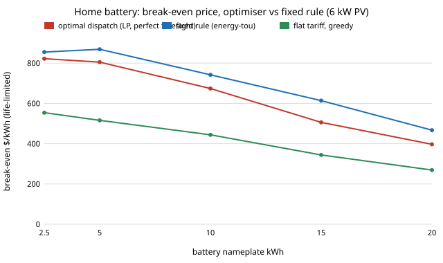

# energy-tou-lp: how much is a home battery worth on a time-of-use tariff if it is dispatched optimally, and does that change the sizing answer?

Track 16 (energy), next step 2 of [`energy-tou`](../energy-tou) ("replace the fixed rule by a day-ahead optimiser (LP) to find the true value, and charge cycling wear to the battery"). `energy-tou` reported break-evens from a fixed rule and called them lower bounds. This project computes the bound: a linear program that sees the whole year (and a 36 h receding-horizon version) against that rule, with a cycle-life limit so that an optimiser that cycles hard pays for it in battery life.

**Live page:** https://duncan-haywood.github.io/oss-monorepo/research/energy-tou-lp/

**Headline (modelled; assumed tariff, synthetic weather).** On the same assumed three-band tariff, a 10 kWh battery behind 6 kW of PV breaks even at **$867/kWh** installed under optimal dispatch with perfect foresight, against **$674** for the best fixed rule and **$444** on the flat tariff. With the battery's life limited to 4,000 full cycles (the optimiser cycles it 338 times a year, the rule 226), the optimal figure is **$742**, still **10% above the rule** and still under the assumed $800 at 10 kWh. With the same life limit the optimiser's gain is largest at 15 kWh (**$614** against the rule's **$506**) and smallest at 2.5 kWh (**$855** against **$822**). A rolling 36 h plan with a perfect forecast gets within $1 of the whole-year optimum ($866 against $867), so a day-ahead controller does not need to see the year. The size ranking does not change: small batteries (2.5 to 5 kWh) clear $800, 10 kWh and larger do not. This says how much a better controller adds on a stylised tariff, not that any home should buy a battery.

**Builds on.** [`energy-tou`](../energy-tou) and [`energy-home`](../energy-home) (weather, load, battery and tariff model, reused unchanged; a test checks that the LP never costs more than any of the `energy-tou` rules). Battery scheduling by linear programming under time-varying prices is standard (for example the PyPSA and HiGHS stack used in [`energy-mix`](../energy-mix)); no single paper is reproduced. No CU Boulder group's work; no connection is claimed.



## Method (`src/energy_tou_lp/model.py`)
Same hourly year as `energy-tou` (10 seeded synthetic weather years, 8,000 kWh/yr load, 6 kW PV, battery 90% usable, 90% round trip, C/2, 6% discount, export $0.05). PV is used directly first; the rest is a linear program in three hourly variables (PV surplus into the battery, grid into the battery, battery to load) and a state of charge:

minimise  &Sigma; price<sub>t</sub> &middot; imports<sub>t</sub> &minus; export &middot; exports<sub>t</sub> + wear &middot; &Sigma; discharge<sub>t</sub>

subject to energy balance of the battery (&radic;(round trip) each way), power limit C/2, capacity, and no negative import. It is solved by HiGHS through SciPy (about 0.3 s a year). Three controllers:
- **year LP:** the whole year at once, perfect foresight (a lower bound on any controller's bill).
- **rolling 36 h:** solve 36 h with a perfect forecast, commit 24 h, repeat (a day-ahead controller with a perfect day-ahead forecast).
- **best rule:** the better of the 50% and 100% grid-fill peak-discharge rules of `energy-tou`.

**Cycle life.** Break-even = annual bill saving / (capital-recovery factor x kWh). The "life-limited" column shortens the battery's life to min(15 years, 4,000 full cycles / cycles per year) before computing the factor, so extra cycling is charged as a shorter life rather than twice. `wear` is a separate knob inside the optimiser (dollars per kWh delivered) that makes it cycle less; it is not added to the bill.

### Checks (`tests/`, 8)
LP with no battery equals the no-battery bill; the LP never costs more than any `energy-tou` rule; battery energy balance, state-of-charge, power and PV/need limits hold in the solution; a flat tariff with no PV earns nothing; a very large wear charge stops all cycling; a larger wear charge lowers throughput; the rolling plan lies between the year LP and the rule; the rule's cost matches `energy-tou`'s simulator.

## Reproduce
```bash
pip install pytest numpy scipy
cd research/energy-tou-lp
python -m pytest -q tests                     # 8 tests (needs ../energy-home and ../energy-tou)
PYTHONPATH=src:../energy-tou/src:../energy-home/src python experiments/run.py   # about 1.5 min; writes experiments/results.txt
python experiments/figure.py                  # experiments/breakeven.svg
```

## Results (`experiments/results.txt`; deterministic, mean of 10 weather seeds, 10 kWh unless stated)
- **A. Controller.** Break-even ($/kWh, no life limit / life-limited), cycles per year, annual bill (no battery: $1,365): flat greedy $444 / $444, 208, $924; TOU greedy $553 / $553, 208, $796; best fixed rule $674 / $674, 226, $671; rolling 36 h $866 / $733, 343, $473; year LP $867 / $742, 338, $472. Optimal dispatch saves about $200 a year more than the best rule.
- **B. Wear charge in the optimiser.** Up to $0.05 per kWh delivered changes nothing (the tariff spread is wider); $0.10 gives $785 life-limited (290 cycles a year, bill $513); $0.20 gives $800 (262 cycles, $542). So when cycle life binds, a wear-aware optimiser is worth $43 to $58/kWh over a wear-blind one, and it brings 10 kWh to the $800 line.
- **C. By size (life-limited, rule / year LP / flat greedy).** 2.5 kWh $822 / $855 / $554; 5 $805 / $869 / $516; 10 $674 / $742 / $444; 15 $506 / $614 / $344; 20 $397 / $467 / $269. The optimiser adds $33 to $108/kWh; its largest gain is at 15 kWh.
- **D. Peak price (rule / LP at wear $0.05).** $0.28: $358 / $412; $0.35: $477 / $548; $0.45: $674 / $742; $0.55: $879 / $936; $0.70: $1,210 / $1,227. The controller matters most when the spread is moderate; at a very wide spread the simple rule is nearly optimal.
- **E. No PV (pure arbitrage).** Without the life limit the LP breaks even at $786 against the rule's $736 (346 against 298 cycles a year); life-limited, the LP's $660 is *below* the rule's $686, because 346 cycles a year wears out 4,000 cycles in 11.6 years. Wear charges of $0 to $0.10 in the optimiser all gave $660 here, so the coarse wear sweep did not find a better trade-off.

## Limitations
- **Perfect foresight.** The year LP and each 36 h window know the weather and load exactly. Real controllers forecast with error, so these figures are upper bounds on what a controller can earn; how much a real forecast loses was not measured.
- **Assumed tariff, synthetic weather and load,** inherited from `energy-tou` and `energy-home`: no measured data and no real utility rate (section D shows the spread steers the answer).
- **Crude degradation.** Wear is a cycle-count life limit (4,000 full cycles, assumed, one number); no depth-of-discharge, temperature or calendar ageing. Section B shows the answer depends on it, and which wear charge is best was only swept coarsely.
- **Stylised economics.** No demand charges, fixed charges, taxes, incentives, inverter replacement or backup value. Export is a flat $0.05, and the LP may export freely.
- **Simulated is not tested.** Home batteries are a fire hazard and a grid connection needs a licensed electrician and the utility's approval. Nothing here is installation advice; no safety analysis was done.

## Next steps
1. Add forecast error (persistence or a seasonal forecast) to the rolling controller, to see how much of the $200 a year survives.
2. Replace the cycle-count life with a depth-of-discharge degradation model, and optimise the wear charge for life-limited value directly.
3. Use a published TOU tariff and measured hourly data (NREL TMY, a public household load); build the sizing tool a household can run on its own bill.

## Outside dependencies
NumPy and SciPy (HiGHS) plus the sibling projects `energy-home` and `energy-tou`; every price is assumed and stated above.
