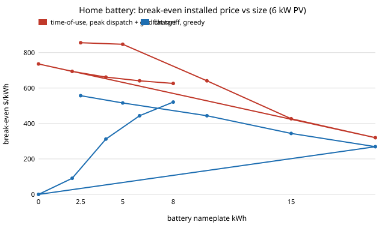

# energy-tou: does time-of-use pricing make a home battery pay, and which size?

Track 16 (energy), next step 2 of [`energy-home`](../energy-home) ("add time-of-use import prices and see whether the break-even rises above $800"). `energy-home` found that at a flat $0.30 import / $0.05 export tariff a 10 kWh battery pays only below **$451/kWh** installed, under the assumed $800. A time-of-use (TOU) tariff pays for moving energy from cheap hours to dear ones, which is exactly what a battery does. This project asks how much that is worth. Produced with AI assistance (Claude).

**Live page:** https://duncan-haywood.github.io/monorepo-projects/research/energy-tou/

**Headline (modelled; assumed tariff, synthetic weather).** Under an assumed three-band tariff ($0.15 off-peak 21:00-07:00, $0.28 shoulder, $0.45 peak 16:00-21:00; load-weighted mean $0.296, the same average as the flat $0.30), a 10 kWh battery behind 6 kW of PV breaks even at **$641/kWh** installed with peak-only discharge and full off-peak grid charging, against **$444** on the flat tariff: 44% higher, but still under the assumed $800. The battery clears $800 only when it is small: **$856 at 2.5 kWh and $847 at 5 kWh**, falling to $427 at 15 kWh and $320 at 20 kWh, because the first kWh of battery covers the peak and later ones have nothing dear left to avoid. Filling the battery fully from the grid is not best: a half fill ($674) beats a full fill ($641), because grid energy takes the room that free midday PV surplus would have filled. The spread is what matters: with the peak price at $0.28, $0.45 and $0.70 (off-peak $0.15), break-even is $307, $641 and $1,208. A battery with no PV earns $736/kWh on this tariff by arbitrage alone, and nothing on a flat one. This says where TOU changes the sizing answer, not that any home should buy a battery.

**Builds on.** [`energy-home`](../energy-home) (weather, load, battery and cost model, reused unchanged; a test checks that on a flat tariff with greedy dispatch this project reproduces its imports, exports and break-even exactly). The arbitrage view follows the usual storage-value literature; no single paper is reproduced. No CU Boulder group's work; no connection is claimed.



## Method (`src/energy_tou/model.py`)
Same hourly year as `energy-home` (10 seeded synthetic weather years, 8,000 kWh/yr load, 6 kW PV, battery 90% usable, 90% round trip, C/2, 6% discount, 15-year life, export $0.05). The import price now depends on the hour of day. Two dispatch rules, no forecast:
- **greedy:** discharge whenever the load needs it (as `energy-home`).
- **peak:** discharge only in the tariff's top-price hours; PV surplus always charges; optionally fill a share (`grid_charge`) of usable capacity from the grid in the lowest-price hours.

Break-even = (bill without battery - bill with it) / (capital-recovery factor x kWh), the same definition as `energy-home`.

### Checks (`tests/`, 8)
Flat tariff plus greedy dispatch matches `energy-home` imports, exports and break-even; the TOU band shape; policy is irrelevant without a battery; energy balance with grid charging; grid charging requires the peak policy; peak dispatch beats the flat break-even; a battery with no PV earns nothing on a flat tariff and something on TOU; peak dispatch equals greedy when every hour is peak.

## Reproduce
```bash
pip install pytest
cd research/energy-tou
python -m pytest -q tests                              # 8 tests (needs ../energy-home)
PYTHONPATH=src python experiments/run.py               # about 6 s; writes experiments/results.txt
python experiments/figure.py                           # experiments/breakeven.svg
```
Standard library only.

## Results (`experiments/results.txt`; deterministic, mean of 10 weather seeds)
- **A. Break-even, 6 kW PV, 10 kWh.** Flat greedy $444; TOU greedy $553; TOU peak-only discharge, no grid charge $543; with a 50% grid fill $674; with a 100% fill $641. Peak-only without grid charge is slightly worse than greedy: holding charge for the peak leaves the shoulder hours unserved.
- **B. By battery size (TOU, peak, full fill / flat greedy).** 2.5 kWh $856 / $557; 5 $847 / $516; 10 $641 / $444; 15 $427 / $344; 20 $320 / $269.
- **C. By PV size (10 kWh, TOU / flat).** 0 kW $736 / $0; 2 $694 / $91; 4 $662 / $312; 6 $641 / $444; 8 $626 / $521. TOU matters most for homes with little solar.
- **D. Peak price sweep** (off-peak $0.15, shoulder $0.28): $0.28 gives $307 (no peak band, so peak hours are all daytime hours), $0.35 $414, $0.45 $641, $0.55 $868, $0.70 $1,208. Break-even rises about $1,000 per $0.10 of peak price in this range.
- **E. Annual bill** with 6 kW PV: $1,365 without the battery, $705 with 10 kWh (saving $660 a year before the battery's cost, $0.296 average price).

## Limitations
- **Assumed tariff.** The three bands are round numbers chosen to have the flat tariff's average, not any utility's rate; real TOU plans differ by season, weekday and demand charges. Section D shows the answer is steered by the spread, so check a real tariff before using any number here.
- **Synthetic weather and load,** inherited from `energy-home`: no measured data.
- **Simple dispatch.** A fixed rule with no forecast; an optimiser could do better, so break-evens are lower bounds on what TOU storage is worth. The half fill beating the full fill shows the rule matters.
- **Stylised economics.** No degradation from extra cycling (grid charging adds cycles), no incentives, taxes, fixed charges, inverter replacement or backup-power value. Export is a flat $0.05.
- **Simulated is not tested.** Home batteries are a fire hazard and a grid connection needs a licensed electrician and the utility's approval. Nothing here is installation advice; no safety analysis was done.

## Next steps
1. Take a published TOU tariff (dated, sourced) and measured hourly data (NREL TMY and a public household load) in place of the assumed ones.
2. Replace the fixed rule by a day-ahead optimiser (LP) to find the true value, and charge cycling wear to the battery.
3. Pair with `energy-lcos` sourced prices, and build the sizing tool a household can run on its own bill.

## Outside dependencies
None. Standard library plus the sibling project `energy-home`; every price is assumed and stated above.
