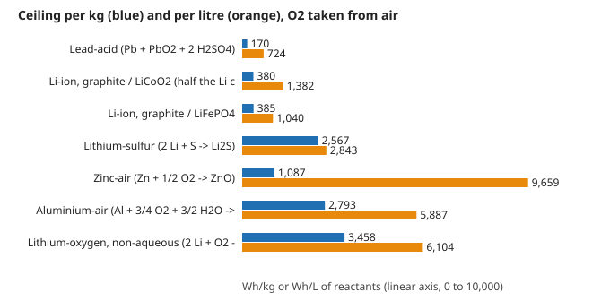

# energy-volumetric: how much energy can each storage chemistry hold per litre, and does the ranking by weight survive? Volumetric ceilings from reactant densities

Track 16 (energy), next step 2 of `energy-density`. **Headline.** With oxygen taken from air, the active-material ceilings are zinc-air 9,659 Wh/L, lithium-oxygen 6,104, aluminium-air 5,887, lithium-sulfur 2,843, graphite/LiCoO<sub>2</sub> 1,382, graphite/LiFePO<sub>4</sub> 1,040 and lead-acid 724. The ranking by weight does not carry over: lithium-sulfur beats graphite/LiCoO<sub>2</sub> by 6.8 times per kg but only 2.1 times per litre, because lithium is light and bulky (0.534 kg/L); zinc-air beats lead-acid by 6.4 times per kg and 13 times per litre. Hydrogen holds 1,314 Wh/L at 700 bar and 2,314 Wh/L as a 20 K liquid (hydrogen alone, oxygen from air). Sand heated to 500 &deg;C holds 171 Wh/L as heat and 70 Wh/L as electricity at best. Produced with AI assistance (Claude).

**Live page:** https://duncan-haywood.github.io/oss-monorepo/research/energy-volumetric/

**Builds on.** `energy-density` (couples, voltages, atomic weights, thermal and flywheel models). No CU Boulder group's work; no connection is claimed.



## Method (`src/energy_volumetric/model.py`)
Wh/L = *n* F *E* / (&Sigma; *M*<sub>i</sub> / &rho;<sub>i</sub>) over the reactants, in two views: every reactant stored (oxygen as liquid, 1.141 kg/L), and oxygen taken from air (its volume dropped). Water in Al-air is counted. Stores use Wh/kg from `energy-density` times an assumed bulk density (sand 1.6, salt 1.8, CFRP 1.56 kg/L).

Densities (kg/L, **all assumed** handbook values, none checked against a primary source in this run): Pb 11.34, PbO<sub>2</sub> 9.38, H<sub>2</sub>SO<sub>4</sub> 1.83, H<sub>2</sub>O 1.00, LiC<sub>6</sub> 2.20 (approximate), Li<sub>0.5</sub>CoO<sub>2</sub> 5.00 (approximate), FePO<sub>4</sub> 3.07, Li 0.534, S 2.07, Zn 7.14, Al 2.70, liquid O<sub>2</sub> 1.141, liquid H<sub>2</sub> 0.0708. H<sub>2</sub> at 700 bar, 0.0402 kg/L, is the DOE value checked in `energy-density`.

## Reproduce
```bash
pip install pytest
cd research/energy-volumetric
python -m pytest -q tests                              # 7 tests (needs ../energy-density)
PYTHONPATH=src python experiments/run.py               # instant; writes experiments/results.txt
python experiments/figure.py                           # experiments/volumetric.svg
```
Standard library only.

## Results (`experiments/results.txt`; deterministic)
See the file for all rows. Wh/kg and Wh/L (O<sub>2</sub> from air): lead-acid 170 and 724; Li-ion LCO 380 and 1,382; Li-ion LFP 385 and 1,040; Li-S 2,567 and 2,843; Zn-air 1,087 and 9,659; Al-air 2,793 and 5,887; Li-O<sub>2</sub> 3,458 and 6,104. With every reactant carried (liquid O<sub>2</sub>), Zn-air falls to 3,816, Al-air to 3,754 and Li-O<sub>2</sub> to 2,936: the air-breathing advantage is a factor of 1.6 to 2.5 per litre and exists only if air is free to use.

## Limitations
- **Active material only.** No pores, electrolyte, separator, current collectors, casing or packing gaps. Real cells reach a fraction of these (see `energy-practical`); the volumetric gap is usually smaller than the gravimetric one for Li-ion and larger for metal-air.
- **Assumed densities,** unverified here; LiC<sub>6</sub> and Li<sub>0.5</sub>CoO<sub>2</sub> are approximations, so the Li-ion rows may be off by several percent. The ranking conclusions (factor 2 or more) are robust to that; close comparisons are not.
- **Reactant volume, not product volume,** and no swelling during discharge. Liquid oxygen and 20 K hydrogen need cryogenics that are not counted.
- Bulk densities for sand and salt are assumed; stores exclude tank, insulation and heat exchangers.

## Next steps
Check the densities against crystal-structure databases; add discharged-state volumes; add pack-level volumetric figures to `energy-practical`; feed Wh/L into a siting or footprint term of `energy-lcos`.

## Outside dependencies
None beyond the sibling project `energy-density`.
