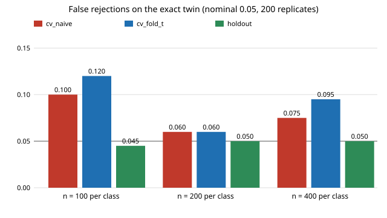

# Which significance rule gives a classifier two-sample test the right false-rejection rate on a digital twin?

A free-choice run (not one of the priority tracks), chosen because its sibling `research/free-c2stpower` ended with a caveat: the C2ST's empirical null was noisy and a check on fresh exact-twin replicates falsely rejected 0 to 29% of the time against a nominal 5%. This project asks which of three simple rules actually holds its size. **Stylised and simulated only; no real data, no LLM.**

**Live page:** https://duncan-haywood.github.io/monorepo-projects/research/free-c2stexact/

Every number below is copied from `experiments/results.txt`.



## Results

Setup: the same pendulum "real system" as `mimic-twinc2st` (Coulomb friction 0.3, viscous 0.1, Student-t(3) sensor noise, sd 0.02 rad). A replicate draws *n* real and *n* twin trajectories (independent start angles), fits gradient-boosted trees and applies a one-sided rule at alpha = 0.05. Rules:

- `cv_naive`: 5-fold cross-validated out-of-fold scores, Mann-Whitney p-value as if the 2n scores were independent.
- `cv_fold_t`: t-test that the five per-fold AUROCs average above 0.5.
- `holdout`: train on half the data, score the other half, exact-null Mann-Whitney p-value. The test scores of the two classes are exchangeable under the null whatever the classifier, so this rule is valid by construction.

On the **exact twin** (200 replicates per cell, Wilson 95% intervals in `results.txt`):

| features | n | cv_naive | cv_fold_t | holdout |
|---|---|---|---|---|
| raw | 100 | 0.100 | 0.120 | 0.060 |
| raw | 200 | 0.075 | 0.105 | 0.055 |
| raw | 400 | 0.110 | 0.130 | 0.040 |
| raw+resid | 100 | 0.100 | 0.120 | 0.045 |
| raw+resid | 200 | 0.060 | 0.060 | 0.050 |
| raw+resid | 400 | 0.075 | 0.095 | 0.050 |

- **Both cross-validation rules are over-sized here, mildly.** Across the six cells their rates run 0.060 to 0.130, never below 0.060 (`cv_fold_t` 0.060 to 0.130, `cv_naive` 0.060 to 0.110). Several intervals still include 0.05, so the evidence is a consistent direction, not a large effect.
- **The holdout rule stays at the nominal level**: 0.040 to 0.060 in all six cells, every interval containing 0.05, as the theory says.
- **Its price is power.** Coulomb -10% (raw features, 100 replicates): holdout rejects 0.09, 0.20 and 0.92 at n = 100, 200, 400, against 0.17, 0.62 and 1.00 for `cv_naive`. Those cross-validated figures come from a rule that over-rejects on the null, so they are not a fair comparison. Gaussian-vs-Student-t noise with second-difference features: holdout 0.44 at n = 50 and 1.00 at 100, `cv_naive` 0.95 and 1.00. Rough reading: holdout needs about twice the data of the cross-validated rules for the same detection, since it trains and tests on half each.
- **Not tried:** a permutation test on the cross-validated statistic, which should also hold its size and keep the power of cross-validation, at about 100 times the training cost. That is the natural next step and is not claimed here.

## Builds on

Lopez-Paz and Oquab (2017), "Revisiting Classifier Two-Sample Tests", ICLR: the C2ST and held-out accuracy as a test statistic. Mann and Whitney (1947), *Annals of Mathematical Statistics*: the rank-sum test. Pedregosa et al. (2011), scikit-learn, *JMLR*. The simulator is imported from `research/mimic-twinc2st` and the experiment extends `research/free-c2stpower`. No lab's work is built on, and no lab is affiliated with or endorses this project. The citations were not re-fetched in this run; all three are standard references.

## Reproduce

```bash
cd research/free-c2stexact
pip install numpy scipy scikit-learn joblib
python3 -m unittest discover -s tests -v    # 5 tests
python3 experiments/run.py                  # about 20 minutes on 4 CPUs, writes results.txt and results.json
python3 experiments/figure.py               # experiments/null_rate.svg, parsed from results.txt
```

## Limitations

One toy system, one real parameter set, one classifier (60 boosting iterations, untuned), one split fraction (50/50) and one seed per replicate; 200 null replicates, so a rate carries about +-0.03 of sampling error and the over-sizing of the cross-validated rules is small relative to it. The power rows use 100 replicates and compare rules of unequal size. The Mann-Whitney normal approximation is used rather than the exact distribution (the test half has at least 50 per class in the null cells, 25 per class at n = 50 in the Gaussian-noise row). Nothing here is a claim about a physical pendulum.

## Next steps

Add a permutation-calibrated cross-validated statistic, try other split fractions, and apply the rule to the MuJoCo twin of `mimic-mujocotwin`.

## Outside dependencies

numpy, scipy, scikit-learn and joblib (pip). No data, services or models. Produced with AI assistance (Claude). No LLM proposer was used.

MIT.
