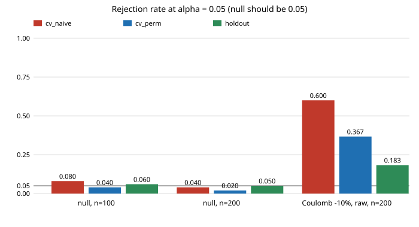

# Does a permutation test on the cross-validated statistic keep its size and beat the holdout rule's power on a digital twin?

A free-choice run (not one of the priority tracks), taking the step that `research/free-c2stexact` left open: that project found a naive significance rule on cross-validated classifier scores mildly over-sized and a half-and-half holdout rule valid but low-powered, and named a permutation test on the cross-validated statistic as untried. **Stylised and simulated only; no real data, no LLM.**

**Live page:** https://duncan-haywood.github.io/monorepo-projects/research/free-c2stperm/

Every number below is copied from `experiments/results.txt`.



## Method

Same pendulum "real system" and simulator as `mimic-twinc2st` (Coulomb friction 0.3, viscous 0.1, Student-t(3) sensor noise, sd 0.02 rad), same boosted-tree classifier (60 iterations), raw features, alpha = 0.05. A replicate draws *n* real and *n* twin trajectories. Three rules are applied to the same data:

- `cv_naive`: 5-fold out-of-fold scores, Mann-Whitney p-value as if independent (from `free-c2stexact`).
- `holdout`: train on half, exact-null Mann-Whitney on the other half (from `free-c2stexact`).
- `cv_perm` (new): the statistic is the pooled out-of-fold AUROC of the 5-fold cross-validation. The whole cross-validation is refit on B = 39 random label permutations, and p = (1 + #{null statistic >= observed}) / 40. Labels are exchangeable under the null, so this is valid for any classifier. Its p-values lie on the grid k/40, so the exact-size rejection is p <= 0.05 (p = 0.025 or 0.05).

## Results

Null (exact twin, 100 replicates per cell, Wilson 95% intervals in `results.txt`):

| n | cv_naive | cv_perm | holdout |
|---|---|---|---|
| 100 | 0.080 | 0.040 | 0.060 |
| 200 | 0.040 | 0.020 | 0.050 |

Power, Coulomb error -10% (60 replicates), n = 200: `cv_naive` 0.600 [0.47, 0.71], `cv_perm` 0.367 [0.26, 0.49], `holdout` 0.183 [0.11, 0.30].

- **`cv_perm` holds its size**: 0.040 and 0.020, both at or below 0.05 (intervals [0.02, 0.10] and [0.01, 0.07]).
- **It roughly doubles the holdout rule's power at this cell** (0.367 vs 0.183), and the intervals only just overlap ([0.26, 0.49] vs [0.11, 0.30]). With 60 replicates this is suggestive, not established.
- **`cv_naive` has the most power (0.600) but is not a valid test**: in `free-c2stexact` (200 replicates) it falsely rejected 0.075 to 0.110 on the raw-feature null. In this smaller run its null rates are 0.080 and 0.040, which cannot confirm or refute that. Its extra power over `cv_perm` is not a fair comparison.
- **Cost**: 40 cross-validation fits instead of one, about 30 to 40 times the training time.
- **A bug caught on the way**: the first run rejected at p < 0.05, which on the k/40 grid means only p = 0.025, an effective level of 0.025, giving null rates of 0.02 and 0.01 and power 0.25. The rule was changed to p <= alpha and the experiment rerun; the numbers above are from the rerun only.

## Builds on

Lopez-Paz and Oquab (2017), "Revisiting Classifier Two-Sample Tests", ICLR. Phipson and Smyth (2010), "Permutation p-values should never be zero", *Statistical Applications in Genetics and Molecular Biology*: the (1 + count)/(B + 1) form. Mann and Whitney (1947). Pedregosa et al. (2011), scikit-learn, *JMLR*. The simulator is imported from `research/mimic-twinc2st` and the baselines from `research/free-c2stexact`. No lab's work is built on, and no lab is affiliated with or endorses this project. The citations were not re-fetched in this run; all are standard references.

## Reproduce

```bash
cd research/free-c2stperm
pip install numpy scipy scikit-learn joblib
python3 -m unittest discover -s tests -v    # 5 tests, about 1 to 2 minutes
python3 experiments/run.py                  # about 1 hour on 4 CPUs, writes results.txt and results.json (with p-values)
python3 experiments/figure.py               # experiments/rates.svg, parsed from results.txt
```

## Limitations

One toy system, one classifier, one split scheme, raw features only, and few replicates (100 null, 60 power), so rates carry about +-0.04 to +-0.1 of sampling error; the null comparison cannot show whether `cv_naive` is over-sized. Only one power cell (n = 200, Coulomb -10%). B = 39 limits the p-value resolution and costs power relative to a larger B. Nothing here is a claim about a physical pendulum.

## Next steps

Power curves over n and B = 99, more null replicates, other split fractions, and the MuJoCo twin of `mimic-mujocotwin`.

## Outside dependencies

numpy, scipy, scikit-learn and joblib (pip). No data, services or models. Produced with AI assistance (Claude). No LLM proposer was used.

MIT.
