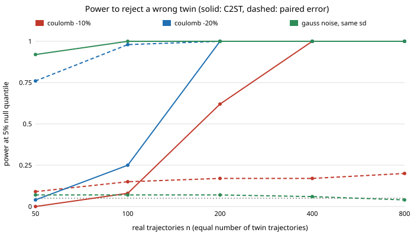

# How many real trajectories does a classifier two-sample test need to reject a wrong digital twin?

A free-choice run (not one of the priority tracks), chosen because the sibling project `research/mimic-twinc2st` showed that a classifier two-sample test (C2ST) can see twin errors that a paired trajectory error cannot, but only at one sample size (800 per class) and with no significance rule. The question a practitioner asks next is "how much real data do I need?", and whether the paired test is the cheaper choice when it applies. **Stylised and simulated only; no real data, no LLM.**

Every number below is copied from `experiments/results.txt`.



## Results

Setup: the "real" system is a pendulum (RK4, dt 0.02 s, 100 steps, start angle uniform on [-2, 2] rad, released at rest) with viscous friction 0.1, Coulomb friction 0.3 and Student-t (3 d.o.f.) sensor noise, sd 0.02 rad. A twin changes one assumption. A test *rejects* when its statistic exceeds the 95th percentile of the same statistic for the exact twin (the null). Power is the share of replicates that reject, with a Wilson 95% interval. Two statistics:

- **C2ST**: 5-fold cross-validated AUROC of gradient-boosted trees separating *n* real from *n* twin trajectories (independent start angles, so no pairing needed). Raw angles for friction errors; raw plus second-difference features for the noise-shape error.
- **Paired error**: mean squared residual between the twin's noise-free trajectory and the real *noisy* trajectory from the *same* start angle. Needs matched starts.

| twin error | n = 50 | 100 | 200 | 400 | 800 |
|---|---|---|---|---|---|
| Coulomb -20%, C2ST power | 0.04 | 0.25 | 1.00 | 1.00 | 1.00 |
| Coulomb -20%, paired power | 0.76 | 0.98 | 1.00 | 1.00 | 1.00 |
| Coulomb -10%, C2ST power | 0.00 | 0.08 | 0.62 | 1.00 | 1.00 |
| Coulomb -10%, paired power | 0.09 | 0.15 | 0.17 | 0.17 | 0.20 |
| Gaussian noise, same sd, C2ST power | 0.92 | 1.00 | 1.00 | 1.00 | 1.00 |
| Gaussian noise, same sd, paired power | 0.07 | 0.07 | 0.07 | 0.06 | 0.04 |

(C2ST: 24 replicates per cell, so intervals are wide, e.g. 1.00 means [0.86, 1.00]; paired: 400 replicates. Full intervals are in `results.txt`.)

- **When pairing is available and the error moves the mean, the paired test is far cheaper.** At a 20% Coulomb error it reaches 0.98 power with 100 trajectories where the C2ST has 0.25, and the C2ST needs about 200.
- **A small mean error is the paired test's weak spot here.** At 10% its power stays at 0.09 to 0.20 even at n = 800, while the C2ST reaches 0.62 at 200 and 1.00 at 400. A plausible but untested reason: squared Student-t(3) noise has infinite variance, so the mean squared residual does not concentrate at the usual rate. A robust paired statistic (median, trimmed mean) was not tried, so this is a comparison against one conventional statistic, not against all paired tests.
- **A same-variance noise-shape error is invisible to the paired test by construction** (power 0.04 to 0.07, about the nominal 5%), and the C2ST with second-difference features finds it with 50 trajectories (0.92).
- **The null threshold is itself noisy.** It comes from 60 exact-twin replicates. On 24 fresh exact-twin replicates per setting, the false-rejection rate was 0.00 to 0.29 (raw features: 0.08, 0.08, 0.04, 0.29, 0.00 for n = 50 to 800; raw+resid: 0.17, 0.04, 0.12, 0.00, 0.17), against a nominal 0.05. Each of these is 24 draws, so most of the spread is sampling noise, but it means the small-n power values, especially the C2ST's, are approximate, and a real application needs more null replicates or a permutation test.

## Builds on

Lopez-Paz and Oquab (2017), "Revisiting Classifier Two-Sample Tests", ICLR: the C2ST and its use of held-out accuracy as a test statistic. Pedregosa et al. (2011), scikit-learn, *JMLR*: `HistGradientBoostingClassifier` and cross-validation. The simulator and friction/noise models are copied from the sibling project `research/mimic-twinc2st`. No lab's work is built on, and no lab is affiliated with or endorses this project. The citations were not re-fetched in this run; both are standard references that the sibling project already lists.

## Reproduce

```bash
cd research/free-c2stpower
pip install numpy scikit-learn joblib
python3 -m unittest discover -s tests -v    # 7 tests
python3 experiments/run.py                  # about 30 minutes on 4 CPUs, writes results.txt and results.json
python3 experiments/figure.py               # experiments/power_vs_n.svg, parsed from results.txt
```

## Limitations

One toy system and one real parameter set; three twin errors; one classifier (gradient-boosted trees, default-ish settings, not tuned); 24 replicates per C2ST cell and a 60-replicate null (see above); the paired statistic is one conventional choice. The noise-shape feature set was picked after the sibling project found raw angles missed that error. The sample size is varied for real and twin together; in practice the twin can be simulated as many times as you like, which this design does not exploit. Nothing here is a claim about a physical pendulum or any real simulator. Written with AI assistance (Claude), per the repository's integrity rules.

## Next steps

Replace the empirical null with a permutation test, add a robust paired statistic, let the twin sample be much larger than the real one, and apply the same recipe to a MuJoCo twin.

## Outside dependencies

numpy, scikit-learn and joblib (pip). No data, services or models.
