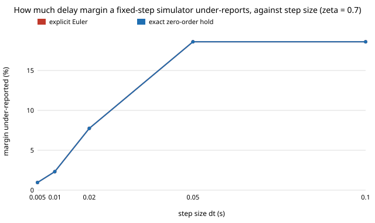

# How much feedback delay can a digital twin's controller tolerate, and does a fixed-step simulator get that margin right? (free choice)

Needs `numpy` (eigenvalues). **Free-choice project** (`PROJECTS.md`, "Picking work", step 1; draw 0.022). Why it seemed worth doing: sim-to-real transfer for control often fails on latency the twin did not model, and the twin itself quantises delay to whole steps. For the simplest loop, a PD-controlled double integrator, both the true margin and the simulator's margin have exact answers, so the gap between them can be computed rather than assumed.

**Live page:** https://duncan-haywood.github.io/oss-monorepo/research/free-delaymargin/

## Question

Plant x'' = u with u(t) = -kp x(t-τ) - kd v(t-τ), kp = 4, kd = 2ζ·2. What is the largest τ for which the loop is stable, and what margin does a fixed-step simulator with step dt report when it must represent τ as a whole number of steps?

## Headline result (exact; see Limitations)

- **The analytic margin is 0.19 to 0.37 s for this loop** (ζ = 2: 0.188 s; ζ = 0.7: 0.369 s; ζ = 0.3: 0.266 s), from the frequency-domain crossing ω² = (kd² + √(kd⁴ + 4kp²))/2, τ* = atan2(kd ω, kp)/ω.
- **A fixed-step simulator under-reports the margin, and the shortfall is a quantisation rule, not integrator error.** For exact zero-order-hold integration the largest stable delay in steps is n = ⌈τ*/dt − ½⌉ − 1, i.e. the largest n with (n + ½)·dt < τ*. It held in 25 of 25 (ζ, dt) cases. The half step is the zero-order hold's own latency.
- **Size of the shortfall (ζ = 0.7):** 18.6% too small at dt = 0.1 s (3 steps = 0.30 s against 0.369 s), 7.8% at 0.02 s, 2.3% at 0.01 s and 1.0% at 0.005 s. A controller run at 10 Hz in a twin shows 3 steps of tolerated delay where the continuous loop tolerates 3.7; for ζ = 2 it shows 1 step where 1.9 are tolerated.
- **Explicit versus semi-implicit Euler versus exact hold matters little here:** the three agree to the step in almost every case. The exception is the lightly damped loop (ζ = 0.3, dt = 0.02 s), where semi-implicit Euler is 2.1% low and explicit Euler and the exact hold are 9.6% low.

Figure: `experiments/margin_error_vs_dt.svg`. Tables: `experiments/results.txt`.



## Method

`delaymargin.py` gives the analytic margin, and builds the closed-loop one-step map for three schemes (explicit Euler, semi-implicit Euler, exact integration under a held input). The delay of n whole steps makes the state a (2(n+1))-vector; the loop is stable iff the spectral radius of that companion matrix is below 1. `max_stable_steps` scans n upward and stops at the first unstable one. Nothing is sampled. A time-domain simulation (`simulate`) cross-checks the eigenvalue answer in the tests.

## Reproduce

```bash
cd research/free-delaymargin
python3 -m unittest discover -s tests -v   # 5 tests, about a second
python3 experiments/run.py > experiments/results.txt
python3 experiments/figure.py
```

Tests check the analytic margin against its own crossing equation, convergence of the simulated margin to it as dt shrinks, agreement of the eigenvalue answer with a time-domain run (decay just inside the margin, growth just outside), that stability switches at a single n, and the half-step rule.

## Limitations

- One plant (double integrator) and one controller form (PD on delayed full state), kp = 4 fixed. The rule is verified on 5 damping ratios and 5 step sizes, not proved in general.
- Delay is constant and an integer number of steps; fractional-delay interpolation, jitter and sensor/actuator asymmetry are not modelled (see `free-jittertwin`).
- The margin is a worst-case stability threshold, not a performance measure; no real robot or measured latency is used.

## Prior work

The delay margin of PD feedback on a double integrator is a textbook frequency-domain calculation (for example Åström and Murray, *Feedback Systems*, on delay margin); the formula here was derived from the characteristic equation s² + (kd s + kp)e^{-sτ} = 0 and checked in the tests against that equation directly. The citation was written from memory, not re-checked against the source.

## Next steps

Fractional-delay interpolation in the simulator; measure real loop latency on a hobby servo or simulated robot and place it against the margin; nonlinear plants.

## Owner steps
None.

## Outside dependencies
Python standard library plus numpy.
