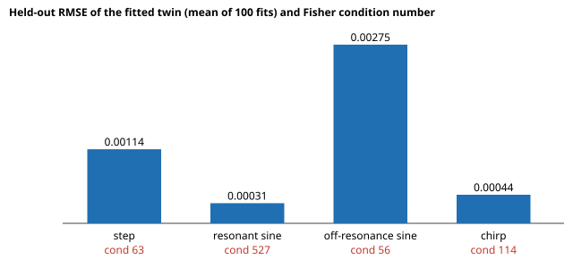

# Which test input should you use to calibrate a mass-spring-damper twin? Cramér-Rao bounds against fitted errors (preliminary)

**Why this seemed worth doing (free-choice run).** Digital-twin work here has studied what a twin gets wrong (`timestep-twin`, `workcell-twin`, `roundtrip-twin`), but not how the experiment that *calibrates* the twin is chosen. The textbook proxy for "is this input informative" is the conditioning of the Fisher matrix. This project checks whether it predicts how well the calibrated twin predicts something it was not fitted on. Produced with AI assistance (Claude).

**Live page:** https://duncan-haywood.github.io/monorepo-projects/research/free-excitation/

**Headline (stylised, one plant).** Fitting mass, damping and stiffness of a lightly damped oscillator (ζ = 0.1) from one 10 s noisy position trace, a unit-RMS input at the natural frequency gives the lowest held-out prediction error (mean RMSE 3.1×10⁻⁴ against 4.4×10⁻⁴ for a chirp, 1.1×10⁻³ for a step and 2.8×10⁻³ for an off-resonance sine) even though it has the **worst** Fisher condition number (527, against 63 for the step and 56 for the off-resonance sine). Condition number ranks the inputs backwards here. The step is fine for mass and stiffness but its damping estimate is 4.5× noisier than the resonant sine's (0.76% vs 0.17% relative std), and a sine three times off resonance is 4.7 to 7.7× worse than the resonant sine on every parameter. Fitted spreads are within 0.83 to 1.09 of the Cramér-Rao bounds.

**Builds on.** Classical system-identification and optimal-experiment-design theory: Ljung (1999), *System Identification: Theory for the User*, 2nd ed., Prentice Hall; Goodwin and Payne (1977), *Dynamic System Identification: Experiment Design and Data Analysis*, Academic Press; Cramér-Rao bound as in Kay (1993), *Fundamentals of Statistical Signal Processing: Estimation Theory*, Prentice Hall. It builds on none of the CU Boulder groups in `prompt.md` and claims no connection to them; the motivation is simulation fidelity and calibration of twins in general.

## Method
- Plant `m x'' + c x' + k x = u(t)`, truth `(m, c, k) = (1, 0.4, 4)`, position sampled every 0.02 s for 10 s with Gaussian noise of std 0.01, zero initial state. RK4 with 0.01 s substeps (a unit test checks the step response against its decay envelope and zero-crossing spacing).
- Four inputs, each scaled to unit RMS over the trace (equal input energy): unit step, sine at ωₙ = 2 rad/s, sine at 3ωₙ, linear chirp 0.2 to 6 rad/s.
- Cramér-Rao standard deviations from `JᵀJ/σ²`, with `J` the central-difference sensitivity of the output to `(m, c, k)`. The condition number is that of `JᵀJ` after scaling each column by its parameter's truth (so units do not matter).
- Fitting: Gauss-Newton with step halving from a start perturbed up to ±30% per parameter, 100 noisy traces per input.
- Held-out test: RMS position difference between the fitted twin and the truth under a different unit-RMS chirp (6 down to 0.5 rad/s), averaged over the 100 fits.

## Reproduce
```bash
cd research/free-excitation
PYTHONPATH=src python3 -m unittest discover -s tests -v   # 8 tests, standard library only, a few seconds
python3 experiments/run.py > experiments/results.txt       # about 45 s
python3 experiments/figure.py                              # writes experiments/heldout.svg
```

## Results (from `experiments/results.txt`)
| input | m / c / k CRB (% of truth) | fitted sd (%) | fitted sd / CRB | cond. number | held-out RMSE |
|---|---|---|---|---|---|
| step | 0.25 / 0.80 / 0.18 | 0.25 / 0.76 / 0.19 | 0.99 / 0.95 / 1.07 | 63 | 1.14×10⁻³ |
| resonant sine | 0.22 / 0.20 / 0.22 | 0.19 / 0.17 / 0.19 | 0.88 / 0.83 / 0.88 | 527 | 3.1×10⁻⁴ |
| off-resonance sine | 1.02 / 1.56 / 1.03 | 1.02 / 1.55 / 1.04 | 1.00 / 0.99 / 1.01 | 56 | 2.75×10⁻³ |
| chirp | 0.19 / 0.23 / 0.19 | 0.21 / 0.23 / 0.20 | 1.09 / 1.04 / 1.05 | 114 | 4.4×10⁻⁴ |

Biases are below 0.25% of truth for every parameter. Section C of the results shows that placing the parameters at an independent one-sigma corner gives a held-out error of 2.1 to 2.5×10⁻³ for the step, resonant sine and chirp: that is far above the fitted errors for the resonant sine, because its parameter errors are strongly correlated in the directions the held-out input is insensitive to. Per-parameter bounds, taken alone, would mislead too.



## Limitations
- **One plant, one noise level, one truth point, one held-out input.** A different held-out input (for example one with energy near resonance) could change the ranking; this was not varied. The conclusion is that conditioning is not a safe proxy here, not that resonant sines are always best.
- Fitted spreads sit slightly *below* the bound for the resonant sine (0.83 to 0.88) with 100 traces; a spread under an unbiased-estimator bound is sampling noise or small bias in a nonlinear fit, and was not investigated further.
- The condition number as defined weights all three parameters equally after scaling; other criteria (A-, D- or I-optimality, the last of which targets prediction error directly) were not computed and may agree with the held-out ranking.
- Process noise, sensor bias, unmodelled dynamics and nonlinear friction are absent. The truth is inside the twin's model class, which real twins never are.
- Preliminary: nothing here was checked against a physical system.

## Next steps
Compute I-optimality (average prediction variance over the held-out input) to see if it explains the ranking; vary the held-out input; add model mismatch (Coulomb friction) so the truth is outside the twin's class.
