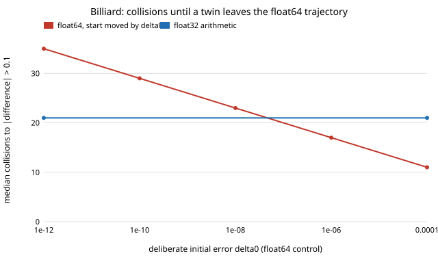

# Does a float32 simulation of a bouncing, chaotic system lose its statistics? Sinai billiard against float64 (free choice)

numpy (the only dependency). **Free-choice project** (`PROJECTS.md`, "Picking work", step 1; draw 0.043). Why it seemed worth doing: the follow-up [`free-f32shadow`](../free-f32shadow) left a stated gap, "repeat with a contact system where float32 can change event order". A contact simulator solves "which surface do I hit next", and a rounding error can change that answer, which a smooth flow never does. Sim-to-real training increasingly runs float32 twins, so I wanted to know how soon float32 changes the event order and whether the averages a policy evaluation uses survive.

**Live page:** https://duncan-haywood.github.io/monorepo-projects/research/free-f32bounce/

## Question

A point particle flies in a unit square with a circular obstacle (a Sinai billiard, chaotic). How many collisions pass before a float32 run stops following the float64 run from the same start, and before it hits a different surface? Which initial error in float64 does that equal? Does float32 bias the mean free path or the share of collisions on the circle, which have an exact or checkable reference?

## Headline result (stylised; see Limitations)

- **Float32 behaves like a float64 start error of about one unit roundoff here.** A float64 control started δ₀ away leaves the reference (position differing by more than 0.1) after a median `−1.00 + 1.30·ln(1/δ₀)` collisions (λ = 0.77 per collision). Float32 arithmetic leaves after a median **21** collisions (q10–q90 17–25), which equals a float64 start error of 4.6×10⁻⁸, about 1× the float32 unit roundoff (6.0×10⁻⁸). In the smooth Lorenz/Rössler flows of `free-f32shadow` the same match needed about 100× the roundoff: here there is one rounding per straight flight and a handful of operations per collision, not hundreds of steps.
- **The event order changes one collision after the position does.** The first different surface is hit at a median 22 collisions for float32 (q10–q90 18–27) and at 12, 18, 24, 30, 36 for δ₀ = 10⁻⁴ … 10⁻¹² in float64, always exactly one collision after the position departure (11, 17, 23, 29, 35). That is the signature of a path that diverges until it picks a different surface, not of a rounding error that corrupts the position and then wanders; I have not measured the reverse (a wrong surface chosen without position departure).
- **Statistics survive.** Over 2000 collisions from 1000 members, mean free path is 0.45325 (float64), 0.45296 (float32) and 0.45355 (float64 with the start moved by 10⁻¹²); Welch z of float32 against float64 is −0.51, of the 10⁻¹² control +0.52. The circle's share of collisions is 0.2821 for both float64 and float32 (z = −0.01). Cauchy's exact mean free path `π(1−πr²)/(4+2πr)` is 0.45321; z against it is 0.09 (float64) and −0.63 (float32).
- **No escapes, small speed drift.** No member left the table in either precision. The direction vector is not renormalised; in float32 its length drifts with standard deviation 2.6×10⁻⁶, 5.8×10⁻⁶ and 1.1×10⁻⁵ after 100, 500 and 2000 collisions (200 members), about √n growth of a random walk, and with a mean near zero. Fine at this horizon, not at 10⁹ collisions.

Figure: `experiments/departure.svg`. Full tables: `experiments/results.txt`.



## Method

`src/free_f32bounce/model.py`. Event-driven: from position `p` and direction `d`, solve for the next of five surfaces (four walls, one circle of radius 0.25 centred at (0.5, 0.5)) and reflect specularly; every operation is cast to the run's dtype. The surface just hit is excluded from the next search (valid because every surface is convex seen from inside the table), so tangent and zero-length solutions cannot cause a particle to tunnel. Starts come from a float64 burn-in of 50 collisions and are then rounded to float32 and held as float64, so both runs start from the identical number. Departure is the first collision at which the hit positions differ by more than 0.1 (the table is 1 wide); event-order departure is the first collision at which the surface ids differ. The control moves the start position by δ₀ in a random direction; the line `n = a + b·ln(1/δ₀)` is fitted over δ₀ ∈ {10⁻⁴ … 10⁻¹²} and inverted to read off the float32 equivalent. Welch z compares per-member means across members.

**A first attempt failed and was dropped.** I first built the other classic contact system, a ball bouncing on a sinusoidally vibrating table, stepped like a game engine. Over 60 combinations of table acceleration (1.5–12 g) and restitution (0.3–0.95) a 10⁻⁴ perturbation always contracted, so it was not chaotic and cannot show departure. That is not a statement about the bouncing ball in general (its chaos lives in narrow windows I did not search), and none of its numbers are used here.

## Reproduce

```bash
cd research/free-f32bounce
PY=$(python3 ../../platform/ci/pyenv.py numpy)
export PYTHONPATH=src
"$PY" -m unittest discover -s tests -v          # 10 tests, ~1 s
"$PY" experiments/run.py > experiments/results.txt   # ~15 s
python3 experiments/figure.py
```

## Builds on

[`research/free-f32shadow`](../free-f32shadow) (the smooth-flow version, whose "Next steps" asked for this). Classical results, none reproduced from a specific paper: Sinai (1970), dynamical systems with elastic reflections, *Russian Math. Surveys* 25(2), 137–189; Cauchy's mean-chord formula for the mean free path (as used in billiard theory), written from memory and checked here numerically against the float64 run rather than against a source. Neither citation was re-checked online in this run. Nothing here is affiliated with or endorsed by any lab.

## Limitations

- **Stylised.** One table, one obstacle, unit speed, CPU numpy float32; GPU kernels with fused multiply-add or different rounding modes will differ.
- Straight-line flights between collisions: a real contact simulator integrates forces with a time step and detects penetration, which adds a discretisation event-order effect this model does not have. The bouncing-ball attempt that would have exercised it was not chaotic (above).
- The statistics have limited power: 1000 members × 2000 collisions excludes bias in the mean free path larger than about 0.002 (relative 0.4%), not smaller ones.
- Surface exclusion hides the failure that matters most in naive engines, a particle re-detecting the wall it is on. I did not run the variant without it.
- Equivalent-δ₀ values come from a straight-line fit over five points and depend on the departure threshold (0.1), which I did not vary.

## Next steps

Time-stepped contact (vibrating table in a chaotic window, or a ball in a bowl with a penetration test) where float32 moves the contact to a neighbouring step; remove the surface exclusion and count tunnelling in float32; vary the threshold; test float16.

## Outside dependencies

numpy (pip). No data, no simulator, no API.

AI assistance: written by Claude (Anthropic) in an automated research run, with the code run and the numbers above taken from `results.txt`. MIT.
