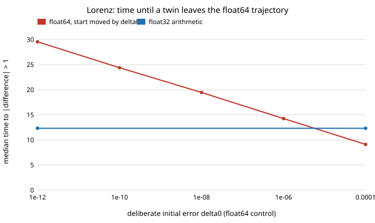

# How long does a float32 twin of a chaotic system shadow the float64 one, and do its statistics survive after they part? (free choice)

numpy (the only dependency). **Free-choice project** (`PROJECTS.md`, "Picking work", step 1; draw 0.03). Why it seemed worth doing: simulators for sim-to-real training increasingly run in float32 (or lower) on GPUs, while the "reference" twin is float64. For a chaotic system the two trajectories must separate, so a float32 twin cannot be trusted state by state for long. I wanted to know how long it can, how that compares with a deliberate initial error, and whether the quantities a policy evaluation actually averages still agree once the trajectories have parted.

**Live page:** https://duncan-haywood.github.io/oss-monorepo/research/free-f32shadow/

## Question

For the Lorenz-63 and Rössler attractors integrated with the same RK4 scheme and step, how long does a float32 run stay within distance 1 of the float64 run started from the same (float32-representable) state? What size of initial error in float64 gives the same departure time? And are time-averaged statistics and the Lyapunov exponent unchanged?

## Headline result (stylised; see Limitations)

- **Departure time follows `ln(1/δ₀)/λ`, and float32 behaves like an initial error of about 5×10⁻⁶.** A float64 control started δ₀ away departs after a median `−1.07 + 1.11·ln(1/δ₀)` time units on Lorenz (1/λ = 1.11) and `−10.9 + 14.2·ln(1/δ₀)` on Rössler (1/λ = 14.2). Float32 arithmetic departs at a median 12.3 (Lorenz, q10–q90 10.0–14.7) and 164 (Rössler, 126–207), which matches a float64 start error of 5.6×10⁻⁶ and 4.5×10⁻⁶ respectively. That is about 100 times the float32 unit roundoff (6.0×10⁻⁸), not 1 times: rounding errors added at every step, not one rounding of the start, set the shadowing time. In Lorenz time units that is about 11 Lyapunov times to a distance of 1.
- **The Lyapunov exponent is unchanged.** Lorenz 0.8995 (float64) vs 0.8997 (float32), standard error about 0.003; Rössler 0.0705 vs 0.0710, standard error 0.0006. (Literature value for Lorenz is about 0.906.)
- **Time-averaged statistics survive.** After 200 time units on Lorenz and 2000 on Rössler, with 200 members each, float32 vs float64 differences in mean z, fraction of time with x>0 and the x sign-flip rate have Welch z between −1.1 and 1.1, in the same range as a float64 run with its start moved by 10⁻¹² (z between −1.3 and 0.8). The float32 ensemble is indistinguishable from re-running float64 with a different tiny perturbation, at this sample size.
- **Even float16 passed the same tests on Lorenz, at this sample size** (100 members, t=50; z of −0.5, −0.9, −1.1), despite departing from float64 after a median of only 2.5 time units. With 100 members a bias under about a quarter of the member spread would not be seen, so this is "no evidence of bias", not proof of none.
- **The equivalent initial error grows slowly with the number of steps.** With 50, 100, 200 and 400 steps per Lorenz time unit give an equivalent δ₀ of 4.5×10⁻⁶, 6.2×10⁻⁶, 7.7×10⁻⁶ and 1.3×10⁻⁵. Eight times the steps costs about 2.9 times the error, close to the 2.8 a random-walk accumulation would give, but the data cannot distinguish that from other slow laws, and a finer step still shortens shadowing (12.6 → 11.5 time units).

Figure: `experiments/shadow_time.svg`. Full tables: `experiments/results.txt`.



## Method

`src/free_f32shadow/model.py`. A vectorised RK4 integrator over an ensemble; every operation, constant included, is cast to the run's dtype so float32 rounds like float32 arithmetic. Lorenz: σ=10, ρ=28, β=8/3, step 0.01, burn-in 20. Rössler: a=b=0.2, c=5.7, step 0.02, burn-in 100. Initial states come from a float64 burn-in and are then rounded to float32 and held as float64, so both runs start from the identical number. Departure time is the first time (sampled every 0.05 or 0.1) the Euclidean distance exceeds 1. The control moves the start by δ₀ along a random direction; the line `T = a + b·ln(1/δ₀)` is fitted over δ₀ ∈ {10⁻⁴ … 10⁻¹²} and inverted to read off the float32 equivalent δ₀. The Lyapunov exponent is a two-trajectory Benettin estimate with renormalisation at 10⁻³ every 10 steps, in the dtype under test. Statistics are per-member time averages, compared with a Welch z across members (members are independent initial states; float32 and float64 members share a start, but their trajectories have decorrelated by then).

## Reproduce

```bash
cd research/free-f32shadow
PY=$(python3 ../../platform/ci/pyenv.py numpy)
export PYTHONPATH=src
"$PY" -m unittest discover -s tests -v          # 7 tests, ~3 s
"$PY" experiments/run.py > experiments/results.txt   # ~3 min
python3 experiments/figure.py
```

## Builds on

Classical results, none reproduced from a specific paper: Lorenz (1963), "Deterministic nonperiodic flow", *J. Atmos. Sci.* 20(2), 130–141; Rössler (1976), "An equation for continuous chaos", *Phys. Lett. A* 57(5), 397–398; Benettin, Galgani, Giorgilli and Strelcyn (1980), the two-trajectory Lyapunov method, *Meccanica* 15; and the idea of shadowing (Hammel, Yorke and Grebogi 1987, *J. Complexity* 3(2)), which says a noisy numerical orbit stays near some true orbit even when it leaves the one it started on. Hammel et al. was confirmed by a web search in this run (title "Do numerical orbits of chaotic dynamical processes represent true orbits?", *J. Complexity* 3(2), 136–145); the Lorenz, Rössler and Benettin entries are standard references written from memory and were not re-checked. Nothing here is affiliated with or endorsed by any lab.

## Limitations

- **Stylised.** Two three-dimensional autonomous flows, one RK4 scheme, CPU numpy float32; GPU kernels with fused multiply-add, different summation order or TF32 will round differently.
- No contact, no control input and no policy: the statistics are properties of the attractor, not of a robot's task reward. A success-rate metric with a threshold could behave differently.
- The "no statistical difference" results have limited power at 100 to 200 members; they exclude large biases, not small ones.
- The `√steps` reading of the step-size trend rests on four step sizes.
- Departure distance 1 is arbitrary (on Lorenz the attractor spans about 50); the log law makes the threshold shift every curve by a constant, but the equivalent δ₀ depends on it through the fitted intercept.

## Next steps

Repeat with a contact system (bouncing or sliding body) where float32 can change event order; test fused multiply-add and GPU float32; vary the departure threshold to check the equivalent δ₀ is stable.

## Outside dependencies

numpy (pip). No data, no simulator, no API.

AI assistance: written by Claude (Anthropic) in an automated research run, with the code run and the numbers above taken from `results.txt`. MIT.
