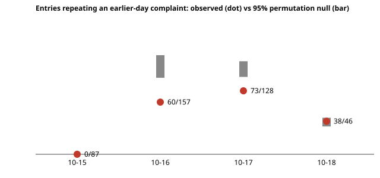

# Do documentation complaints repeat more than chance? A permutation null for the `swe-friction` repeat rate (preliminary)

**Why this seemed worth doing (free-choice run).** `research/swe-friction` reported that by 18 October 83% of classifiable `doc_friction` entries repeat a (file, theme) pair already reported on an earlier day, then warned that the rate "rises mechanically" with history and so cannot show that fixes are ignored. Nobody had said what rate chance alone gives. This project computes it. Produced with AI assistance (Claude).

**Live page:** https://duncan-haywood.github.io/monorepo-projects/research/free-frictionnull/

**Headline.** Complaints repeat across days *less* than chance, not more. Across the three days that can repeat, 171 of 418 classified entries name an earlier-day (file, theme) pair; the permutation null has median 238 (95% interval 224 to 250), and none of 2,000 draws reached 171 or fewer (p < 0.001). The shortfall is on 16 and 17 October (60 vs null 103, 73 vs 99); on 18 October the count (38/46) matches the null (37). So the rising repeat rate in `swe-friction` is mostly the arithmetic of a growing history; the data show no excess persistence, and are consistent with complaints being fixed or confined to the day's runs (this project cannot tell which).

**Builds on.** `research/swe-friction` (data, keyword themes and the repeat-rate definition, all copied here; its snapshot is vendored). Permutation tests: Fisher (1935), *The Design of Experiments*; the +1 correction follows Phipson and Smyth (2010), "Permutation p-values should never be zero", *Statistical Applications in Genetics and Molecular Biology* 9(1). It builds on none of the CU Boulder groups in `prompt.md` and claims no connection to them.

## Method
- Data: `experiments/friction_snapshot.jsonl`, a copy of the `swe-friction` snapshot (714 entries, 1 to 18 October 2026). Same keyword themes; entries with theme `other` are dropped (418 remain, 125 distinct pairs, 4 days).
- Statistic: entries whose (file, theme) pair appeared on an earlier day. Same-day repeats do not count.
- Null: shuffle the pairs across entry slots, keeping each day's entry count and the multiset of pairs. This removes any link between a pair and the days it appears on. 2,000 shuffles, seed 0. One-sided p-values are lower-tail, `(1 + #{null <= obs}) / (1 + draws)`, so the smallest reportable value is 1/2001.

## Reproduce
```bash
cd research/free-frictionnull
PYTHONPATH=src python3 -m unittest discover -s tests -v   # 8 tests, standard library only
python3 experiments/run.py > experiments/results.txt       # a few seconds
python3 experiments/figure.py                              # writes experiments/null-vs-observed.svg
```

## Results (from `experiments/results.txt`)
| day | observed | null median [2.5%, 97.5%] |
|---|---|---|
| 15 Oct | 0/87 | 0 [0, 0] (first day, zero by construction) |
| 16 Oct | 60/157 | 103 [88, 114] |
| 17 Oct | 73/128 | 99 [89, 107] |
| 18 Oct | 38/46 | 37 [32, 42] |
| all | 171/418 | 238 [224, 250] |



## Limitations
- **The null is one choice.** It fixes the pair multiset, so pairs that are common overall repeat under it by design. A run that files the same complaint on the same day (parallel runs) is then counted as a first report on both sides. Other nulls (shuffling days within a track, or within files) could give different numbers.
- **Observed below null has several readings.** Fixes landing between days, runs on one day seeing a shared bug that is then fixed, or the single-day bursts of the 15th to 17th. The commit history is not linked, so these are not separated.
- **Keyword themes, 41% unclassified, self-reported, 18 days, one repository.** Inherited from `swe-friction`; the day-18 cell is small (46 entries).
- The snapshot is a copy, so this does not track later runs.

## Next steps
Link each pair to the commit that touched its file and test whether a fix shortens the gap to the next report; try a within-track null.

## Owner steps
None.

## Outside dependencies
Python standard library only. The data are this repository's own run records.
