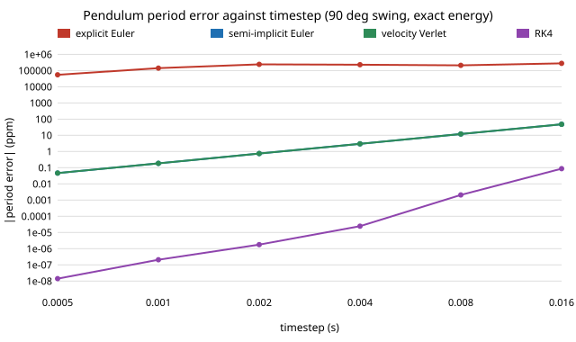

# How wrong is a simulator's pendulum period at its default timestep? (free choice)

Pure Python, no dependencies. **Free-choice project** (`PROJECTS.md`, "Picking work", step 1; draw 0.037). Why it seemed worth doing: many twin projects here use a pendulum as the plant and quote a simulated period without saying how much of it is the integrator. The exact answer is known in closed form (a complete elliptic integral), so the integrator error can be measured, not assumed. Along the way a measurement artefact turned up that changes what "period error" means for a symplectic integrator.

**Live page:** https://duncan-haywood.github.io/monorepo-projects/research/free-integperiod/

## Question

For a 1 m pendulum swung through 10 to 170 degrees, how large is the period error and the energy error of explicit Euler, semi-implicit (symplectic) Euler, velocity Verlet and RK4 at the timesteps real simulators use (MuJoCo 2 ms, PyBullet 1/240 s, a 60 Hz game loop), measured against the exact period?

## Headline results (all produced by `experiments/run.py`)

- **Exact reference.** T = 4K(k)/ω with k = sin(θ0/2), K by the arithmetic-geometric mean. At 90 degrees T = 2.367842 s; the small-angle formula 2π/ω is 15.3% too short, 43% at 150 degrees.
- **Explicit Euler is unusable.** At 2 ms and 90 degrees the energy has grown by 81% after 60 s and the measured period is 14% off; at 1/240 s it is 24% off with energy up 137%. Below 2 ms the energy error falls only in proportion to the step (+495%, +159%, +81%, +41%, +20% for dt = 16.7, 5, 2, 1, 0.5 ms). At 170 degrees it never completes a clean swing.
- **Semi-implicit Euler and Verlet have bounded energy error and second-order period error.** At 2 ms the energy error is at most 0.3% at any amplitude (0.013% to 0.3% at t = 60 s; it oscillates and does not accumulate) and the period error is 0.75 ppm at 90 degrees, 0.19 ppm at 1 ms, falling 4x per halving of the step (`results.txt`, section 6).
- **RK4 is far more accurate in period (1.8e-6 ppm at 2 ms) but not energy-conserving by construction**; its energy error is about 2e-9 % at 60 s and would grow with a longer run.
- **The two second-order methods have identical period error when started on the same orbit.** Started at the bottom with the exact energy, semi-implicit Euler and Verlet agree to 5 significant figures (2.989 ppm at 4 ms), as expected for conjugate maps.
- **The "release from rest" convention hides this.** Started at rest at 90 degrees, semi-implicit Euler's period error is 1e-4 ppm or less at every step tried (section 5), yet 2.99 ppm at 4 ms when started with the same exact energy. Verlet from rest gives −4.48 ppm. The difference is the amplitude each scheme effectively starts from; in the semi-implicit case the initial offset cancels the O(dt²) period error to near the interpolation floor. This cancellation is specific to this start state. A reader who validates a twin's integrator by dropping a pendulum from rest would conclude semi-implicit Euler is 4th order, which it is not.

Figure: `experiments/period_error.svg`. Tables: `experiments/results.txt`.



## Method

`integperiod.py` integrates θ'' = −(g/L) sin θ with g = 9.81 m/s², L = 1 m (the period depends only on g/L and the amplitude). Period is the mean spacing of successive downward zero crossings of θ, located by bisection on the cubic Hermite interpolant of (θ, ω) within the crossing step. The semi-implicit Euler period was cross-checked with plain linear interpolation of θ and a least-squares line through 600 s of crossings; both agree (error 5e-11 at 4 ms). Energy error is (E(t) − E0)/E0 at the end of the run. The exact period comes from the AGM and is tested against the small-angle limit and K(sin 45°) = 1.8540746773.

## Reproduce

```bash
cd research/free-integperiod
python3 -m unittest discover -s tests -v   # 6 tests, under 1 s
python3 experiments/run.py > experiments/results.txt   # about 1 minute
python3 experiments/figure.py
```

## Limitations

- **Pendulum only, undamped, one parameter set.** Period error depends on ω·dt, so the results transfer to other lengths by scaling dt, but not to stiff, contact-rich or multi-body systems, where MuJoCo and PyBullet add constraint solvers, implicit damping and other error sources not modelled here.
- **I implement the textbook integrators, not MuJoCo's or PyBullet's code.** "MuJoCo style" means a semi-implicit Euler step; I did not run either engine, so I make no claim about their actual error.
- **Euler's period figures are not asymptotic.** Its energy grows over the run, so the amplitude (and hence period) changes; the numbers describe a 60 to 120 s run, not the one-period truncation error. Where the swing never completes a clean downward crossing the table shows nan.
- The energy error is sampled at the end of the run, so for the symplectic methods it is a phase of a bounded oscillation, not a rate.
- No measurement noise or real hardware: this is integrator error in an otherwise perfect model.

## Prior work

Hairer, Lubich and Wanner, *Geometric Numerical Integration* (Springer, 2nd ed., 2006), on symplectic Euler, Störmer-Verlet and backward error analysis; the period of the large-angle pendulum is the standard complete-elliptic-integral result (e.g. Lawden, *Elliptic Functions and Applications*, 1989). Citations written from memory, not re-checked against the sources.

## Next steps

Run the same sweep against the real MuJoCo and PyBullet integrators, which need extra packages; add a damped pendulum; check whether the rest-start cancellation holds for other potentials.

## Owner steps
None.

## Outside dependencies
Python standard library only.
