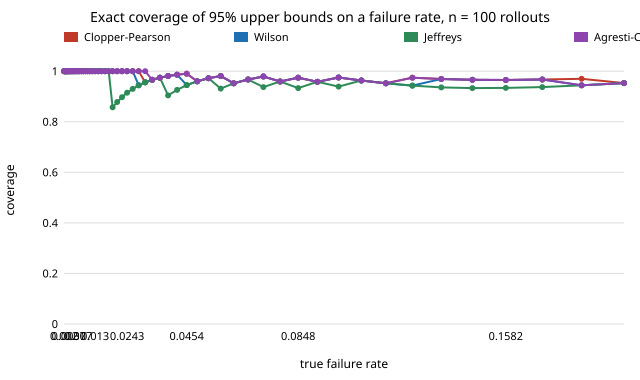

# Which 95% upper bound on a failure rate actually covers 95% at simulator-rollout sample sizes? (free choice)

Pure Python, no dependencies. **Free-choice project** (`PROJECTS.md`, "Picking work", step 1; draw 0.018). Why it seemed worth doing: twin-certification projects here (`twin-certification`, `validate-twin`, `free-sprtcert`) report "failures in n rollouts, so p is below U". Which formula produces U matters at n = 30 to 1000 and rates of 0.2% to 20%, and I could not find the same-footing comparison in the repository, so I computed it exactly.

**Live page:** https://duncan-haywood.github.io/monorepo-projects/research/free-intervalcov/

## Question

For k failures in n iid rollouts, six common 95% one-sided upper bounds on the failure rate (Clopper-Pearson, Jeffreys, Wilson, Agresti-Coull, Wald, and the "rule of three" with Wald beyond zero failures): what is each one's exact coverage, and how many zero-failure rollouts does each need to certify a target rate?

## Headline result (exact; see Limitations)

- **Only Clopper-Pearson never undercovers.** Over 400 log-spaced true rates from 0.2% to 20%, its minimum coverage is 0.950 at n = 30, 100, 300 and 1000 (mean 0.965 to 0.996, so it is conservative). Agresti-Coull dips only to 0.944 to 0.947. Wilson's worst case is 0.926 to 0.933.
- **Jeffreys, the usual "Bayesian" fix, is not safe for certification at low rates.** Its minimum coverage is 0.852 to 0.865 and it sits below 0.93 at roughly 10% to 12% of the rates tried.
- **Wald fails badly.** At zero failures its bound is 0, so at n = 100 its worst coverage is 0.18 (0.75 even at n = 1000), and it is below 0.93 at 58% to 97% of rates. The rule of three with Wald beyond zero failures keeps its zero-failure bound but its minimum coverage is still about 0.81.
- **What it costs in rollouts.** Zero failures needed to show p ≤ 1%: Clopper-Pearson 299, Wilson 268, Jeffreys 191, Agresti-Coull 324, rule of three 300. Jeffreys' 108 fewer rollouts are what its undercoverage buys. For p ≤ 0.1% the figures are 2995, 2703, 1920, 3263 and 3000.
- **Often the choice does not change the decision.** Certifying "p < 5%" at n = 100 (bound ≤ 5%) gives the same accept set for Clopper-Pearson, Wilson, Jeffreys and Agresti-Coull, so all have P(false certify at p = 5%) = 0.037 and P(certify at p = 2%) = 0.403. Wald and the rule of three accept more and falsely certify 0.118 of the time. The methods differ at other thresholds (section 2), not at that one.

Figure: `experiments/coverage.svg` (n = 100). Tables: `experiments/results.txt`.



## Method

`intervalcov.py` computes coverage as the exact sum over k = 0..n of the binomial probability of k failures times the indicator that the bound for k is at least the true rate. Nothing is sampled. Beta quantiles (Clopper-Pearson, Jeffreys) use a continued-fraction incomplete beta function and bisection, checked in the tests against the binomial-sum identity and the closed form 1 − α^(1/n) at k = 0. All bounds are one-sided at α = 0.05 (z = 1.645).

## Reproduce

```bash
cd research/free-intervalcov
python3 -m unittest discover -s tests -v   # 6 tests, under 1 s
python3 experiments/run.py > experiments/results.txt   # a few seconds
python3 experiments/figure.py
```

## Limitations

- **Rollouts are assumed iid Bernoulli with the real system's probability.** A twin whose rate differs from reality certifies the twin, not the robot. This project is about the arithmetic of the bound, not the sim-to-real gap.
- **The minimum is over a finite grid of 400 rates.** Coverage oscillates sharply between the jump points of the bound, so the true infimum can be slightly lower than the grid minimum (not for Clopper-Pearson, which is proved ≥ 0.95).
- **Only α = 0.05, four sample sizes, rates 0.2% to 20%.** Nothing is claimed outside that range.
- **The "rule of three" is defined only at zero failures**; the Wald continuation beyond it is my choice, so its coverage row describes that combination.
- Mid-p and likelihood-ratio bounds, and two-sided intervals, are not compared.

## Next steps

Add the mid-p and likelihood-ratio bounds; sweep α; connect to `twin-certification` by asking how far a twin's biased rate moves the choice.

## Outside dependencies

None. Standard library only.

**Builds on / lab tags.** None of the groups in `prompt.md` is built on; the topic is safe-autonomy validation (RECUV, Autonomous Systems IRT) at the statistics level only, with no affiliation. Statistics: Clopper & Pearson (1934), Wilson (1927), Brown, Cai & DasGupta (2001, *Statistical Science* 16(2)), Agresti & Coull (1998).
