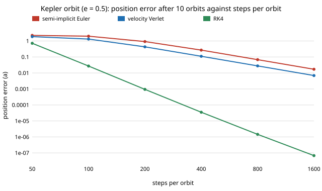

# How many fixed steps per orbit does a twin need before an eccentric orbit stops drifting? (free choice)

Pure Python, no dependencies. **Free-choice project** (`PROJECTS.md`, "Picking work", step 1; draw 0.036). Why it seemed worth doing: `free-integperiod` measured integrator error on the pendulum, whose potential is smooth and whose speed barely changes. Orbits, flybys and any twin with a close approach (a UAV passing an obstacle, a satellite at periapsis) are the opposite case: the speed and force change by a large factor within one orbit, and the common advice "use a symplectic integrator, it conserves energy" is checked here against an exact solution instead of being assumed.

**Live page:** https://duncan-haywood.github.io/oss-monorepo/research/free-keplerdrift/

## Question

Against the exact two-body solution (Kepler's equation), how many fixed steps per orbit do explicit Euler, semi-implicit Euler, velocity Verlet and RK4 need to keep position, energy and periapsis direction right, as eccentricity goes from 0 to 0.9?

## Headline results (all produced by `experiments/run.py`, tables in `experiments/results.txt`)

- **Explicit Euler never works.** The energy has moved by 67% of |E0| at some step even on a circular orbit at 100 steps per orbit, and it is still wrong at 8192 steps per orbit (section 3).
- **The symplectic methods' energy error is bounded but grows steeply with eccentricity.** Worst energy excursion at 100 steps per orbit, semi-implicit Euler / Verlet: 0.4% / 0.0004% (e = 0), 12% / 1.1% (e = 0.5), 71% / 11% (e = 0.7), and 5400% / 1900% at e = 0.9 (section 2). Bounded means it does not accumulate, not that it is small: a periapsis passage at coarse steps throws the orbit onto a different one.
- **RK4 needs far fewer steps for a given position error, including on a 10-orbit run.** Steps per orbit for position error under 0.01 a after 10 orbits: RK4 64, 128, 512, 4096 at e = 0, 0.3, 0.7, 0.9; semi-implicit Euler and Verlet 512, 1024, 8192 and more than 8192 (section 3). At four force evaluations per RK4 step against one per symplectic step, RK4 is still cheaper by about 2 to 4 times at e ≤ 0.7. The long-run argument for symplectic methods (no secular energy drift) does not rescue them inside this horizon.
- **The periapsis direction wanders under the symplectic methods and creeps under RK4.** At e = 0.5 and 100 steps per orbit the direction of the Laplace-Runge-Lenz vector is off by −0.62 rad (semi-implicit) and −0.77 rad (Verlet) after 50 orbits, against 0.0039 rad for RK4 (section 4). Doubling the steps shrinks the one-orbit angle about 16x for RK4 (7.8e-5 to 5.0e-6 from 100 to 200 steps); for the symplectic pair it falls by 2x to 36x per doubling, not yet in the asymptotic regime at these steps (4b).
- **At e = 0.9 every fixed-step method fails at 100 steps per orbit**: the position error after 10 orbits is 80 a for RK4 and 260 to 450 a for the others, meaning the body has been thrown out of the orbit. A fixed step sized for the orbit-averaged speed is far too coarse at periapsis, where the speed is 19 times the apoapsis speed at this eccentricity ((1+e)/(1−e)). This is where an adaptive or event-aware step is needed, not a better fixed-step scheme.

Figure: `experiments/pos_error.svg`.



## Method

`keplerdrift.py` integrates r'' = −r/|r|³ (GM = a = 1, period 2π, specific energy −1/2) from periapsis. The reference is exact: the position at time t from Kepler's equation M = E − e sin E solved by Newton's method (tested to 1e-12), so no "fine-step run" stands in for the truth. Position error is the distance to the exact position at the end of the run (at most 2a for a bound orbit; larger values mean the body left the orbit). Energy excursion is the maximum |E(t) − E0|/|E0| over all steps. Periapsis direction is the angle of the Laplace-Runge-Lenz vector after k orbits, exactly zero in the true solution. Steps-per-orbit in section 3 is the first power of two n such that n, 2n and 4n all give position error under 0.01 a, so an accidental phase alignment does not count.

## Reproduce

```bash
cd research/free-keplerdrift
python3 -m unittest discover -s tests -v   # 7 tests, under 1 s
python3 experiments/run.py > experiments/results.txt   # about 1 minute
python3 experiments/figure.py
```

## Limitations

- **Unit-scale two-body problem only.** Results scale with steps per orbit, not with physical size, but do not transfer to multi-body, perturbed (J2, drag) or contact problems.
- **Short horizon (10 orbits for position, up to 200 for direction).** Symplectic methods are advertised for very long runs; this does not test thousands of orbits, where RK4's secular energy drift (visible in its linear direction creep) would eventually matter.
- **Fixed step and the standard textbook schemes only.** No adaptive step, no regularisation (Kustaanheimo-Stiefel), no time-transformed symplectic scheme, which are the standard fixes at high eccentricity. I did not run MuJoCo, PyBullet or any real simulator.
- **Position error at a single end time is phase-sensitive**: a value near 2a means phase is lost, not that the error is 2a in any meaningful rate. Section 5 is non-monotone for Euler for this reason; use the energy and direction tables for rates.
- Explicit Euler's direction column saturates once the orbit has left its ellipse; ignore it past a few orbits.

## Prior work

Hairer, Lubich and Wanner, *Geometric Numerical Integration* (Springer, 2nd ed., 2006), on symplectic methods, long-time energy behaviour and variable-step difficulties; Kepler's equation and the closed-form orbit are standard (e.g. Danby, *Fundamentals of Celestial Mechanics*, 2nd ed., 1988). Citations written from memory, not re-checked against the sources. Builds on the approach of `free-integperiod` (pendulum); no affiliation with any author or lab is implied. Twin theme: the integrator error is part of the sim-to-real gap before any model error.

## Next steps

Add an adaptive step and a time-transformed symplectic scheme at e = 0.9; run thousands of orbits to find where symplectic overtakes RK4; repeat on the real MuJoCo and PyBullet integrators on a bouncing or swinging close-approach case.

## Owner steps
None.

## Outside dependencies
Python standard library only.
