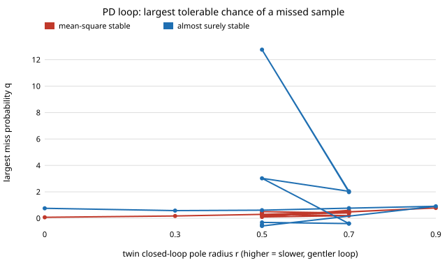

# free-missedpd: how many missed samples can a PD loop tuned on a fixed-period twin survive?

**Why this was worth doing.** `free-jittertwin` studied a scalar unstable plant where a miss just doubled the period. A robot joint is second-order, and a real link loses *runs* of samples, so the interval becomes 2, 3, 4 &times; the nominal period. Does the earlier picture (a mean-square test far stricter than what simulated runs do) carry over to a PD loop on a double integrator, and how does the answer depend on how aggressively the twin was tuned? **Result (exact second-moment calculation plus simulation):** with each sample lost independently with probability *q* and the last command held, a loop whose twin has both poles at z = 0.5 is mean-square stable only up to **q = 0.293** but almost surely stable up to **q = 0.611** (at q = 0.55, 999 of 1000 simulated runs converge; at q = 0.65, 1 in 1000). A deadbeat-tuned twin (poles at 0) tolerates only q = 0.070 in mean square; a slow twin (poles at 0.9) tolerates 0.780. Stylised: ideal plant, no noise or delay, known model; the plant and loop are chosen, not taken from a robot (see Limitations). Produced with AI assistance (Claude).

**Live page:** https://duncan-haywood.github.io/monorepo-projects/research/free-missedpd/

**Builds on.** Standard random-sampling / Markov-jump stability ideas (almost-sure Lyapunov exponent versus mean-square moment), as in `free-jittertwin`; no specific paper is relied on or re-verified here. Related in this repository: `free-jittertwin`, `latency-twin`, `deadtime-twin`. No CU Boulder group's work is built on or implied; the link to the digital-twin theme is that a twin's fixed step hides runs of lost samples.

## Model
Plant x&Prime; = u (units arbitrary; only h<sub>0</sub>-scaled gains matter), zero-order hold, nominal period h<sub>0</sub> = 0.1. Control u = &minus;k<sub>p</sub>x &minus; k<sub>d</sub>v is computed at each *received* sample and held. Each nominal slot's sample is lost independently with probability q, so the interval between received samples is m h<sub>0</sub> with probability (1&minus;q)q<sup>m&minus;1</sup>. The gains place both closed-loop poles of the fixed-period loop at z = r (k<sub>p</sub> = (1&minus;r)<sup>2</sup>/h<sub>0</sub><sup>2</sup>, k<sub>d</sub> = (1&minus;r)(3+r)/(2h<sub>0</sub>); tested). The one-interval map M(h) is exact. `missed.py` gives:
- **mean-square stability**: the second-moment operator P &rarr; E[M P M<sup>T</sup>] on (P<sub>11</sub>, P<sub>12</sub>, P<sub>22</sub>) is a 3&times;3 matrix summed exactly over m (to 400); stable iff its eigenvalues lie inside the unit circle (Jury test, no sampling);
- **almost-sure stability**: the Lyapunov exponent from one 200,000-sample product with renormalisation (fixed random stream across q); the threshold is bisected to 0.002.

## Reproduce
```bash
cd research/free-missedpd
python3 -m unittest discover -s tests -v     # 9 tests
python3 experiments/run.py                   # ~15 s, stdlib only, seed 7; writes results.txt
python3 experiments/figure.py                # miss_limits.svg
```

## Results
Full tables: `experiments/results.txt`.



| twin poles at z = r | spectral radius if every interval is 2h<sub>0</sub> / 4h<sub>0</sub> | largest q, mean-square | largest q, almost-sure |
|---|---|---|---|
| 0.0 (deadbeat) | 3.00 / 11.7 | 0.070 | 0.753 |
| 0.3 | 1.51 / 6.49 | 0.174 | 0.579 |
| 0.5 | 0.64 / 3.64 | 0.293 | 0.611 |
| 0.7 | 0.59 / 1.32 | 0.480 | 0.763 |
| 0.9 | 0.84 / 0.73 | 0.780 | 0.907 |

- **A fast twin is fragile in a different way from a slow one.** For r &le; 0.3 even a single missed sample (interval 2h<sub>0</sub>) is unstable if it repeats (spectral radius above 1), yet the loop still converges almost surely at q up to 0.58 to 0.75, because long runs of misses are rare and the good steps contract hard. For r = 0.9 the loop is stable at every fixed interval tried (up to 10h<sub>0</sub>, radius 0.93).
- **The almost-sure limit is not monotone in r** (0.579 at r = 0.3, 0.611 at r = 0.5; deadbeat is higher still at 0.753, where a successful step contracts to zero and erases everything before it). Treat the almost-sure column as accurate to about &plusmn;0.01 (Monte Carlo, N = 200,000, single seed); the mean-square column is exact up to the 400-slot truncation.
- **Mean-square verdicts are conservative, as in `free-jittertwin`.** At r = 0.5 the mean-square test fails for q &gt; 0.293 while runs keep converging: share of 3,000 runs (400 samples) ending below 10<sup>&minus;6</sup> is 1.000 at q = 0.4, 0.999 at 0.55 and 0.001 at 0.65 (above the almost-sure limit).
- **The second-moment operator is correct, and a Monte Carlo of the mean square is hard to trust near the limit.** E|state|<sup>2</sup> after 3 samples: operator 3.025 against Monte Carlo 3.023 (r = 0.5, q = 0.1) and 2.041 against 2.043 (r = 0.7, q = 0.2); at q = 0.3 the operator gives 12.76 and 400,000 runs give 11.98, because the mean is carried by rare long runs of misses (probability q<sup>m</sup>) that the sample misses. That is the practical reason a twin-side ensemble can say "fine" while the exact test says "unstable".

## Limitations
- **One chosen plant and loop** (double integrator, critically damped pole placement, h<sub>0</sub> = 0.1). No joint friction, torque limit, saturation, measurement noise, or delay; these are not sourced from a robot or datasheet. The miss-rate figures are in units of "fraction of nominal samples lost" and say nothing about any particular wireless link.
- **Losses are independent**; real bursts are correlated, which would make long runs more likely than this model says (and shift both limits lower). Not studied.
- **Lyapunov limits are Monte Carlo** (one seed); the non-monotone shape in r is stable under the common random stream but not confirmed across seeds.
- The controller does not know when samples were missed (it does not rescale its gain by the elapsed time). An interval-aware controller is the obvious fix and is not tested.
- The check of the moment operator is against the same model, so it validates the algebra, not the physics.

## Next steps
Correlated (Gilbert-Elliott) losses, which should shrink every limit; an interval-aware gain; adding a one-sample delay; a torque limit, which makes long intervals worse than linear.

## Outside dependencies
None: Python standard library only.
