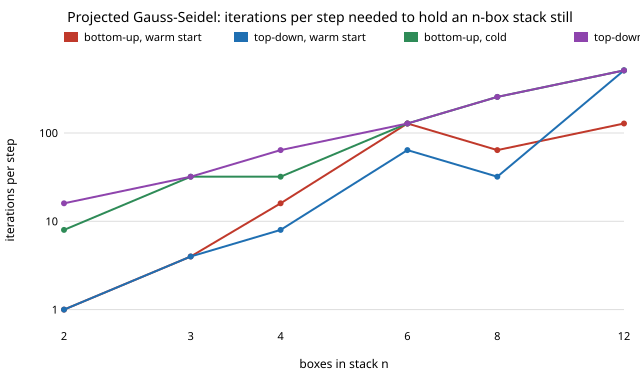

# How many solver iterations does a physics twin need to hold a stack of boxes still? (free choice)

Pure Python, no dependencies. **Free-choice project** (`PROJECTS.md`, "Picking work", step 1; draw 0.014). Why it seemed worth doing: `free-keplerdrift` and `free-integperiod` isolate the integrator's share of the sim-to-real gap. The other knob every rigid-body twin (Bullet, Box2D, ODE, and iterative solvers in MuJoCo-style engines) exposes is the *solver iteration count*, usually left at a default (10 is common) with the belief that it is plenty. A resting stack has an exact answer (contact `i` carries the weight above it), so this can be tested instead of assumed.

**Live page:** https://duncan-haywood.github.io/monorepo-projects/research/free-pgsstack/

## Question

For a vertical stack of n unit boxes at rest, how many projected Gauss-Seidel (sequential-impulse) iterations per 60 Hz step stop the stack from sagging, jittering or flying apart, and how do the sweep order and warm starting change that?

## Headline results (all produced by `experiments/run.py`, tables in `experiments/results.txt`)

- **The iteration count needed grows much faster than the number of boxes.** Smallest K (from 1, 2, 4 ... 2048) that holds the stack still (speed < 1e-3 m/s, total overlap < 1e-4 m over the last second) *and keeps holding for every larger K tried*: n = 2: 1; n = 4: 16 (bottom-up, warm) / 8 (top-down, warm); n = 6: 128 / 64; n = 12: 128 / 512; n = 16: more than 2048 / 1024; n = 24 and 32: warm-started sweeps never held within 2048, and cold sweeps held at n = 24 (2048) but not n = 32 (section 1). Sixteen iterations (a common engine default is about 10; I tested powers of two only) hold at most 4 boxes in this setup.
- **Cold start (no warm start) needs far more iterations at small n** (n = 2: 8 to 16 against 1) **but is mixed at large n**: at n = 16 and 24 the cold sweeps held where the bottom-up warm one did not, at n = 12 they needed 512 against 128 (section 1).
- **More iterations do not reliably help.** At n = 16 bottom-up warm, the state after 3 s is held at K = 1024 (zero speed) but not at K = 2048 (speed 1.77 m/s, overlap 0.18 m); at n = 6, K = 32 holds, K = 64 does not (speed 0.014 m/s), K = 128 holds (sections 2 and 3). The impulses are still correct only where the stack is exactly still, so "converged" here is a property of one lucky trajectory as much as of K.
- **Sweep order does not give a clean rule.** Top-down needs fewer iterations at n = 4 to 8 and 16, more at n = 12; I did not find a consistent winner.

Figure: `experiments/iters_needed.svg` (points above 2048 omitted).



## Method

`pgsstack.py`: body 0 is the ground, body i (mass 1 kg, height 1 m) rests on body i-1, one normal contact between neighbours. Each 60 Hz step: add gravity (semi-implicit Euler), optionally apply the stored impulses (warm start), then K Gauss-Seidel sweeps over the contacts. Each sweep computes the impulse that zeroes the relative normal velocity minus a Baumgarte bias (beta = 0.2, no slop), accumulates it and clamps the accumulated impulse at zero. Contacts with a positive gap are skipped and their stored impulse is zeroed. Positions are then advanced. This is the textbook sequential-impulse scheme (Catto, GDC 2006), written from scratch; it is not any engine's code.

The reference is exact: at rest, contact i must carry `(n-i+1) m g dt`, and `tests/` checks one box and a converged 3-box stack against it. The boxes start exactly touching and at rest, so any motion comes from the solver, not from an impact. "Overlap" is the sum of penetration depths, "speed" the largest body speed, both maxima over the last second of a 3 s run. The required K is the smallest power of two from which every larger power of two up to 2048 also holds.

## Reproduce

```bash
cd research/free-pgsstack
python3 -m unittest discover -s tests -v   # 7 tests, under 1 s
python3 experiments/run.py > experiments/results.txt   # about 2 minutes (run in the background)
python3 experiments/figure.py
```

## Limitations

- **A 1-D vertical stack of identical point-like contacts**, normal forces only: no friction, rotation, restitution, or box-box manifolds with four contact points (which make real stacks harder or easier). Do not read the numbers as any engine's behaviour.
- **One time step (60 Hz), one mass ratio, beta = 0.2.** I did not sweep these; Baumgarte stabilisation and the contact on/off switch are plausible causes of the non-monotone behaviour (a contact is skipped once the Baumgarte push opens a gap), but I did not isolate the cause with an ablation.
- **The "holds" criterion is a threshold on one 3 s run**, deterministic but chaotic past a few boxes, so the exact K values at n ≥ 6 are specific to this setup; the growth with n and the non-monotonicity are the findings, not the individual K values.
- No real engine was run. Next step: repeat in PyBullet / MuJoCo with a stack and compare, and test split impulse (pseudo-velocity) and a direct solve for the stack.

## Prior work

Catto, "Iterative Dynamics with Temporal Coherence" (GDC 2005) and "Fast and Simple Physics using Sequential Impulses" (GDC 2006) describe the solver and warm starting; Gauss-Seidel convergence on a chain is classical (e.g. Saad, *Iterative Methods for Sparse Linear Systems*). Citations written from memory, not re-checked against the sources. No affiliation with any author, engine or lab is implied. Twin theme: solver settings are part of the sim-to-real gap alongside integrator error (`free-keplerdrift`).

## Owner steps
None.

## Outside dependencies
Python standard library only.
