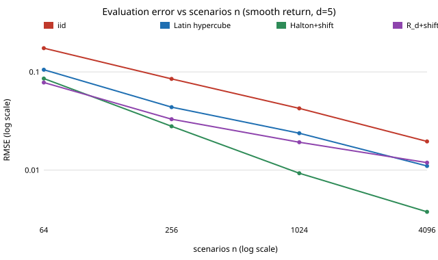

# Do low-discrepancy scenarios make a twin evaluate a policy more accurately than iid domain randomisation? (free choice)

Pure Python, no dependencies. **Free-choice project** (`PROJECTS.md`, "Picking work", step 1; draw 0.04). Why it seemed worth doing: sim-to-real work evaluates a policy by averaging its return over scenarios drawn from a domain-randomisation distribution, almost always iid. Randomised quasi-Monte Carlo (RQMC) and Latin hypercubes are cheap drop-in replacements, but the textbook gains assume a smooth integrand, and a robot's headline metric is a success *rate*, which is a jump. I wanted to know how much of the gain survives that, and in how many randomised parameters.

**Live page:** https://duncan-haywood.github.io/monorepo-projects/research/free-qmcdr/

## Question

A twin scores a policy by averaging the return over `n` scenarios `u ∈ [0,1]^d`. How does the error of that estimate depend on the sampler (iid, Latin hypercube, randomly shifted Halton, randomly shifted Roberts `R_d` lattice), on how smooth the return is (smooth, a clipped-cost kink, a success/failure jump) and on the number of randomised parameters `d`?

## Headline result (stylised; see Limitations)

- **Latin hypercube only changes the constant.** Its error still falls like `n^-0.5` (fitted slopes −0.48 to −0.54 in all 12 cases), but it cuts the MSE 1.6× to 12× at n = 1024, most when the return depends on few parameters (12.2× for a smooth return with decaying parameter importance, 1.6× for a smooth return in d = 10).
- **A randomly shifted Halton sequence changes the rate when the return is smooth or low-dimensional.** Smooth, d = 2: slope −0.92 and 149× lower MSE at n = 1024 (that is, one Halton scenario is worth about 149 iid ones). Smooth, d = 5: −0.76, 21×. Smooth d = 10 with decaying importance: −0.83, 106×.
- **The jump is where the gain shrinks but does not vanish.** For the success-rate indicator Halton keeps 24× (d = 2), 7.4× (d = 5) and 4.2× (d = 10), with slopes −0.79, −0.65 and −0.59, against a theoretical `n^-0.5` for iid. The advantage falls with dimension at every smoothness level: Halton's MSE reduction goes 149× → 21× → 5.3× for smooth returns as d goes 2 → 5 → 10.
- **The `R_d` lattice is erratic.** Great at d = 2 (137× smooth, 75× jump) but at d = 5 its fitted slope is −0.45 (smooth) and −0.47 (kink), no better than iid, with its error at n = 4096 *above* Halton's at n = 1024. I did not diagnose why (a resonance of this particular generator with the shift is a guess, untested), so treat `R_d` at d = 5 as a cautionary result about one implementation, not a law.
- **Intervals stay honest.** The 95% t-interval built from 8 independent randomisations of 128 points covers 94.3% to 97.0% in 16 sampler-by-function cells of 400 trials each (binomial noise is about ±1.1 points), including for the jump return, so the gain does not cost a valid confidence interval.

Figure: `experiments/rmse_vs_n.svg`. Full tables: `experiments/results.txt`.



## Method

All four samplers are unbiased for the mean over the unit cube. The exact mean of each return function is computed in rational arithmetic, so the error is measured against truth, not against a big simulation:

- `smooth`: `∏ⱼ (1 + cⱼ(uⱼ − ½))`, mean 1, with interactions of every order; `cⱼ = 1.6` (or `1.6/j` for "decay").
- `kink`: `max(0, Σ wⱼuⱼ − t)`, a clipped cost; exact mean from the generalised Irwin–Hall CDF and its integral.
- `jump`: `1[Σ wⱼuⱼ ≤ t]`, a success indicator; exact mean is the generalised Irwin–Hall CDF. `t` is half of `Σ wⱼ`. "Decay" uses integer weights `round(8/j)` so a few parameters dominate.

Each cell is the RMSE over 100 independent randomisations, at n = 64, 256, 1024, 4096; the slope is a least-squares fit of log RMSE on log n. Randomisations are seeded by a string, so `results.txt` reproduces exactly.

## Reproduce

```bash
cd research/free-qmcdr
PYTHONPATH=src python3 -m unittest discover -s tests -v   # 10 tests, ~4 s
PYTHONPATH=src python3 experiments/run.py > experiments/results.txt   # ~2 min
python3 experiments/figure.py
```

## Builds on

Classical results, none reproduced from a specific paper here: Cranley and Patterson (1976) random shifts; Halton (1960); McKay, Beckman and Conover (1979) Latin hypercubes; Owen (1997) on Latin hypercube variance; L'Ecuyer and Lemieux (2002) on randomised quasi-Monte Carlo; Roberts (2018) for the `R_d` recurrence (a blog post, not peer reviewed); Niederreiter (1992) for the `n^-1` smooth-integrand rate. Domain randomisation as a sim-to-real tool: Tobin et al. (2017). Related here: `crn-twin` (common random numbers for comparing two policies), `twin-evaluation` (a biased twin as a control variate) and `shapley-sampling`. This project is about the sampler for the scenario distribution only and is orthogonal to those. It builds on none of the faculty groups named in the research brief and is not affiliated with them.

## Limitations

- **Stylised.** Uniform scenario parameters and analytic returns, not a simulator; a real success region is not a half-space. The jump's boundary here is a smooth hyperplane, which is kind to low-discrepancy points; a fractal or thin-sliver failure region would be harsher.
- Halton's quality at d = 10 and small n is known to be uneven (correlated high-prime coordinates); the d = 10 slopes here average over that. I did not test scrambled Sobol (needs direction numbers I did not vendor), which is the usual recommendation.
- 100 randomisations per cell: slopes are good to about ±0.05 and MSE ratios to tens of per cent; the large ratios (100×+) are noisier.
- One seed string; the `R_d` anomaly at d = 5 could be partly luck of the shifts. Not re-run with other seeds.
- Correlated parameters, discrete parameters and adaptive (sequential) scenario selection are not covered.

## Next steps

Scrambled Sobol with vendored Joe–Kuo numbers; a real MuJoCo or pendulum twin with a measured success region; combine with a control variate (`twin-evaluation`); check `R_d` at d = 5 with several seeds.

## Outside dependencies

None. Pure Python 3.9+; no data, no simulator, no API.

AI assistance: written by Claude (Anthropic) in an automated research run, with the code run and the numbers above taken from `results.txt`. MIT.
