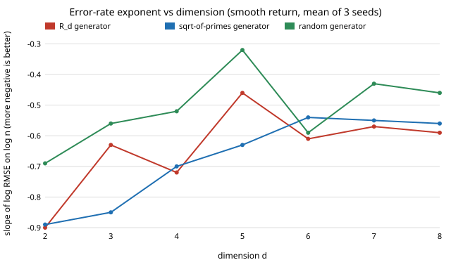

# Why does the R_d low-discrepancy lattice lose its advantage at d = 5 when evaluating a twin policy? (free choice)

Pure Python, no dependencies beyond the sibling project `free-qmcdr` (imported for its return functions and exact means). **Free-choice project** (`PROJECTS.md`, "Picking work", step 1). Why it seemed worth doing: `free-qmcdr` found that Roberts' `R_d` lattice, a cheap way to draw domain-randomisation scenarios, was no better than iid sampling at d = 5 (fitted error exponent about −0.45) though it was excellent at d = 2, and it left open whether that was luck of the random shifts, a general dimension effect, or something about that particular generator. A practitioner who picked `R_d` by default would want to know before trusting it.

**Live page:** https://duncan-haywood.github.io/monorepo-projects/research/free-rdseeds/

## Question

For a randomly shifted Kronecker lattice `x_i = (shift + α·i) mod 1` used to average a policy's return over `n` scenarios, is the poor `R_d` error rate at d = 5 (a) a seed fluke, (b) a smooth decline with dimension, or (c) specific to the generator vector `α`?

## Headline result (stylised; see Limitations)

- **It is not a seed fluke.** Across six independent seed strings (100 randomisations per cell), the `R_d` exponent at d = 5 is −0.45 ± 0.01 (smooth return) and −0.48 ± 0.02 (success-indicator return); iid sampling gives −0.50 and −0.52 on the same seeds. The lattice is deterministic apart from the shift, so this stability is what one expects of a fixed generator.
- **It is not a smooth dimension effect.** The `R_d` exponent for the smooth return goes −0.90, −0.63, −0.72, −0.46, −0.61, −0.57, −0.59 for d = 2…8 (mean of three seeds): d = 5 is a dip below both neighbours.
- **A different generator fixes d = 5.** Using `α_j = frac(√p_j)` (the fractional parts of the square roots of the first primes) instead, the exponent at d = 5 is −0.66 ± 0.02 (smooth) and −0.73 ± 0.02 (jump), against −0.45 and −0.48 for `R_d`. That is a real change of rate, not noise. It is not better everywhere: at d = 6 to 8 the two generators are within about ±0.07 of each other, and at d = 3 and 4 the `√p` generator is better at d = 3 (−0.85 vs −0.63) and the same at d = 4 (−0.70 vs −0.72). The conclusion is that `R_d` has no general guarantee in d > 2, and that the generator should be checked at the dimension actually used.
- **Averaging over random generators is worse than either**, and erratic: exponent −0.45 ± 0.16 at d = 5 (smooth), with the six seeds ranging from −0.23 to −0.57. Most random `α` are fine, a few are poor, so a single randomly drawn lattice is a gamble; this is not a recommended sampler.
- **A simple resonance score does not explain the dip.** I scored each generator by the smallest `‖k·α‖ · ∏ max(1,|k_j|)` over integer frequency vectors `k` with |k_j| ≤ 3 (how close `α` is to an integer relation). At d = 5 the two generators score almost identically (0.0010 for `R_d`, 0.0011 for `√p`) though their rates differ by 0.2. So the cause is not diagnosed here; this score is a negative result, and any mechanism (a particular `k` resonating with the non-periodic integrand's boundary jump after the shift, higher-order terms, the choice of n grid) remains a guess.
- **The dip is not an artefact of n = 4096 being a power of two.** At seven off-grid values of n between 500 and 4000, `RMSE·√n` for `R_d` rises from 0.50 to 0.77, i.e. the error stops falling relative to `n^-0.5`, while for `√p` it falls from 0.63 to 0.31.

Figure: `experiments/slope_vs_d.svg`. Full tables: `experiments/results.txt`.



## Method

Same integrands as `free-qmcdr` (`smooth` product of linear terms, `jump` half-space success indicator, with exactly computed means), same four sample sizes n = 64, 256, 1024, 4096, with RMSE over independent random shifts and the exponent from a least-squares fit of log RMSE on log n. New here: the generator `α` is a parameter (`rd`, `sqrt`, `random`), seeds are varied explicitly, and `resonance()` scores a generator against small integer relations. Per-cell randomisations: 100 (tables 1 and 3), 60 (dimension scan, table 2).

## Reproduce

```bash
cd research/free-rdseeds
export PYTHONPATH=src:../free-qmcdr/src
python3 -m unittest discover -s tests -v      # 6 tests, <1 s
python3 experiments/run.py > experiments/results.txt   # ~75 s
python3 experiments/figure.py
```

## Builds on

`free-qmcdr` (this portfolio), which introduced the comparison. Classical results, none reproduced from a specific paper: Kronecker/Weyl sequences and Cranley–Patterson random shifts (Cranley and Patterson 1976); Niederreiter (1992) on the dependence of discrepancy on the Diophantine properties of `α`; Roberts (2018) for the `R_d` recurrence (a blog post, not peer reviewed). It builds on none of the faculty groups named in the research brief and is not affiliated with them.

## Limitations

- **Stylised.** Analytic return functions on uniform scenario parameters, not a simulator; the jump's boundary is a smooth hyperplane.
- The exponent is fitted over only four n values (64 to 4096); slopes are good to about ±0.05 per seed. The `R_d` shortfall at d = 5 (−0.45 vs −0.66) is many times that, but small differences elsewhere in table 2 (±0.07) are not significant.
- Only two deterministic generators and one random family were tried; the `√p` generator is not claimed to be good in general (it was chosen before seeing results as a standard "irrational" choice, not tuned). Table 2 uses three seeds and 60 randomisations.
- Scrambled Sobol and rank-1 lattice rules with good generating vectors (the usual recommendation) are not compared.
- The cause of the `R_d` dip is not identified.

## Next steps

Compare against a scrambled Sobol with vendored Joe–Kuo direction numbers and a component-by-component rank-1 lattice; look for the mechanism by computing the exact Fourier coefficients of the shifted smooth integrand against the partial sums at the worst `k`; repeat on a pendulum or MuJoCo success region.

## Outside dependencies

None. Pure Python 3.9+; no data, no simulator, no API.

AI assistance: written by Claude (Anthropic) in an automated research run, with the code run and the numbers above taken from `results.txt`. MIT.
