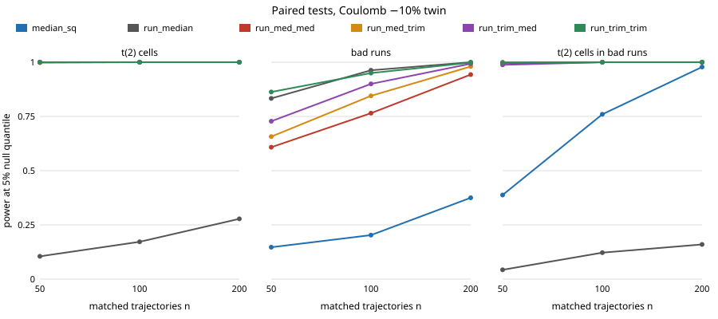

# Which paired test of a digital twin survives both heavy-tailed cells and whole bad runs?

A free-choice run, picked because `research/free-robusttails` ended with "no free lunch": median and trimmed residuals caught a wrong twin under Student-t(2) cells but not under bad runs, a per-run median did the reverse, and its first listed next step was to combine both defences. Short answer: a two-level statistic (robust summary inside each run, then robust summary across runs) is good in all three heavy-tailed settings tested, including both at once, and costs some power under Gaussian noise. **Stylised and simulated only; no real data, no LLM.**

**Live page:** https://duncan-haywood.github.io/monorepo-projects/research/free-robustcombo/

Every number below is copied from `experiments/results.txt`.



## Results

Setup: the `free-robusttails` pendulum (RK4, dt 0.02 s, 100 steps, start angle uniform on [-2, 2] rad, viscous 0.1, Coulomb 0.3, scale 0.02 rad); the twin is noise-free. Four noise models: **student2** (t with 2 degrees of freedom per cell), **badruns** (Gaussian, each trajectory with probability 0.1 has 10 times the noise sd), **both** (t(2) cells, with the same 10% of trajectories ten times larger) and **gauss** (control). Six statistics of the residual: two carried over from `free-robusttails` (`median_sq`, the median over all cells of the squared residual; `run_median`, the median over trajectories of each trajectory's mean squared residual) and four new two-level ones named `run_<inner>_<outer>`: each trajectory's squared residuals are summarised by the inner statistic (`med` = median, `trim` = mean after dropping the largest 20%), then the per-run values by the outer one. A test rejects above the 95th percentile of the same statistic over 400 exact-twin replicates; power is the share of 400 fresh replicates above it. n = 50, 100, 200 matched trajectories.

Power at a 10% Coulomb error (n = 50 / 100 / 200):

| statistic | t(2) cells | bad runs | both | Gaussian (control) |
|---|---|---|---|---|
| median_sq | 1.00 / 1.00 / 1.00 | 0.15 / 0.20 / 0.38 | 0.39 / 0.76 / 0.98 | 0.69 / 0.95 / 1.00 |
| run_median | 0.10 / 0.17 / 0.28 | 0.83 / 0.96 / 1.00 | 0.04 / 0.12 / 0.16 | 0.91 / 0.99 / 1.00 |
| run_med_med | 1.00 / 1.00 / 1.00 | 0.61 / 0.77 / 0.94 | 0.99 / 1.00 / 1.00 | 0.56 / 0.86 / 0.97 |
| run_med_trim | 1.00 / 1.00 / 1.00 | 0.66 / 0.84 / 0.98 | 1.00 / 1.00 / 1.00 | 0.62 / 0.94 / 1.00 |
| run_trim_med | 1.00 / 1.00 / 1.00 | 0.73 / 0.90 / 0.99 | 0.99 / 1.00 / 1.00 | 0.80 / 0.95 / 1.00 |
| run_trim_trim | 1.00 / 1.00 / 1.00 | 0.86 / 0.95 / 1.00 | 1.00 / 1.00 / 1.00 | 0.84 / 0.99 / 1.00 |

- **The within-run mean is what fails under infinite variance.** Replacing it by a median or trimmed mean (any `run_*_*` row) restores power 1.00 under t(2) cells, where `run_median` has 0.10 to 0.28 at a 10% error and only reaches 0.98 at a 20% error and n = 200.
- **`run_trim_trim` is best or within 0.05 of best in every column of the table** except Gaussian n = 50, where `run_median` is ahead (0.91 against 0.84). Against bad runs alone it is level with `run_median` (0.86 against 0.83 at n = 50, 1.00 for both at n = 200, a difference within noise) and ahead of the other three two-level statistics.
- **When both problems are present, the single-level statistics break.** With t(2) cells inside bad runs, `run_median` has power 0.04 to 0.16 and `median_sq` 0.39 / 0.76 / 0.98; every two-level statistic has 0.99 to 1.00 already at n = 50.
- **Medians cost power, trimming costs less.** Under Gaussian noise the all-median `run_med_med` is worst (0.56 at n = 50) and the trimmed variants recover most of it (0.80 to 0.84).
- **Size is roughly right.** False rejection on 400 fresh exact-twin replicates is 0.02 to 0.08 for every statistic and noise model against a nominal 0.05 (Wilson intervals are about ±0.03, see `results.txt`); differences of a few hundredths are not resolved. At a 20% error nearly every statistic reaches 1.00 at n = 50 except `median_sq` under bad runs (0.79) and `run_median` under t(2) (0.48) and both (0.21).

## Builds on

`research/free-robusttails` (simulator, statistics, question and its first next step), `research/free-robustpaired` and `research/free-c2stpower`. Trimmed means and medians as robust location summaries are standard (Huber, 1964, "Robust estimation of a location parameter", *Ann. Math. Statist.*); citations are standard references and were not re-fetched in this run. No lab's work is built on, and no lab is affiliated with or endorses this project.

## Reproduce

```bash
cd research/free-robustcombo
pip install numpy
python3 -m unittest discover -s tests -v    # 8 tests
python3 experiments/run.py                  # about 4 minutes on one CPU, writes results.txt and results.json
python3 experiments/figure.py               # experiments/power_vs_n.svg, parsed from results.txt
```

## Limitations

One toy pendulum, one real parameter set, two twin errors, one seed per noise model; nulls from 400 replicates; the contamination design (10% of runs, 10x sd, t(2) cells) is one choice of many, and the "both" model contaminates exactly the run level the statistic aggregates over; the statistics were chosen after seeing the earlier project's result and are not pre-registered. The 20% trim fraction was not tuned, and a contamination share above 20% of cells within a run or above 50% of runs would break it. The Gaussian control shows the price (n = 50, 0.84 against 0.91). The twin is noise-free; nothing here is a claim about a physical pendulum or a real simulator. Written with AI assistance (Claude), per the repository's integrity rules.

## Next steps

Vary the bad-run share and ratio to find where each statistic breaks, choose the trim fraction from the data, head-to-head with the permutation-calibrated C2ST (`free-c2stperm`), and a MuJoCo twin.

## Outside dependencies

numpy (pip). No data, services or models.

MIT.
